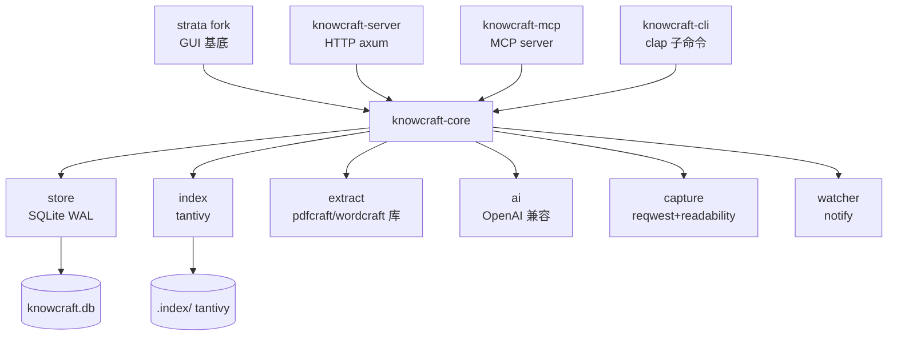
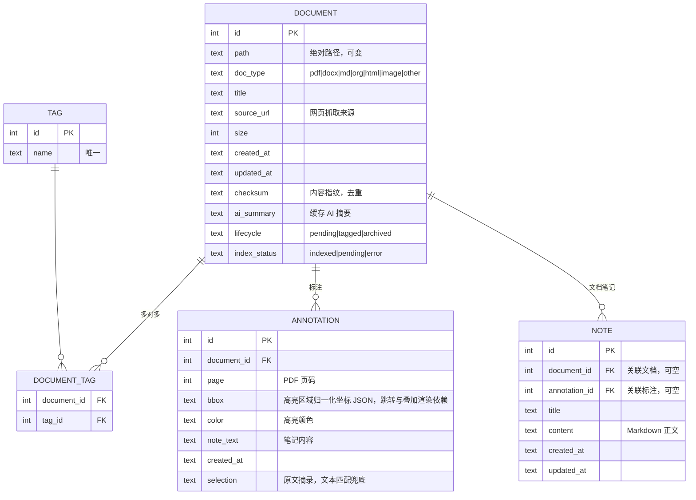
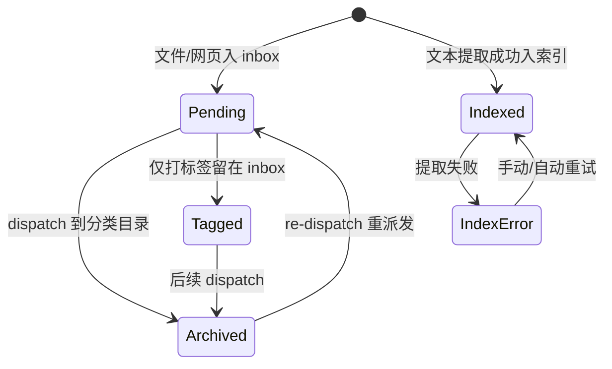
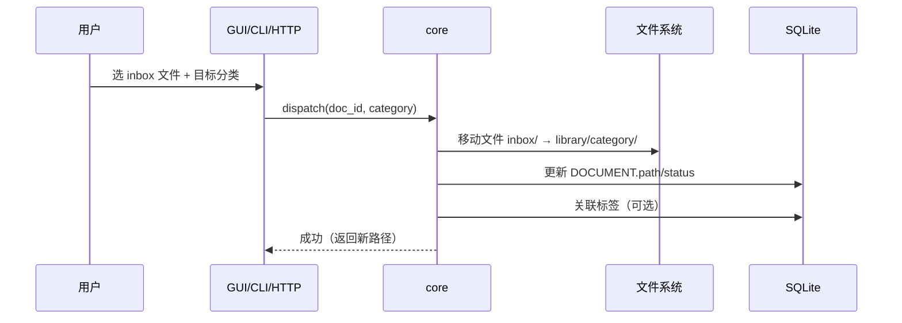
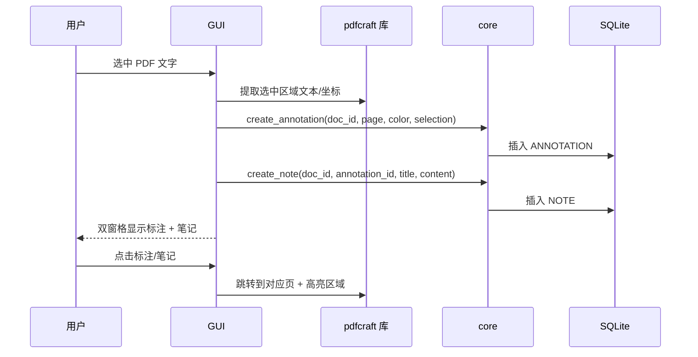
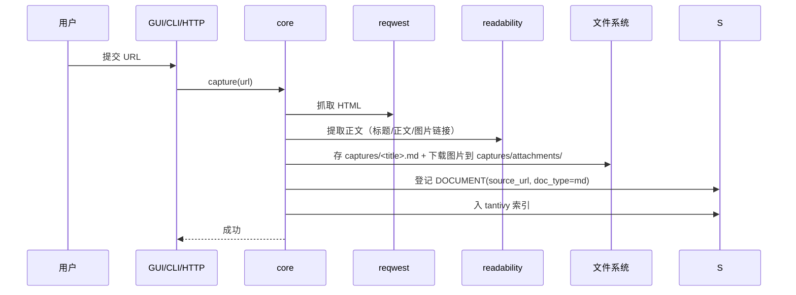
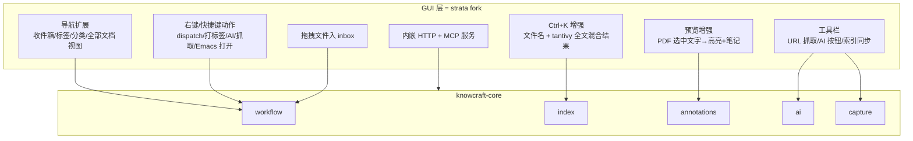
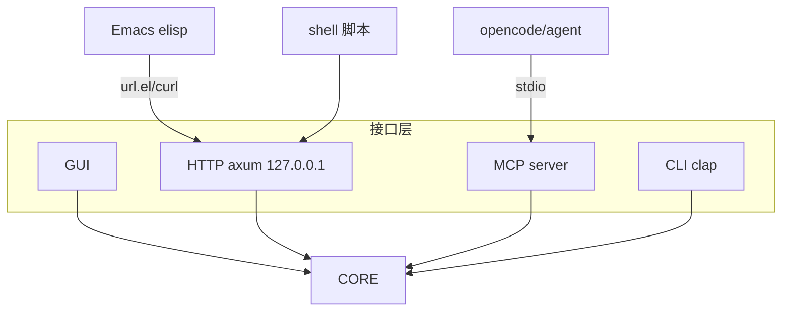
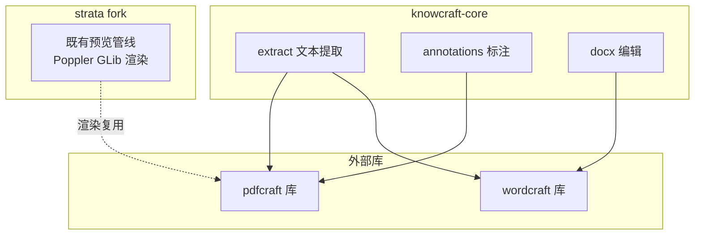
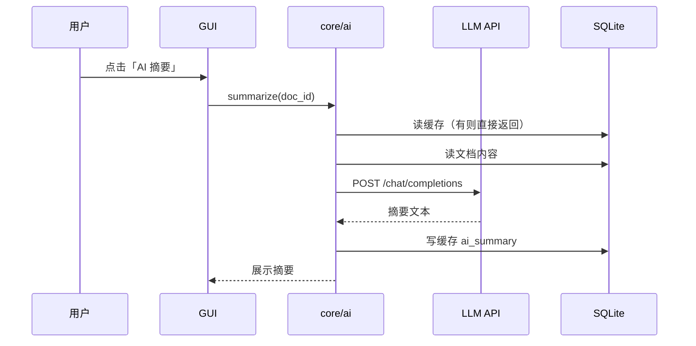

# knowcraft 设计文档

- 日期：2026-11-02
- 状态：已确认（设计阶段完成，待 grill 压力测试与最终确认）
- 关联命令：`/brainstorm`

## 1. 背景与目标

整合 ArtCraft 系 Rust 工具（pdfcraft、wordcraft）与文件管理器 strata，构建一个类 DEVONthink 的知识管理软件 knowcraft。目标平台为 Linux 为主，预留跨平台抽象（core 层跨平台，GUI 层 GTK4 限定 Linux）。

产品定位：桌面知识工作台。未分类内容统一进入收件箱（inbox），经 dispatch 归档到分类目录；支持全文搜索、PDF 标注与笔记、文件浏览与预览、AI 辅助、docx 编辑、网页抓取。

与现有 MyNotes（`~/Work/MyNotes`，Emacs mynote.el）完全独立，全新数据模型，不迁移旧数据。

## 2. 需求摘要（已确认决策）

| 决策项 | 结论 |
| --- | --- |
| 产品名 | knowcraft |
| 数据根目录 | `~/Knowledge`（可配置） |
| 软件形态 | 桌面 GUI + 本地 HTTP 服务 + MCP server + CLI，四接口 |
| 数据模型 | 文件系统 + SQLite 元数据 + tantivy 全文索引；inbox 工作流 |
| 分类模型 | 文件系统目录为主 + 标签为辅 |
| GUI 框架 | strata fork 深改造为入口（workspace 成员，git subtree 跟踪上游） |
| 工具集成 | pdfcraft / wordcraft 库嵌入：crate 引用优先，无 crate 则源码入库（vendor），不采用 CLI 降级 |
| 全文搜索 | tantivy 自建索引（M0 验证中文分词） |
| AI 辅助 | OpenAI 兼容 API（本地或云端） |
| 网页抓取 | Markdown 正文 + 附件 |
| 与 MyNotes | 全新开始，不迁移 |
| 许可证 | 沿用 MIT（strata 为 MIT，pdfcraft/wordcraft 为 MIT 或 Apache 2.0） |

## 3. 总体架构

Cargo workspace，核心库独立，接口层为薄壳。全部入口（GUI / HTTP / MCP / CLI）共享 knowcraft-core 同一套业务逻辑。

```
knowcraft/
├── Cargo.toml              # workspace
├── crates/
│   ├── knowcraft-core/     # 核心库：无 UI 依赖
│   │   └── src/
│   │       ├── store.rs        # SQLite 访问（WAL，单写者约定）
│   │       ├── index.rs        # tantivy 封装（增量索引/查询）
│   │       ├── extract.rs      # 文档文本提取（pdfcraft/wordcraft 库）
│   │       ├── workflow.rs     # inbox→dispatch→归档 逻辑
│   │       ├── tags.rs         # 标签管理
│   │       ├── annotations.rs  # 标注 CRUD
│   │       ├── ai.rs           # OpenAI 兼容客户端
│   │       ├── capture.rs      # 网页抓取（reqwest + readability）
│   │       ├── watcher.rs      # 文件系统监听（notify），触发索引更新
│   │       ├── error.rs        # 统一错误类型
│   │       └── lib.rs
│   ├── knowcraft-server/   # HTTP(axum) + 服务层，依赖 core
│   ├── knowcraft-mcp/      # MCP server，依赖 core
│   ├── knowcraft-cli/      # CLI 子命令（clap），依赖 core
│   └── strata/             # strata fork，GUI 基底，改造扩展
```



关键约定：
- 接口层不复制业务逻辑（DRY）；逻辑变更只发生在 core
- **唯一写者 + HTTP 路由**：GUI 进程为唯一写者，持有 SQLite 与 tantivy 写权限；GUI 运行时，CLI 的写请求经 HTTP 路由到 GUI 进程执行；无 GUI 运行时 CLI 自持锁写（降级运行）；watcher 与写操作同进程时抑制自反馈
- SQLite WAL 模式；tantivy 写入由唯一写者串行化，不存在跨进程写竞争
- watcher 监听数据根目录文件变更，自动增量入索引；变更事件去抖节流；文档内容变更时清除 `ai_summary` 缓存

## 4. 数据模型与目录布局

```
~/Knowledge/
├── inbox/              # 收件箱：未分类内容统一入口
├── library/            # 归档库：分类目录树（dispatch 目标）
│   └── <category>/...  # 可嵌套分类
├── notes/              # 独立笔记（Markdown，无归属文档）
├── captures/           # 网页抓取（Markdown 正文 + attachments/ 附件）
└── knowcraft.db        # SQLite 元数据
    .index/             # tantivy 索引
```

核心数据流：外部文件/网页 → `inbox/` → 分类（标签或分类目录）→ `library/`。



tantivy 索引位于 `~/Knowledge/.index/`，字段：`path / title / content / doc_type`。PDF/docx 文本提取经 pdfcraft/wordcraft 源码库，Markdown/org 直接读文本。中文分词在 M0/M1 验证（选用 jieba 风格 tokenizer 或等价方案）。

关联与一致性约定：
- **id 为主关联键**：ANNOTATION/NOTE/DOCUMENT_TAG 及 tantivy 索引均以 `document_id` 关联，`path` 仅为可变定位属性
- dispatch 移动文件与更新 `path` 在同一事务内完成（配合唯一写者保证原子性）
- watcher 检测到外部移动时按 `document_id` 更新 path 并重建索引条目；孤儿记录由索引重建任务清理

## 5. 核心工作流

### 5.1 文档生命周期状态机



### 5.2 dispatch 流程



### 5.3 PDF 标注与笔记（双窗格）



### 5.4 网页抓取



## 6. GUI 设计（strata fork 深改造）

保留 strata 原生能力：三视图（Columns/Icons/List）、键盘导航与自定义快捷键、Ctrl+K 递归文件名搜索、主题系统（95 主题）、富预览（Markdown/HTML/PDF/图片/音视频）、Custom actions。

新增知识管理扩展层（改造以加模块为主，改原逻辑为辅，OCP）：



改造方式：
- git subtree 跟踪 lgse/strata 上游 main；改造代码集中于 `src/knowledge/` 新增模块（navigation、inbox_view、tag_view、search_ext、annotate、dispatch、ai_actions、server_host）
- 少数注入点：应用启动挂载导航项、右键菜单注册、Ctrl+K 结果合并、预览行为扩展
- strata 的 Custom actions 机制保留，作为外部脚本挂 knowcraft CLI 的补充通道

快捷键：`hjkl`/方向键导航、`space` 预览、`d` dispatch、`n` 新建笔记、`c` 抓取网页、`Ctrl+K` 搜索。

## 7. 服务层（HTTP / MCP / CLI）

四入口共享 core。Emacs 经 HTTP 调用，agent 经 MCP（stdio），脚本经 HTTP。



### 7.1 HTTP API（axum，绑定 127.0.0.1）

鉴权与安全（默认强制）：
- 启动时生成并持久化 token，所有写端点与 capture 端点要求 `Authorization: Bearer <token>`；读端点默认允许本机访问，可通过配置要求 token
- CORS 关闭或限制为本地来源白名单
- `/api/capture` 限制抓取地址：禁止内网/本机地址（防 SSRF），仅允许 http/https 公网 URL

| 端点 | 方法 | 用途 |
| --- | --- | --- |
| `/api/documents` | GET | 文档列表（按视图过滤） |
| `/api/documents/{id}` | GET | 文档详情 |
| `/api/search?q=` | GET | tantivy 全文搜索 |
| `/api/documents/{id}/dispatch` | POST | dispatch 到分类 |
| `/api/documents/{id}/tags` | POST | 打标签 |
| `/api/annotations` | GET/POST | 标注查询/新增 |
| `/api/notes` | GET/POST | 笔记查询/新增 |
| `/api/capture` | POST | 网页抓取 |
| `/api/ai/summarize` `/ai/translate` `/ai/suggest-tags` | POST | AI 辅助 |
| `/api/status` | GET | 服务状态/索引进度 |

### 7.2 MCP tools

`search_documents`、`list_inbox`、`add_to_inbox`、`dispatch_document`、`tag_document`、`create_note`、`capture_url`、`summarize_document`、`suggest_category`。

### 7.3 CLI 子命令（直连 core，不经 HTTP）

- `knowcraft search <query>`
- `knowcraft add <path|url>`（入 inbox）
- `knowcraft dispatch <id|path> <category>`
- `knowcraft capture <url>`
- `knowcraft summarize <id|path>`
- `knowcraft status`（服务/索引状态）
- `knowcraft serve`（GUI 内嵌服务等价入口）

## 8. 集成层



- PDF 渲染/预览：复用 strata 既有预览管线（Poppler GLib），不重复造轮子；pdfcraft 源码库负责文本提取（索引）与标注（坐标落 SQLite 叠加渲染，支持时写回 PDF 文件）
- wordcraft 源码库：docx 新建/编辑、docx→PDF 转换；docx 文本提取（索引）以 zip+XML 直读实现（docx 即 zip+XML），不依赖 wordcraft 库
- 文本提取策略：PDF→pdfcraft 源码库、docx→zip+XML 直读、md/org/txt→直接读、网页→capture 后已是 md、图片→无文本（OCR 后续）
- **引入方式（无 CLI 降级）**：pdfcraft/wordcraft 若已发布可引用 crate 则直接依赖；否则以 git subtree 将源码纳入 workspace 作为成员 crate（vendor 模式）。trait 抽象（`TextExtractor`、`PdfRenderer`、`DocxEditor`）保留，用于 crate 引用与源码成员两种实现间切换。实现首步 M0 核实许可证（须为 MIT/Apache 2.0，禁止引入 crates.io 同名无关 GPL 项目）与源码可编译性、API 覆盖

## 9. AI 辅助

`core/ai.rs`：OpenAI 兼容 HTTP 客户端，`POST {api_base}/chat/completions`。

配置（`~/.config/knowcraft/config.toml`）：

```toml
[ai]
api_base = "http://localhost:11434/v1"   # Ollama 或云端 OpenAI 兼容端点
api_key = ""                              # 本地可空
model = "llama3"
```

功能：摘要（文档/选中文本）、翻译（中英互译）、分类建议（`response_format: json_object` 结构化输出候选标签/分类 + 置信度）。

约束：后台线程执行不阻塞 UI；摘要结果缓存入 SQLite `ai_summary`，重复点按不重复调用（最小惊讶）；请求设超时（默认 60s，可配置），超时或失败提示重试不阻塞；分类建议对不支持 `json_object` 的端点降级为纯文本解析；文档内容变更时清除 `ai_summary` 缓存。



## 10. 错误处理与测试

统一错误类型 `core::error::Error`（变体：`Store`、`Index`、`Extract`、`Network`、`Ai`、`Capture`、`Workflow`、`Io`）。错误映射：core → GUI 对话框 / HTTP 状态码（JSON 错误体）/ CLI 退出码。不 panic，核心库对外仅 `Result`。

测试策略：

| 层 | 内容 | 工具 |
| --- | --- | --- |
| core 单元 | store CRUD、workflow 状态转换、tags、annotations | cargo test + temp fixture |
| core 提取 | extract 各格式 fixture | fixture 文件 |
| core 索引 | tantivy 建索引/查询/增量 | 内存或 temp 索引 |
| core AI | mock LLM 响应 | mock HTTP server |
| core capture | 本地 fixture HTML 抓取 | fixture + temp 目录 |
| server 集成 | HTTP 端点行为、错误码 | axum + tower::ServiceExt |
| CLI 集成 | 子命令行为与退出码 | assert_cmd |
| GUI | 核心逻辑已在 core 覆盖，标注链路逻辑下沉 core 可测；GUI 层冒烟验证扩展注入不破坏原生功能 | 保留 strata 既有 tests + 冒烟测试 |

补充策略：入 inbox 时计算 `checksum`，重复文档提示合并（去重）；分类目录 CRUD 提供 GUI 树操作与 CLI 子命令入口；快捷键冲突在 M3 集成时校验并记录键位映射。

业务逻辑全部下沉 core，GUI/HTTP/CLI 为薄壳，测试集中于 core。

## 11. 风险与预案

| 风险 | 等级 | 预案 |
| --- | --- | --- |
| pdfcraft/wordcraft 无发布 crate 或 API 覆盖不足 | 高 | 源码 git subtree 入库作为 workspace 成员（vendor 模式），M0 核实许可证与可编译性 |
| crates.io 同名 `pdfcraft` 为无关 GPL 项目 | 高 | 只引用 ArtCraft 官方源码/crate，M0 核实许可证（MIT/Apache 2.0） |
| strata fork 上游同步冲突 | 中 | git subtree；改造集中于新增模块，少触碰上游核心文件 |
| tantivy 中文全文搜索质量 | 中 | 分词器配置，M0/M1 验证后定案 |
| 写并发 | 低 | 唯一写者 + HTTP 路由，无跨进程写竞争 |
| 外部文件移动产生孤儿记录 | 中 | watcher 按 document_id 自愈 + 索引重建任务清理 |

## 12. 里程碑建议

0. M0：集成探针——核实 pdfcraft/wordcraft 许可证与可编译性、API 覆盖，决定 crate 引用或源码入库；验证 tantivy 中文分词
1. M1：core 基础（store/index/extract/workflow + 单测），CLI 可用
2. M2：server（HTTP + MCP）+ Emacs/脚本接口可用
3. M3：strata fork 集成（导航扩展、搜索增强、dispatch 动作）
4. M4：PDF 标注与笔记、AI 辅助、capture、docx 编辑（docx 编辑可独立拆分，不阻塞其余功能）
5. M5：打磨（主题、快捷键、性能、打包）

范围控制：M1/M2 交付 core + server + CLI（无 GUI 依赖），先行验证核心价值；GUI 与重功能后置。

## 13. ADR 记录

关键决策以 ADR 形式记录于 `docs/adr/`：
- 0001：knowcraft 与 MyNotes 完全独立，全新数据模型，不迁移旧数据
- 0002：pdfcraft/wordcraft 引入方式——crate 引用优先，无 crate 则源码入库；不采用 CLI 降级
- 0003：写者仲裁——唯一写者 + HTTP 路由
