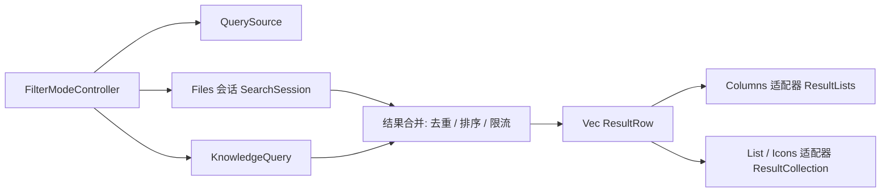
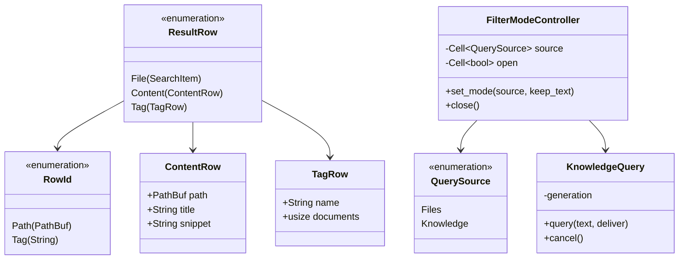
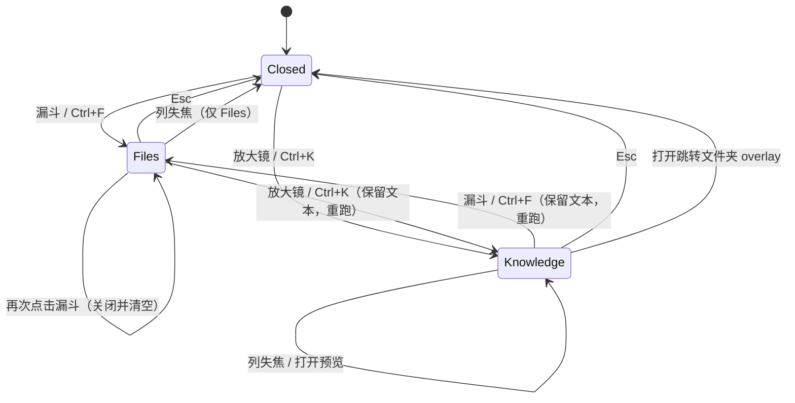
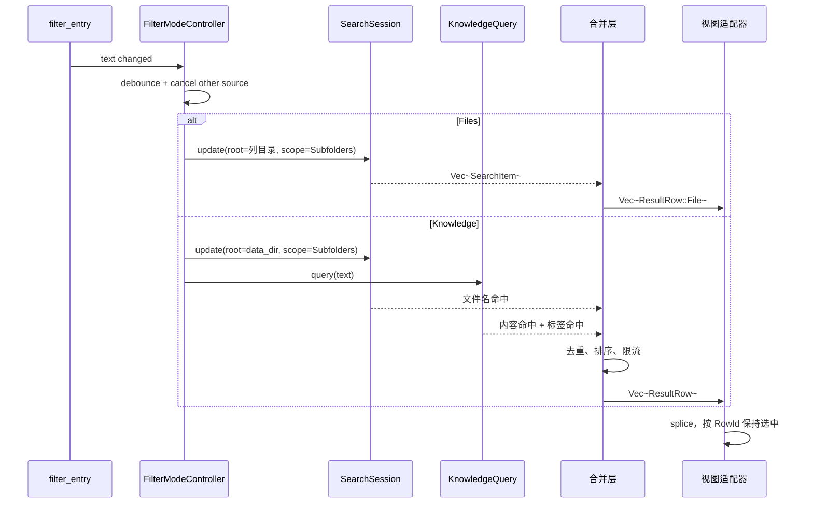
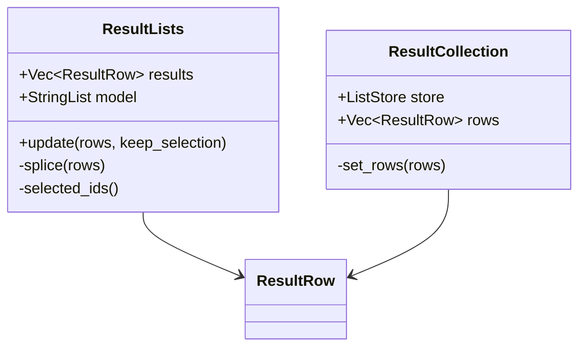

# 知识库搜索内联到列内过滤区

日期：2026-11-07
状态：已实施（见 ADR 0005）

## 背景

当前 Ctrl+K 打开中央 overlay 搜索面板（`ui/search.rs`），结果按「文件名 / 标签 / 文档内容」三段展示；
每列的 filter 通过列头漏斗展开输入行，结果直接替换该列列表。

两种入口的输入方式、结果打开方式、状态管理各自独立。本设计把知识库搜索并入列内 filter 的形态：
同一列头、同一条输入行、同一套结果列表，只有数据来源不同。

## 目标

- 知识库搜索在列内完成，不再使用中央 overlay 呈现搜索结果
- 搜索图标位于每列 filter 漏斗之后，与其共用输入行
- 搜索的结果列表、键盘导航、打开行为与 filter 一致
- 保留知识库三段数据能力：文件名、标签、文档内容

## 非目标

- 不改变 `knowcraft-core` 的搜索语义与接口
- 不改索引 schema，不重建索引
- 不把「跳转文件夹」（Ctrl+Shift+K）搬进列内
- 不改变 `display_title` 的数据源与缓存策略
- 内容命中行不参与重命名与拖拽（第一版）

## 已确认决策

| 编号 | 决策 |
| --- | --- |
| 1 | 「filter 页面」指每列列头展开的过滤区 |
| 2 | 搜索保留三段数据源：文件名、标签、文档内容 |
| 3 | 列内结果不画分段标题，三段合并为一个扁平列表 |
| 4 | 搜索图标位于每个列 / pane 的列头，紧跟 filter 漏斗 |
| 5 | 一条输入行，两个互斥 toggle：漏斗（文件过滤）与放大镜（知识库搜索） |
| 6 | 知识库搜索范围为全库，不受当前列目录限制 |
| 7 | Ctrl+K 保留，落点改为当前列的搜索输入行；窗口 header 的搜索按钮移除 |
| 8 | `#tag` 条目按 Enter 等价于把输入替换为 `tags:<name>` 并重跑搜索 |
| 9 | 文件命中按 Enter 后，当前列结果保留，不导航跳走；目录命中关闭搜索并导航 |
| 10 | 跳转文件夹保留中央 overlay，只把搜索能力移出 |

## 架构

### 分层

三处 filter 入口（Columns、List、Icons）目前是两套实现。本设计引入共享的结果层，
两个视图适配器分别接入：

- Columns 使用 `ResultLists`（`StringList` 模型 + 按位置读取的行数组）
- List / Icons 使用 `inline_search` 的 `ResultCollection`（`ListStore` + 排序器 + 行工厂）
- 两个适配器只负责把同一个 `Vec<ResultRow>` 放进各自的 GTK 模型，不重复合并逻辑

### 类型

- `QuerySource` 放在新文件 `ui/browser/filter_mode.rs`，可见性 `pub(in crate::ui)`
- `RowId::Path` 由 `File` 与 `Content` 共用；标签行使用 `RowId::Tag`
- `ContentRow` 不包装成 `SearchItem`：`SearchItem` 的 `search_path`、`depth`、评分元数据只对
  文件系统遍历结果有意义，内容命中借用它会扩散内部契约（实施时的关键约束）
- `KnowledgeQuery` 迁移自 `ui/search/knowledge.rs`，但补齐 `cancel()`

### 状态机

- 模型由单一 `FilterModeController` 持有 `(open, source)`；两个 toggle 只上报意图
- 「再次点击当前激活 toggle」= 关闭并清空；「点击另一个 toggle」= 切换并保留文本
- Knowledge 模式在列失焦、打开预览时保留；Files 模式沿用现有失焦关闭行为
- 打开中央「跳转文件夹」overlay 时先关闭列内搜索，避免两处焦点

### 数据流

Knowledge 模式的文件名来源与 Files 模式是同一个 `SearchSession` 类型，只是
`SearchInput.root` 不同：Files 用当前列目录，Knowledge 用 `data_dir`。`SharedIndex`
按 `IndexKey { target, limits }` 缓存，两个 root 各有一份索引，切换时不会重复全库遍历。

## 模块设计

### 1. 入口与模式切换

- `filter_controls` 返回四元组：`filter_entry`、`filter_revealer`、`filter_button`、`search_button`
- 两个 toggle 的 `toggled` 只上报意图，由 `FilterModeController::apply_mode` 统一设置
  另一个 toggle、revealer、placeholder、文本与查询
- placeholder：文件过滤为 `Filter this pane (%{keys})`，知识库为
  `Search the knowledge base (%{keys})`
- 列间互斥扩展 `close_other_filters`：关闭其它列的文件过滤与知识库搜索
- 窗口 header 移除搜索按钮；`Ctrl+K` 改为「打开并切到 current 列的知识库搜索」，不负责关闭
- 关闭统一用 Esc 或再次点击当前激活 toggle

快捷键语义：

| 场景 | Ctrl+F | Ctrl+K |
| --- | --- | --- |
| 无搜索展开 | 打开 Files，聚焦 | 打开 Knowledge，聚焦 |
| 当前是另一来源 | 切到 Files，保留文本并重跑 | 切到 Knowledge，保留文本并重跑 |
| 当前已是同一来源 | 聚焦并全选，不关闭 | 聚焦并全选，不关闭 |
| 行内重命名中 | 不抢焦点 | 不抢焦点 |
| 无可见列 | 不动作 | 不动作 |

目标列解析：焦点所在列优先，否则 `active_depth` 对应列；都没有时不动作。
沿用现有 guarded action 的守卫条件（外来模态、行内重命名）。

### 2. 状态持久化

- `ActivePaneFilter` 增加 `source: QuerySource`
- 纳入 `capture_active_filter` / `restore_active_filter` / `hidden_filter_entries`
- 列侧使用等价字段
- 恢复顺序：先恢复来源与 toggle 状态，再恢复文本，最后触发一次查询
- F5、切换视图、重建列之后，来源与文本保持一致

### 3. 共享输入行的写入方

所有写入 filter entry 的路径必须显式声明来源，默认 `Files`。禁止直接 `set_text`：

| 路径 | 来源 |
| --- | --- |
| 用户键入 | 当前 toggle 状态 |
| footer 过滤 `/` | Files |
| `set_listing_filter` / `commit_listing_filter` | Files |
| `clear_listing_filter` / `clear_other_column_filters` | 清空并复位为 Files |
| `show_filter_with_query`（Ctrl+F 预填） | Files |
| type-to-search | Files |
| 状态恢复 | 持久化的 `source` |

`filter_status`、footer 计数、`Target::button()` 等单 toggle 假设同步改为读取当前来源。

### 4. 列内查询管道

- `ColumnQuery` 与 `PaneFilter` 共用 `FilterModeController`
- Files：`SearchSession`，root 为当前列目录
- Knowledge：同一个 `SearchSession` 以 `root = data_dir` 运行文件名命中；
  `KnowledgeQuery` 负责内容与标签命中
- 切换来源时取消另一来源：`SearchSession` 取消当前批次，`KnowledgeQuery::cancel()`
- 输入防抖沿用 `bind_filter_query`
- 模式切换必须显式调用查询入口，不依赖 entry 的 `changed` 信号

`KnowledgeQuery`：

- 每代一个后台线程，线程内串行调用 `knowledge.search(text, 20)` 与 `knowledge.search_tags(text)`
- `cancel()` 递增 generation、置取消标志、移除轮询 source
- 轮询回调在 generation 不匹配时立即 `Break`
- 取消时机：切换来源、Esc、清空文本、列销毁、打开跳转文件夹 overlay

### 5. 结果行模型

- `ResultLists.results` 改为 `Vec<ResultRow>`；`search_model` 仍为 `StringList`，只存主标题，
  行内容按位置从 `results` 读取
- 选中集合从 `HashSet<PathBuf>` 改为 `HashSet<RowId>`
- `splice` 以 `RowId` + 主标题 + `is_directory` 匹配；标签行只比较 `RowId`
- `RenamedResult` 只对 `RowId::Path` 生效；标签行不参与重命名跟随
- `ResultCollection` 的 `ListStore` 元素改为 `BoxedAnyObject<ResultRow>`，排序器继续按位置

### 6. 合并、去重、排序、限流

| 来源 | 上限 | 依据 |
| --- | --- | --- |
| 文件名 | 100 | `RESULT_LIMIT`，沿用 |
| 标签 | 10 | 新增显式上限，按名称排序 |
| 文档内容 | 20 | 现有调用点 |

- 去重键：`RowId::Path`。同一路径同时命中文件名与内容时保留文件名行，内容行只在路径未出现时加入
- 排序：文件名行（保持搜索分数序）→ 标签行（按名称）→ 内容行（按标题）
- 排序键稳定：`(优先级, 路径或标签名)`，保证两次相同查询的行顺序一致

### 7. 激活语义

| 行类型 | 行为 |
| --- | --- |
| 文件行（文件） | 发出 `OpenRequested`，搜索保留 |
| 文件行（目录） | 关闭搜索并导航到该目录 |
| 内容行 | 发出 `OpenRequested`，搜索保留 |
| 标签行 | 输入替换为 `tags:<name>`，Knowledge 模式重跑 |

- 目录命中之所以关闭搜索：导航会替换当前列模型，保留结果列表没有意义；这与 filter 的
  目录行为一致
- 激活必须按行类型与 `RowId` 直接取路径，禁止经过 `PanePositions::source_position` 映射；
  知识库结果不在当前列目录模型中，映射会返回 `None`
- 标签行重跑时，查询以 `tags:` 开头则跳过标签 provider，避免用 `tags:<name>` 去 LIKE 标签名
- 放弃「Esc 从标签查询退回上一条查询」这一层状态；Esc 统一关闭输入行并恢复目录列表

### 8. 选中契约与消费者

| 消费者 | 新行为 |
| --- | --- |
| `ViewState::selected_search_results` | 选中集合含标签行时返回 `None` |
| `Target::current_result` | 只返回文件类行，标签行返回 `None` |
| `Target::selection_is_empty` | 按行类型判断，标签行不算空 |
| Enter 激活 | 走第 7 节的按行类型分支 |
| 预览 / 编辑 | 只对 `File` / `Content` 生效 |
| 右键菜单 | 文件类显示现有菜单；标签行只显示「以标签筛选」 |
| 拖拽 | 文件类可拖拽；标签行不安装拖拽控制器 |
| 剪贴板 | 文件类可复制路径；标签行不参与 |
| 索引徽标 / 缩略图 | 文件类按类型；标签行使用标签图标 |
| 重命名跟随 | 只对 `RowId::Path` |
| `prune_missing_search_results` | 只处理 `RowId::Path`，标签行不参与存在性检查 |

### 9. 可见状态

| 状态 | 展示 |
| --- | --- |
| 输入为空 | 恢复目录列表，关闭结果层 |
| 查询进行中 | 结果区显示加载指示，保留上一批结果 |
| 有结果 | 扁平列表 |
| 无匹配 | 列表区显示 `No matching files or folders` |
| 知识库不可用 | 显示 `Knowledge base unavailable`，与无匹配区分 |

Esc 顺序：焦点在结果列表时先回到输入框；再按一次关闭并恢复目录列表。

### 10. 显示名一致性

- 内容行的显示名统一通过 `knowledge.display_title(path)` 获取，回退文件系统名
- 这保证内容行与列表、预览使用同一套规则（占位值、标题等于文件名、归档回退 `original_name`）
- `display_title` 的缓存继续有效；每行一次查询，命中缓存
- 不为内容行在 GUI 侧另写简化规则

### 11. overlay 瘦身

保留（跳转文件夹仍需要）：

- `ui/search/results.rs` 的列表渲染、行构建、选择恢复、滚动、右键「打开所在文件夹」
- `provider.rs` 的 `Hit::file`、`Section`、`IconRole::File`
- `ui/search.rs` 的 `show_history`、`begin_query` 的 history 分支、键盘导航、Esc

删除：

- `Hit::content`、`Hit::tag`、`IconRole::Tag`、provider 合并
- `knowledge.rs`（查询逻辑迁入 `KnowledgeQuery`）、`tag_mode`
- `file_section`、`knowledge_sections`、`render_results`、`render_current`
- `SearchDialog::show`、`start_search`、`apply_search_event`
- `visible_results`

### 12. 三视图接入与阶段

- 阶段 2 先接 Columns，overlay 保留作为退路
- 阶段 3 接 List / Icons，复用同一个合并层与 `Vec<ResultRow>`，只替换适配器
- 两个阶段都必须通过同一组行为测试：替换列表、模式切换保留输入、Esc 恢复、标签行 Enter

### 13. 删除与改造清单

| 文件 / 位置 | 动作 |
| --- | --- |
| `ui/browser_modes/filter.rs` | `filter_controls` 返回四元组，接入控制器 |
| `ui/browser/columns/append/{header,query,models}.rs` | 接入 Knowledge 模式与 `ResultRow` |
| `ui/browser/columns/search.rs` | `ResultLists` 改用 `RowId` 与 `ResultRow` |
| `ui/browser/collection.rs` | 激活改为按行类型；`restore_filter_controls` 恢复来源 |
| `ui/browser/listing_filter.rs` | 统一 `set_filter_text(target, text, source)` |
| `ui/browser_modes/{filter_session,list_pane,icons_controls}.rs` | `PaneFilter` 接入控制器与 `ResultCollection` |
| `ui/inline_search/{collection,presentation}.rs` | 结果元素改为 `ResultRow` |
| `ui/search/knowledge.rs` | 迁入 `KnowledgeQuery` |
| `ui/search/tests.rs` | 保留 history 相关；搜索 provider 测试迁移 |
| `ui/window/composition/search.rs` | 删除搜索接线，保留跳转 |
| `ui/window/composition/layout.rs` | 删除 header 搜索按钮 |
| `ui/window/composition/tabs.rs` | `search` action 从移除列表拆出处理 |
| `ui/window/keyboard.rs` | `search` action 改为列内搜索落点 |
| `ui/preferences.rs`、`ui/settings/general.rs`、`ui/settings/search/*` | 删除「直接打开搜索到的文件」偏好 |
| `knowledge.rs::search_roots` | 删除无调用方 |
| `ui/shortcut_reference.rs` | 重写搜索与跳转文案 |
| `docs/superpowers/specs/2026-11-03-knowcraft-search-dispatch-design.md` | 标注 superseded |
| `docs/adr/` | 新增 `0005-knowledge-search-inline.md` |

完成条件：`rg "visible_results|search_open_files_directly|SearchDialog::show"` 无残留；
`cargo build` 通过；相关测试通过。

### 14. i18n

逐键处理并同步 `data/locales/zh-CN.json` 与 `en.json`：

- `Search files and folders…`、`Search the knowledge base…`
- `Type to search the knowledge base`
- `No matching files or folders`
- `Knowledge base unavailable`
- `%{keys}  open containing folder`、`Partial results`
- 标签行的「N 篇文档」由 `provider.rs` 硬编码迁入 i18n

### 15. 测试与 QA

纯逻辑：

- `RowId` 生成、去重规则、排序稳定性
- `tags:<name>` 回填与标签 provider 跳过
- 占位标题与 `display_title` 一致性

GTK：

- 列内搜索替换列表、模式切换保留文本并重跑
- Esc 恢复目录列表与焦点
- 标签行 Enter、文件行 Enter 保留搜索、目录行 Enter 关闭搜索
- Knowledge 模式下 F5 与切视图后仍为 Knowledge

QA 场景：

- 更新 `search_filter_sort/global-search-*.jsonl`
- 更新 `accessibility/{toolbar-controls-named,fields-and-sliders-named}.jsonl`
- 更新 `dialogs_and_menus/{dismissed-overlays-return-focus,modal-dialog-blocks-window-shortcuts}.jsonl`
- 更新 `inline_renaming/window-accelerators-leave-rename.jsonl`
- `global-search-finds-file-under-home` 改为「全库文件名命中」
- QA 只能在固定容器内通过 `./scripts/qa.sh` 运行；不跑 QA 时以 Columns 单元测试作为替代验证

### 16. 分阶段实施与回滚

| 阶段 | 内容 | 回滚 |
| --- | --- | --- |
| 1 | `filter_mode.rs`、`ResultRow`、`KnowledgeQuery`、合并与去重、纯逻辑测试 | 删除新增文件 |
| 2 | Columns 接入 Knowledge 模式，overlay 保留 | 移除入口开关 |
| 3 | List / Icons 接入 | 返回 Columns-only |
| 4 | 删除 overlay 搜索，迁移 QA / i18n / 偏好 / 快捷键 | 恢复 overlay 接线 |

阶段 2 结束前必须验证：列内搜索替换列表、模式切换保留输入、Esc 恢复目录、标签行 Enter、
跳转文件夹不回归。

## 边界与错误处理

- `knowledge::init()` 返回 `None`：Knowledge 模式显示「知识库不可用」，不 panic
- 查询期间切换来源或关闭：generation 与取消标志双重校验，过期结果不回写
- 标签查询无上限的问题：显式限制 10 条
- 行内重命名、模态对话框：保留现有守卫，不抢焦点

## 风险

1. `ResultRow` 改造触及列结果模型、行工厂、拖拽、剪贴板、重命名、缩略图与失效清理，
   需要按第 8 节逐项确认；建议先完成阶段 1 的纯逻辑测试再接入视图。
2. List / Icons 的 `ListStore` 元素类型变更会影响 `inline_search` 的排序器与行工厂，
   属于阶段 3 的主要工作量。
3. 内容行的显示名走 `display_title`，每次渲染一次 DB 查询；依赖缓存命中，需在性能测试中
   确认列内滚动不受影响。
