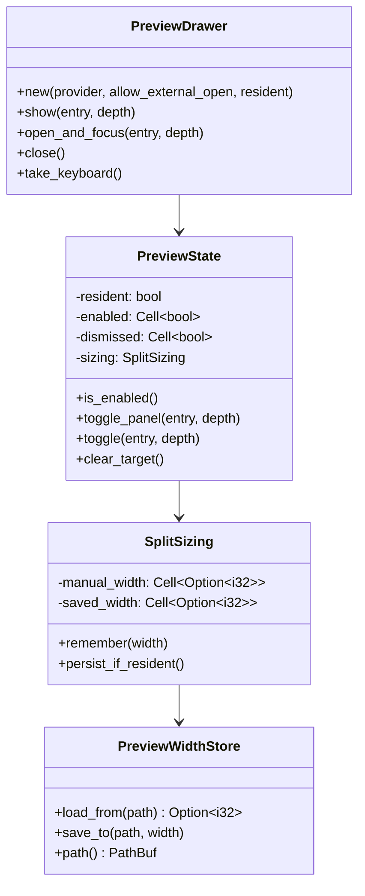
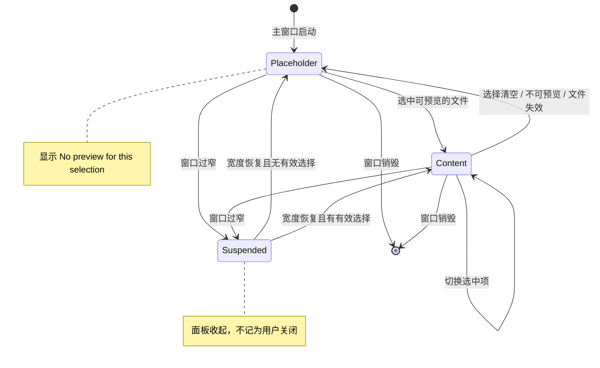
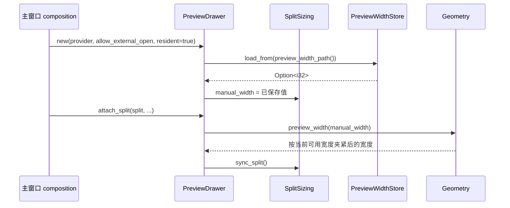

# 预览面板常驻与宽度持久化

日期：2026-11-07
状态：设计已按 grill 审查修订

## 背景

预览面板目前由 `PreviewDrawer` 管理。面板动作 `preview-panel` 已经改为只打开不关闭
（`PreviewState::toggle_panel`），但键盘路径仍保留关闭语义：

- `Space` 经 `PreviewDrawer::toggle` 打开或关闭面板。
- 预览内 `Esc` 经 `dismiss_preview_or_selection` 关闭面板并返回文件列表。
- 预览 header 仍有「Close preview (Space)」按钮。

面板宽度只保存在内存 `SplitSizing.manual_width`，进程退出即丢失；启动后按可用宽度重新计算。
用户要求预览面板始终可见，且下次启动恢复上一次的宽度。

## 目标

- 主浏览窗口的预览面板常驻；选择清空或不可预览时显示占位，不隐藏。
- `Space` 只打开并聚焦预览，不再关闭；`Esc` 在预览内只把焦点交回文件列表。
- 预览宽度跨进程保留，启动时恢复。
- 文件选择 / 保存对话框保持现有的预览开关行为。

## 非目标

- 不恢复 Columns / Icons 视图；视图仍固定为 List。
- 不改变预览内容渲染、媒体播放、标签栏与查找功能。
- 不把临时宽度写入 `settings.toml`；不新增设置项。

## 已确认决策

| 编号 | 决策 |
| --- | --- |
| 1 | `Space` 与 `Esc` 都不再关闭预览 |
| 2 | 预览内 `Esc` 回到文件列表，内容保留 |
| 3 | 仅主浏览窗口常驻；文件选择 / 保存对话框保持可开关 |
| 4 | 窗口过窄时预览自动收起，变宽后自动恢复 |
| 5 | 宽度按单一全局值保存，不分窗口档位 |
| 6 | 临时 UI 状态写入 XDG state 目录，不写入配置文件 |
| 7 | `Space` 打开并聚焦预览；面板按钮只确保可见，不抢焦点 |
| 8 | 保存的宽度是当前窗口夹紧后的分隔线右侧槽位宽度，不是内容区宽度 |

## 架构

- `resident` 是构造期参数，主窗口为 `true`，对话框为 `false`。
- `PreviewWidthStore` 是独立模块，只负责 `preview.toml` 的读写与健全性检查；
  路径由调用方注入，生产代码使用 `preview_width_path()`。
- `SplitSizing.manual_width` 继续作为运行期宽度来源；存储层不参与布局计算。

### 常驻状态

- 主窗口 `enabled` 构造为 `true`，只在控件销毁时置 `false`。
- 对话框 `enabled` 构造为 `false`，保留现有开关行为；这也修正了 819276f 之后
  对话框首帧显示占位、首次 `Space` 反向关闭的问题。
- `dismissed` 在主窗口不再被置位，选择跟随始终有效。
- `clear_target()` 在 `enabled == true` 时已经会显示占位，继续用于目标失效。
- 占位状态放不下时也必须进入 `suspend_panel()`，不能只调用 `hide_panel()`；否则
  `suspended` 标志、分隔条拖动判定与恢复后的键盘交接都会失配。
- `close()` 按 `resident` 分支：主窗口只回焦文件列表，不清空当前内容；对话框保持
  现有 `set_enabled(false)` 与收起动画。目标失效仍统一走 `clear_target()`。

### 启动宽度恢复

保存值只做健全性检查，始终经过现有 `Geometry::preview_width` 夹紧；窗口小于最小宽度时进入
Suspended，恢复后重新应用同一个保存值。

## 模块设计

### 1. 驻留策略

- `PreviewDrawer::new(provider, allow_external_open, resident: bool)` 增加第三个参数。
- 主窗口 composition 传 `true`；`chooser/layout.rs` 与测试夹具传 `false`（新增驻留用例除外）。
- `resident` 同时传给 `Header`，用于隐藏关闭按钮。
- `enabled` 初始化为 `resident`。
- `stop()`、`suspend_panel()` 的语义不变；`resume` 沿用现有 `dock_preview` 与
  `resume_keyboard_claim`，设计中不再虚构 `resume_panel()` 名称。
- `toggle_panel()` 保持只打开；`toggle()` 只服务对话框。

### 2. 键盘与焦点

真实调用链以 `dismissal`（`keyboard/items.rs`）与 `preview_navigation`
（`keyboard/items/preview_keys.rs`）为准，不使用无调用方的旧入口。

| 输入 | 主窗口 | 对话框 |
| --- | --- | --- |
| `Space`（文件） | `open_and_focus`：确保可见、显示目标、`take_keyboard()` | 现有开关 |
| `Space`（文件夹） | 现有 `activate_directory_on_space` 导航 | 不变 |
| `Esc`（预览内任意表面） | `return_from_preview`，内容保留 | 现有 `close_preview` 语义 |
| `Shift+Esc`（预览内） | 与 `Esc` 一致 | 不变 |
| `Shift+Tab` | 不变 | 不变 |
| header 关闭按钮 | `resident` 时隐藏 | 保留 |

Esc 优先级固定为：

1. 预览内的临时层：查找栏、密码框、菜单、peek 先处理各自的 Esc。
2. 预览拥有焦点：回文件列表，`Stop`。
3. 列表焦点且直接搜索激活：结束搜索。
4. 其他情况：清空选择。

实现落点：

- `dismissal` 的 `ESCAPE_ANY_SHIFT` 分支先判断 `preview.owns_focus(event.focused)`，
  命中则 `return_from_preview`；否则保留 peek 关闭与选择清理。
- `preview_navigation` 在 `text_has_focus` 早退之前增加预览焦点判断，使文档、源码、
  媒体、归档表面都能回焦；查找栏与密码框的自身控制器先于它处理。
- `dismiss_direct_search` 的守卫从 `!preview.is_enabled()` 改为 `!preview.owns_focus(...)`。
- 删除三个已失去实际入口的函数：`leave_or_close_preview`、`close_preview`、
  `toggle_file_preview`。前两者没有调用方；`toggle_file_preview` 没有键位绑定，
  但有三组测试仍断言 `i` 键切换预览，实施前先运行确认，随后删除该函数并重写这些测试。
- `open_and_focus` 在目标不可预览时显示占位并把焦点留在列表。
- `preview-panel` 动作保持“只确保可见”，不抢焦点。

### 3. 宽度持久化

| 项 | 设计 |
| --- | --- |
| 位置 | `crate::storage::state_directory()`，默认 `$XDG_STATE_HOME/knowcraft/`，回退 `~/.local/state/knowcraft/` |
| 文件 | `preview.toml` |
| 格式 | `version = 1`，`preview_width = 620` |
| 口径 | 分隔线右侧槽位宽度，包含 grip 与可选的标签栏；不是内容区宽度 |
| 写入 | `storage::writer::save(path, bytes, Policy::State, ...)`，异步合并；失败只记 `warn` |
| 读取 | 仅 `resident == true` 时读取；文件缺失、解析失败、版本不符按无记录处理 |
| 校验 | 只检查正数与明显异常上限（`PREVIEW_WIDTH_SENTINEL = 16384`）；窗口相关夹紧交给 `Geometry` |
| 保存触发 | 指针拖动结束且确实处于拖动、键盘调整结束、窗口销毁前各一次 |
| 保存范围 | 仅 `resident == true`；对话框不读不写 |
| 不保存 | 窄窗口自动收起、窗口最大化/还原、占位状态、程序化布局 |

保存条件必须同时满足：

1. `dragging.replace(false)` 为真，即本次释放确实结束了一次分隔条拖动；
2. `manual_width` 为 `Some`；
3. `!sizing.suspended`；
4. 值与上次落盘值不同。

`end_divider_drag` 会收到任意鼠标释放，不能无条件保存；`suspend_panel()` 与
`SplitSizing::close()` 需要同时清除 `dragging`。`stop()` 在 `set_enabled(false)` 之前
补一次同样的保存判定，覆盖拖动中或键盘调整尚未 idle 就销毁窗口的情况。
退出落盘依赖现有 `main.rs` 的 `writer::flush_at_exit()`，不新增退出钩子。

版本不符与损坏文件按无记录处理，本次会话的首次有效拖动会覆盖旧文件；这是单标量状态文件的
预期行为，不引入 `folder_view_settings` 的 `load_failure` 阻塞策略。

`PreviewWidthStore` 提供 `load_from(path)` / `save_to(path, width)`；生产入口
`preview_width_path()` 使用 `state_directory()`，测试使用 `tempfile::tempdir()`，
不修改 `XDG_STATE_HOME`。

### 4. 调用点调整

| 位置 | 新行为 |
| --- | --- |
| `keyboard/items.rs::dismissal` | 预览焦点优先回焦；不再关闭预览 |
| `keyboard/items/preview_keys.rs::preview_navigation` | 文本早退前处理预览焦点 Esc |
| `keyboard/direct.rs::dismiss_direct_search` | 守卫改为预览未持有焦点 |
| `keyboard/preview.rs` | 删除 `leave_or_close_preview`、`close_preview`、`toggle_file_preview` |
| `keyboard/commands.rs`、`keyboard/items.rs` 的 Space 分支 | 改调 `open_and_focus` |
| `preview/drawer/header.rs::close_button` | `resident` 时不可见 |
| `preview/lifecycle.rs::close` | 按 `resident` 分支 |
| `preview/lifecycle.rs::stop` | 补一次宽度保存判定后再禁用 |
| `preview/layout/sync.rs::show_empty_preview` | 放不下时进入 `suspend_panel()` |
| `preview/layout/sidebar.rs::preview_need` | 使用经 `Geometry` 夹紧后的宽度 |
| 操作释放、删除、选择清空 | 继续 `clear_target`，落到占位 |
| `chooser/shortcuts/*` | 不变 |

### 5. 文案与快捷键参考

| 字符串 | 位置 | 主窗口 | 对话框 |
| --- | --- | --- | --- |
| `Preview a file, or open a folder` | `shortcut_reference.rs`、`settings/keyboard.rs` | 改为 `Focus the preview panel`（zh-CN：`聚焦预览面板`） | 不适用 |
| `Close preview or cancel the current interaction` | `shortcut_reference.rs`、`settings/keyboard.rs` | 改为 `Return to the file list or cancel the current interaction`（zh-CN：`返回文件列表或取消当前操作`） | 保留原文案 |
| `Close preview (%{keys})` | `preview/drawer/header.rs`、`shortcut_reference.rs` | 控件隐藏；参考条目按上下文拆分 | 保留 |
| `ContextHint::Preview` / `ChooserPreview` | `shortcut_reference.rs` | 主窗口改为聚焦语义 | 保持关闭语义 |

i18n 同步：

- `crates/knowcraft/data/locales/en.json` 与 `zh-CN.json`；
- `crates/knowcraft/data/locales/messages/en.json` 与 `messages/zh-CN.json`；
- zh-CN 键序与 en 一致；
- 无障碍名称与按名称定位的 QA 场景同步更新。

### 6. 测试

纯逻辑：

- `preview.toml` 通过 `load_from` / `save_to` 往返，使用临时目录。
- 文件缺失、版本不符、字段缺失、非数字、负值、超过哨兵值的处理。
- 哨兵值以内的宽屏宽度被保留，由 `Geometry` 在窄窗口夹紧。
- `resident == false` 不读不写。

GTK（需要映射与帧时钟）：

- `Space` 打开并聚焦预览，`is_enabled()` 保持 `true`；Suspended 时经 `claim_on_resume` 延迟取得焦点。
- 预览内 `Esc` 与 `Shift+Esc` 在 Document、Media、Archive、Text、占位五类表面都只回焦点。
- 查找栏与密码框的 Esc 先处理自身状态，再回焦。
- 主窗口关闭按钮不可见；对话框关闭按钮可见。
- 窗口变窄自动收起并置 `suspended`，变宽后恢复占位或内容。
- 带已保存宽度启动时，`PreviewDrawer::new` 返回后即可断言 `manual_width`，不依赖帧时钟。
- 选择清空、删除当前文件、切换目录后预览仍可见。
- 对话框首次 Space 打开、首次 Esc 取消对话框。

### 7. QA 影响与迁移

统一迁移规则：以前断言 `"preview": null` 的场景，改为断言占位文案；
以前点击 `Close preview (Space)` 的步骤直接删除。

逐文件影响：

| 文件 | 处理 |
| --- | --- |
| `quick_preview/preview-hides-on-folder.jsonl`、`preview-hides-on-shift-range-folder.jsonl` | `preview: null` 改为占位断言 |
| `quick_preview/marquee-keeps-preview-closed.jsonl` | 删除“保持关闭”断言，改为常驻 |
| `quick_preview/columns-preview-reopens-after-closing.jsonl` | 行为已移除，删除 |
| `quick_preview/column-preview-fills-free-space.jsonl`、`narrow-window-keeps-last-column.jsonl`、`columns-keyboard-*.jsonl` | 核对宽度与 Columns 断言，按常驻规则更新 |
| `quick_preview/preview-focus-ignores-file-commands.jsonl`、`space-previews-filtered-result*.jsonl` | Space 改为打开并聚焦，重写步骤预期 |
| `quick_preview/model-preview-reports-limits.jsonl`、`preview-find-navigates-content.jsonl` | 删除关闭按钮步骤 |
| `filter_results/space-completes-composition.jsonl` | 回归 IME 组合期间 Space 不触发预览 |
| `escape_selection/*`、`dialogs_and_menus/customize-takes-focus-single-escape.jsonl`、`drag_and_drop/escape-cancels-file-drag.jsonl` | 核对 Esc 优先级并更新 |
| `accessibility/*` | 更新预览按钮与 Esc 名称 |
| `archive_preview/archive-rows-select-on-click.jsonl` | 核对关闭按钮步骤 |

场景头部的 `modes` 保持现状：Columns / Icons 代码仍可运行，只是没有用户入口；
本次不批量改写 `modes`，只修改受预览语义影响的步骤。

QA 无法在本机运行，只做 JSONL 解析与 `cargo check -p knowcraft --tests --features qa` 验证，
并在报告中标注未运行。

## 实施阶段

| 阶段 | 内容 | 回滚 |
| --- | --- | --- |
| 1 | 驻留语义、Space/Esc、关闭按钮、文本表面、测试与 QA 迁移 | 恢复 `dismiss_preview_or_selection` 的关闭分支 |
| 2 | 宽度存储、加载/保存触发、`stop()` 兜底、纯逻辑测试 | 删除存储模块与保存调用 |

阶段 1 必须先通过对话框回归（首次 Space、首次 Esc、宽窗口启动）；阶段 2 依赖阶段 1 的
`resident` 分支。

## 边界与错误处理

- 宽度文件损坏：忽略记录，使用默认布局；不阻止启动，不弹窗；首次有效拖动覆盖。
- 写入失败：`writer::save` 记录失败信息，界面不回滚。
- 窗口窄于最小宽度：进入 Suspended；保存值不被覆盖。
- 窗口销毁：`stop()` 先尝试保存，再设置 `enabled = false`。
- 对话框与主窗口共用 `PreviewDrawer`，通过 `resident` 区分，避免复制实现。
- 多进程：主窗口是唯一写者，chooser 不读不写；单标量无合并语义。
  该约束依赖应用单实例与 chooser 不保存，写入设计。

## 风险

1. Esc 迁移涉及五个预览表面与直接搜索，改动面比原设计大；按模块 2 的优先级表逐条实现。
2. `i` 键测试与实现冲突需要在实施前单独运行确认；无论结果如何，`toggle_file_preview`
   都删除，避免留下未来可重新接线的关闭入口。
3. 宽度保存依赖拖动状态判定；遗漏清 `dragging` 会把夹紧值误写为全局宽度。
4. `preview_need` 的未夹紧读取会放大侧边栏折叠概率，必须与 `Geometry` 统一口径。
5. Columns / Icons 代码仍保留，QA 头部 `modes` 仍可使用；常驻语义必须在两种遗留布局下都不崩。

## ADR

新增 `docs/adr/0006-preview-always-visible.md`，记录：主窗口预览不可由用户关闭、对话框保留开关、
宽度存放于 XDG state、Esc 优先级。
