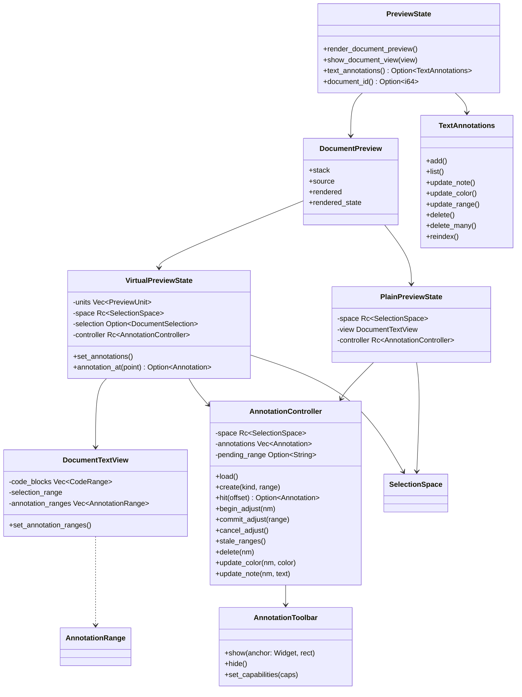
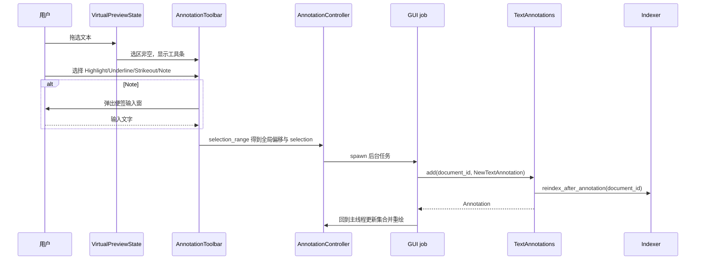

# 预览文本标注设计（PDF 与非 PDF 统一）

- 日期：2026-11-07
- 状态：已按三轮 grill 审查修订
- 关联：ADR 0004（PDF 标注写回）、`docs/superpowers/specs/2026-11-02-knowcraft-design.md`
- 审查记录：`docs/review/grill-deepseek-v4-pro-20261107-161642.md`、
  `docs/review/grill-doubao-seed-2.1-turbo-20261107-161642.md`、
  `docs/review/grill-20261107-161642.md`

## 1. 背景

PDF 预览已有完整标注链路：选中文本、创建 highlight/underline/strikeout/note、编辑便签、删除，
数据写入 `annotations` 表并写回 PDF 文件。

非 PDF 预览（Markdown、org、docx、html、纯文本）使用 `virtual_preview`，支持跨行选择
与复制，但没有标注层，也没有持久化。两类文档的标注能力不一致。

CSV/TSV 等单表文档走 `single_table_preview`，不构造列表与选区，不在本次支持范围内。

本设计让预览面板统一支持标注叠加与编辑。非 PDF 标注只入库，不修改源文件；PDF 保持既有写回行为。

## 2. 目标与非目标

目标：

- 非 PDF 预览支持创建、显示、编辑附注、修改颜色、删除、调整范围。
- PDF 与非 PDF 共用同一套标注列表、创建工具条与编辑菜单外观。
- 非 PDF 标注保存在 `annotations` 表，不写入源文件。
- 标注附注文字继续参与文档全文索引。
- 外部修改导致锚点失效时明确提示，不自动重定位。

非目标：

- 标注列表与导航侧栏。
- 自动重定位、模糊匹配修复失效锚点。
- Rendered 与 Source 视图之间共享锚点。
- 表格与媒体单元内部逐字标注。
- CSV/TSV 等单表文档标注。
- 标注导出、跨文档聚合、标注级全文检索。
- 文本侧单点 note；`note` 必须附着于非空选区。
- 为 PDF 补齐改色与改范围能力（PDF 保留现有能力集）。

## 3. 已确认决策

| 议题 | 决策 |
| --- | --- |
| 文档范围 | PDF 与非 PDF 统一 |
| PDF 写回 | 继续写回 PDF，同时入库 |
| 非 PDF 存储 | 扩展 `annotations` 表，不新建表 |
| 锚点基准 | 预览可见文本的字符偏移 |
| 编辑能力 | 新建四类、编辑附注、删除、改色、调整范围 |
| 标注列表 | 不做 |
| 附注呈现 | 行内标记 + 气泡 |
| 锚点失效 | 标记失效，不自动修复，提供删除入口 |
| 可用条件 | 已注册文档即可，不要求源文件可写 |
| 视图处理 | 锚点绑定创建视图（rendered / source） |
| 索引 | 标注内容并入文档索引，变更后立即重建 |
| 颜色选择 | 固定调色板 |
| 调整范围 | 重新选中文本覆盖原范围 |

## 4. 数据模型

### 4.1 表结构

`annotations` 表新增三列，`SCHEMA_VERSION` 由 2 升为 3：

| 列 | 类型 | 语义 |
| --- | --- | --- |
| `view` | `TEXT NOT NULL DEFAULT ''` | 空串表示 PDF；`rendered` / `source` 表示文本标注 |
| `range_start` | `INTEGER` | 规范文本全局字符偏移起点，文本标注非空 |
| `range_end` | `INTEGER` | 规范文本全局字符偏移终点，开区间，文本标注非空 |

沿用既有列：

- `kind`：`highlight` / `underline` / `strikeout` / `note`。
- `color`：`#RRGGBB`。
- `note_text`：附注文字，可空。
- `selection`：创建时从规范文本切出的原文，用于失效校验。
- `nm`：UUID，`(document_id, nm)` 唯一。
- `page`：文本标注写 `0`。数据库列本身为 `INTEGER` 可空，模型字段保持 `i64`。
- `quads`：文本标注写 `[]`。

索引：沿用 `idx_annotations_document_nm`，新增
`idx_annotations_document_view (document_id, view, range_start)`。

迁移沿用 `ensure_annotation_columns` + `ensure_column`，三列在该函数内追加，新索引也在
该函数内创建（与现有 `idx_annotations_document_nm` 同处）。三列均带默认值或可空，旧库
无需回填。`migrate` 仅在 `user_version < SCHEMA_VERSION` 时执行，因此 `SCHEMA_VERSION`
必须由 2 升为 3，v2 旧库才会走到新增列逻辑。

v2 到 v3 的迁移测试必须覆盖已有 `nm` 的旧行。

### 4.2 规范文本（SelectionSpace）

这是本设计唯一允许的偏移口径，创建与校验必须共用。

```rust
pub struct SelectionSpace {
    pub text: String,
    pub prefix: Vec<usize>,
}

/// 每个 unit 对规范文本的贡献，取该 unit 的复制文本。
fn contribution(unit: &PreviewUnit) -> String;
```

贡献规则：

| unit | 贡献 | 长度 |
| --- | --- | --- |
| `Table` / `Media` | 单个 `\u{FFFC}` 占位符 | 1 |
| `Document` 文本 unit | `copy_text` 原文，保留行尾换行 | `display_text` 字符数 + 0 或 1 |
| `Source` unit | `source` 原文，保留行尾换行 | `display_text` 字符数 + 0 或 1 |
| `copy_text` 为空 | 空串 | 0 |

不使用 `display_text` 作为贡献，因为 `selection_text` 在跨 unit 与整 unit 选中时都会
纳入 `copy_text` 的行尾换行；若两者不一致，跨 unit 标注必然在写库后立即被判失效。

定义：

```
text = concat(contribution(unit) for unit in units)
prefix[0] = 0
prefix[i+1] = prefix[i] + contribution_len(unit_i)
global(unit, offset) = prefix[unit] + offset
```

不变量：

- `text.chars().count() == prefix.last()`。
- `contribution_len(unit) - unit.selection_len() ∈ {0, 1}`，差值为 1 时多出的字符必须是
  末尾 `\n`。
- 光标偏移上限是 `selection_len()`，因此行尾换行不可被选区覆盖，但会出现在跨越它的
  规范文本切片中，与复制语义一致。
- 单元之间不插入换行字符，换行已包含在前一个 unit 的复制文本内。

Rendered 视图的规范文本不来自单一源字符串：布局按 block 分别生成 `styled.text`，每个 block
的 unit 复制文本连续覆盖该 block 的文本，且 block 最后一个 unit 在缺少行尾换行时补一个 `\n`
（`text_unit` 的 `last` 分支）。因此 `concat(copy_text)` 等于“每个 block 文本 + 保证存在的
行尾换行”，跨 block 选中时换行已经包含在前一个 unit 的贡献内。

表格/媒体 unit 的复制文本是非空的整表文本，但 cursor 偏移只有 0 与 1。贡献取单个占位符，
`prefix[i] + 1 == prefix[i + 1]`，因此 `global(unit, 1)` 正好落在该 unit 末尾。

`SelectionSpace::slice` 对文本 unit 与 Source unit 与现有 `selection_text` 结果一致；
唯一差异是表格/媒体 unit 在 `selection_text` 中展开为整表复制文本，而在规范文本中是占位符。
该差异只影响存储的校验串，不影响选区偏移与绘制。

Source 视图的规范文本等于 `normalize_preview_text(content)`，因为 `source_units` 按
`split_inclusive('\n')` 切分且不丢字符。因此 Source 视图的全局字符偏移与原生
`TextBuffer` 字符偏移相等，两条渲染路径得到同一个规范文本。

创建标注：

- 选区 `SelectionPoint { unit, offset }` 先归一化为起止点。
- `range_start = prefix[unit_start] + offset_start`，`range_end = prefix[unit_end] + offset_end`。
- `selection = slice(text, range_start, range_end)`，使用字符切片，不调用 `selection_text()`。

校验标注：

- 使用同一个 `slice(text, start, end)`。
- `start < end`、`end <= text.chars().count()`、切片等于 `selection` 三者同时成立才算有效。

点击命中：

- `point_at` 得到 `(unit, offset)`，用 `global` 换算为全局偏移。

表格与媒体单元各占一个占位字符，因此它们之后的所有偏移仍然正确。表格内部不暴露标注入口，
选区仍按现有行为复制。

### 4.3 失效判定

打开文档或重新渲染后，对每条文本标注：

1. 结构校验：`range_start` 与 `range_end` 存在，且 `0 <= start < end`。
2. 范围校验：`end <= space.len_chars()`。
3. 原文校验：`slice(space.text, start, end) == selection`。

任一不满足即标为失效。失效标注不绘制、不命中，并汇总提示。

core 的 `structural_stale` 只执行第 1 步；第 2、3 步在 GUI 侧完成，因为 core 不持有
预览文本与规范文本长度。

## 5. core 接口

### 5.1 模型与存储

`Annotation` 新增三个字段：

```rust
pub view: String,                  // 空串表示 PDF
pub range_start: Option<i64>,
pub range_end: Option<i64>,
```

`store.rs` 同步改造：

- 新增 `read_annotation(row)` 辅助函数，集中处理 17 列。
- `upsert_annotation` 的 INSERT/ON CONFLICT 列表包含三列。
- `get_annotations` 的 SELECT 列表包含三列。
- `annotations_for(document_id)` 改为返回全部，仅供聚合与同步使用。
- 新增 `pdf_annotations_for(document_id)`：`WHERE view = ''`，保持 `ORDER BY page, id`。
- 新增 `text_annotations_for(document_id, view)`：`WHERE view = ?1 ORDER BY range_start, id`。

`PdfAnnotations::list`、`PdfAnnotations::sync_from_pdf` 与 CLI `annotations list` 改用
`pdf_annotations_for`，避免文本行串入 PDF 路径或被同步删除。
`sync_from_pdf` 的删除范围同样限定 `view = ''`。

`PdfAnnotations` 内部的 `Annotation` 构造点与既有测试使用穷举字段初始化，增加字段后需
显式写 `view: String::new()`、`range_start: None`、`range_end: None`。`read_annotation`
对 `page` 用 `r.get::<_, i64>`，文本行写入 `0`，不会出现 NULL。

### 5.2 TextAnnotations

新增 `crates/knowcraft-core/src/text_annotations.rs`：

```rust
pub struct NewTextAnnotation {
    pub view: String,
    pub kind: String,
    pub range_start: usize,
    pub range_end: usize,
    pub color: String,
    pub note: String,
    pub selection: String,
    pub nm: String,
}

pub struct TextAnnotations {
    store: Store,
    indexer: Indexer,
    lock: Arc<WriteLock>,
}

impl TextAnnotations {
    pub fn new(store: Store, indexer: Indexer, lock: Arc<WriteLock>) -> Self;
    pub fn add(&self, document_id: i64, new: NewTextAnnotation) -> Result<Annotation>;
    pub fn list(&self, document_id: i64, view: &str) -> Result<Vec<Annotation>>;
    pub fn update_note(&self, document_id: i64, nm: &str, text: &str) -> Result<Annotation>;
    pub fn update_color(&self, document_id: i64, nm: &str, color: &str) -> Result<Annotation>;
    pub fn update_range(
        &self,
        document_id: i64,
        nm: &str,
        range_start: usize,
        range_end: usize,
        selection: &str,
    ) -> Result<Annotation>;
    pub fn delete(&self, document_id: i64, nm: &str) -> Result<DeleteOutcome>;
    pub fn delete_many(&self, document_id: i64, nms: &[String]) -> Result<DeleteOutcome>;
    pub fn structural_stale(&self, document_id: i64, view: &str) -> Result<Vec<Annotation>>;
    pub fn reindex(&self, document_id: i64) -> Result<()>;
}

pub struct DeleteOutcome {
    pub deleted: usize,
    pub note_removed: bool,
}
```

约束：

- 全部写方法先取 `WriteLock`，只写数据库，不触碰源文件。
- `add` 校验：`view ∈ {rendered, source}`、`kind` 四选一、`range_start < range_end`、
  颜色为 `#RRGGBB`、`selection` 非空；`nm` 为空时生成 UUID。
- `update_range` 校验与 `add` 相同，并替换 `selection`。
- `delete_many` 在一次事务内按 `nm` 删除，留在同一文档内的行不会被误删；删除前按
  `delete_annotation_by_nm` 的现有逻辑解绑 `notes.annotation_id`。
- `reindex` 调用 `Indexer::reindex_after_annotation(document_id)`，失败返回错误，不回滚数据库写入。
- `structural_stale` 只校验偏移结构，不做原文比对。

索引编排唯一入口是 `TextAnnotations::reindex`。GUI 不再走 `Knowledge::reindex_document`，
避免双路径；后者保留给既有 PDF 路径。GUI 的写任务在后台线程内先取进程级
`index_guard()`，再调用 `reindex`，与归档、导入、索引预热共用同一串行化点。

数据库写入与索引重建分两步、不嵌套持锁：写方法取得 `WriteLock` 写入数据库后释放，
`reindex` 只取 `index_guard()`，与 `index_documents_with_progress` 的既有模式一致，
避免写锁与进程内索引锁交叉持有。

重建触发条件收窄为“附注文字发生变化”：

| 操作 | 是否重建 |
| --- | --- |
| `add` 且 `note` 非空 | 是 |
| `add` 且 `note` 为空 | 否 |
| `update_note` | 是 |
| `update_color` / `update_range` | 否 |
| `delete` / `delete_many` 且 `note_removed` | 是 |
| `delete` / `delete_many` 且无附注行 | 否 |

`DeleteOutcome::note_removed` 由删除前读取的 `note_text` 计算，不额外查询。

core 已有的 `core::annotations::Annotations` 按行 id 提供 `create/list/delete`，保留原语义；
`TextAnnotations` 是文本标注的唯一写入口，两者不合并。CLI 与后续 MCP 接入文本标注时只用
`TextAnnotations`。所有文本写方法只接受 `view != ''` 的行，`nm` 命中 PDF 行时返回错误，
避免误改 PDF 缓存。

### 5.3 Knowledge 入口

`Knowledge` 新增：

```rust
pub(crate) fn text_annotations(&self) -> TextAnnotations
```

复用 `self.store.clone()`、`self.index.clone()`、`self.write_lock.clone()`，构造方式与
`pdf_annotations()` 一致，内部 `Indexer::new(store, index)`。

### 5.4 提取失败的处理范围

`Indexer::content` 当前的 `unwrap_or_default()` 会把提取失败变成空正文，任何调用方都会
用空正文覆盖旧索引。本次不改 `content` 的全局行为，避免影响导入、归档、回收站与重建；
只在标注触发路径上新增：

```rust
pub fn reindex_after_annotation(&self, document_id: i64) -> Result<()>
```

该方法的语义是：取文档 → 提取正文，提取失败立即返回错误（不写索引，旧索引保留）→
拼接非空 `note_text` → `index_document_with_content`。`rebuild` 与 `index_document` 保持现状。
便签拼接逻辑抽为 `Indexer::compose_content(base, notes)`，由 `content` 与新方法共用。

## 6. GUI 设计

### 6.1 组件关系



`AnnotationController` 承载与渲染方式无关的标注逻辑：规范文本、标注集合、失效集合、
重选模式、创建与编辑调用。列表路径与原生文本路径各自只负责“选区从哪来”和“如何绘制/命中”。

| 路径 | 选区来源 | 命中来源 | 绘制 |
| --- | --- | --- | --- |
| `VirtualPreviewState` | 现有指针/键盘选区，`DocumentSelection` | `point_at` + `global` | 每个行控件 `set_annotation_ranges` |
| `PlainPreviewState` | 原生 `TextBuffer` 选区偏移 | `iter_at_position` 的 buffer 偏移 | 单个 `DocumentTextView` |

`PlainPreviewState` 是 Source 小文件路径的状态对象，持有 `SelectionSpace`、原生视图与
`AnnotationController`，并连接 buffer 的选区变化信号。缺少它，小文件路径没有承载标注集合、
重选模式与失效集合的容器，只能再复制一套逻辑。

`AnnotationController` 的写方法（`create`、`delete`、`update_note`、`update_color`、
`commit_adjust`）只发起后台任务，不直接调用 core；任务完成后回主线程更新
`annotations` 并触发两路径各自的刷新回调。

`AnnotationRange { start, end, kind, color, note_marker }`，全部为行内局部字符偏移。

`AnnotationToolbar` 从 `PdfToolbar` 抽取，锚点类型由 `&gtk::DrawingArea` 泛化为
`&gtk::Widget`，坐标由调用方换算为锚点控件坐标。创建按钮四类固定；编辑菜单项由
`AnnotationCapabilities { recolor: bool, adjust_range: bool }` 控制：

| 视图 | recolor | adjust_range |
| --- | --- | --- |
| rendered / source | true | true |
| PDF | false | false |

PDF 侧复用抽取后的工具条与 `prompt_note`，不补齐写回能力，也不显示这两项。

### 6.2 规范文本与偏移模块

新增 `crates/knowcraft/src/ui/virtual_preview/space.rs`：

- `SelectionSpace::from_units(units)`：Rendered 视图与 Source 大文件路径。
- `SelectionSpace::from_text(text)`：Source 小文件路径，单 unit，`prefix = [0]`。
  传入的 `text` 必须是 `normalize_preview_text(content)`，与 `source_units` 的拼接结果相同。
- `SelectionSpace::global(unit, offset) -> usize`
- `SelectionSpace::slice(start, end) -> Option<&str>`（字符切片）
- `SelectionSpace::len_chars() -> usize`
- `selection_range(selection) -> Option<(usize, usize)>`
- `local_range(range, unit, display_len) -> Option<(usize, usize)>`：取交集后把 `end`
  裁剪到 `display_len`，行尾换行不参与绘制。

单测必须覆盖：空 unit、表格/媒体占位、跨 unit 区间、多字节字符、越界、整 unit 选中，
以及对全部 unit 类型断言 `contribution_len(unit) - unit.selection_len() ∈ {0, 1}` 且差值
对应的字符是末尾 `\n`。

### 6.3 Source 视图路径统一

Source 视图存在两条路径：

1. 小文件：`SourcePreviewView` 直接使用一个 `gtk::TextView`。
2. 大文件：`use_virtual_plain_source` 为真时走 `virtual_preview::source_document`。

修订：

- `SourcePreviewView` 的字段类型改为 `DocumentTextView`，构造后显式设置
  `can_target(true)`、`focusable(true)`、`cursor_visible(true)`，保持原生选择与滚动行为。
  该控件的 `set_editable(false)`、`left_margin`、`wrap_mode` 与 CSS class 沿用现有取值。
  每次 `show()` 换 buffer 后调用 `theme::register_document_buffer` 与
  `theme::register_document_view`，与 `plain_text_view` 保持一致，使主题切换时样式同步。
- 小文件路径的规范文本取 `SelectionSpace::from_text(normalize_preview_text(content))`，
  全局偏移等于 buffer 字符偏移；`fill_source_buffer` 的增量插入与滚动策略不变。
  该单 unit 的贡献长度为整份文本字符数，不做行尾换行剥离，因此本路径不存在
  “多出末尾 `\n`”的差值。
- `SourcePreviewView.virtual_state` 由 `Option<Rc<VirtualPreviewState>>` 改为
  `SourceState { List(Rc<VirtualPreviewState>), Plain(Rc<PlainPreviewState>) }`。
  小文件路径在 `show()` 中构造 `PlainPreviewState`，连接 buffer 的选区变化信号，
  把 buffer 偏移直接当成全局偏移。
- 小文件路径的重选取消同样覆盖 `Esc`、点击空白、选区清空、切换视图与切换文件。
- 大文件路径使用 `SelectionSpace::from_units`，其 `text` 等于
  `concat(SourceUnit.source)`，而 `source_units` 按 `split_inclusive('\n')` 覆盖整份
  `normalize_preview_text(content)`，因此两条路径的 `space.text` 全等。
- 增加测试：同一内容分别走两条路径时，`space.text` 与 `space.len_chars()` 全等，
  且同一组选区换算出的全局范围相同。

只有在此前提下，`view = source` 的锚点才能跨文件大小变化保持有效。

表格与媒体单元的控件不是 `DocumentTextView`，不提供其内部标注入口；单表文档走
`single_table_preview`，没有 `ListView` 也没有选区安装，因此 CSV/TSV 不支持标注。

### 6.4 绘制

`DocumentTextView` 的 `BelowText` 层顺序固定为：

1. 代码块背景
2. 标注
3. 选中背景

四类标注绘制：

| kind | 绘制 |
| --- | --- |
| `highlight` | 半透明底色，透明度 35% |
| `underline` | 底色淡化后，在行底部画 2px 实线 |
| `strikeout` | 在行中线画 2px 实线 |
| `note` | 淡化底色，并在 `range_end` 所在行绘制 6×6 圆点 |

逐行切分复用 `snapshot_selection` 的 `forward_display_line` 循环与 `selection_span_bounds`，
不新写算法。`note_marker` 只允许出现在包含全局 `range_end` 的那一行，由 `local_range` 计算时标记。

行控件会被复用，因此 `bind_document_text_view`、`bind_source_row` 与 Source 小文件刷新路径
必须在每次绑定时调用 `set_annotation_ranges`，未匹配的行设为空，避免滚动后串色或残留。
与 `update_bound_selection` 对称，新增 `update_bound_annotations(state, index)`，在物化、
`set_annotations`、视图切换时统一调用。

标注气泡与创建工具条 parent 到稳定的 `PreviewState.content` 或 `ListView`，不 parent 到
会被复用的行内 `DocumentTextView`，避免滚动复用后气泡挂到另一行。锚定位置由
`compute_bounds` 换算为容器坐标。

### 6.5 交互流程



写操作必须在后台线程执行，不得在 GTK 主线程持锁等待。沿用 PDF 的 `spawn_job` 模式：
`glib::MainContext::default().spawn_local` + 工作线程，完成后回主线程。

已有标注交互：

1. `point_at` 命中当前行，得到 `(unit, offset)`，换算为全局偏移。
2. 先匹配附注圆点，再匹配标注主体。
3. 在稳定容器上弹出气泡，锚定到命中标注所在的显示行：编辑附注、改色、调整范围、删除。
4. 固定调色板：黄 `#ffd400`、绿 `#7bd88f`、蓝 `#5ab0f2`、粉 `#ff7ab2`、
   橙 `#ffa94d`、紫 `#b48ead`。
5. 调整范围进入一次性重选模式：`pending_range = Some(nm)`；下一次非空选区覆盖
   原 `range_*` 与 `selection`。

重选模式的取消路径：`Esc`、切换文件、切换视图、点击空白、选区清空，均清除
`pending_range`，不写数据库。

### 6.6 视图切换

- `show_document_view` 在创建或切换视图后，按当前 `DocumentView` 读取
  `list(document_id, view)`。
- Rendered 与 Source 各自维护自己的集合，切换只显示对应集合。
- `render_pending` 完成后重新加载。

### 6.7 失效提示

`notice_container` 增加一行：

- 文案：`Some annotations no longer match this document`。
- 按钮：`Delete stale annotations`。
- 点击后对当前视图按 GUI 计算出的失效 `nm` 集合调用 `delete_many`；
  `DeleteOutcome::note_removed` 为真时再调用一次 `reindex`。

`notice_container` 的句柄由 `VirtualPreviewState` 或 `PlainPreviewState` 持有；小文件路径
需要在 `ScrolledWindow` 之上套一层与 `virtual_preview::notice_container` 相同的容器。
失效集合在每次 `set_annotations` 与重新渲染完成后重新计算，提示行随之增删。

### 6.8 document_id 获取

`PreviewState` 缓存当前条目的 `document_id`：

- `FileEntry.location.native_path()` → `Knowledge::document_by_path()`。
- 未注册文档不显示工具条，不加载标注。

## 7. 索引

`Indexer::content` 已把非空 `note_text` 拼入正文。文本标注沿用该路径：

- 新增或编辑附注：重建后附注文字可检索。
- 删除带附注的标注：重建后不再命中。
- 选中原文本来就在正文中，不重复拼接。
- 改色与改范围不改变附注文字，按 §5.2 的触发表跳过重建。
- 标注触发的重建走 `reindex_after_annotation`（§5.4），提取失败时不写索引，旧索引保留。

重建仍会重新提取源文件正文。源文件被外部修改后，索引跟随新版本，而标注锚点按 §4.3
单独判定为失效。这是有意的分层：索引反映当前文件内容，标注不自动重定位。

## 8. i18n

新增词条前先在 `data/locales/messages/{en,zh-CN}.json` 与 `data/locales/{en,zh-CN}.json` 查重，
只补缺失：

- `Highlight` / `Underline` / `Strikeout` / `Note` / `Copy`
- `Edit note`
- `Delete annotation`
- `Change color`
- `Adjust range`
- `Select text to annotate`
- `Some annotations no longer match this document`
- `Delete stale annotations`

除重选模式的 `Esc` 取消外，不新增快捷键。

## 9. 边界与失败模式

| 场景 | 行为 |
| --- | --- |
| 文档被外部修改 | 原文校验失败，标注标为失效，不绘制 |
| 预览被截断（1 MB） | 超出文本范围的标注标为失效 |
| 未注册文档 | 不显示工具条，不加载标注 |
| 只读文件 | 允许标注，因为只写数据库 |
| 视图切换 | 只显示当前视图标注 |
| 表格/媒体单元 | 占位 1 字符，不提供标注入口 |
| 数据库写入失败 | 工具条收起，提示错误，不修改内存集合 |
| 索引重建失败 | 记录日志，标注仍保存，旧索引保留 |
| 文档进入回收站 | 标注随文档保留 |
| 重选模式下切换文件 | 取消重选，不写库 |
| 同一 `nm` 重复写入 | `(document_id, nm)` 幂等 |

## 10. 测试

core（`crates/knowcraft-core/tests/text_annotations.rs`）：

- v2 到 v3 迁移后旧库可用，三列存在，既有 `nm` 行可读。
- 新增、列表、改附注、改色、改范围、删除、批量删除。
- `(document_id, nm)` 幂等。
- `list` 只返回指定 `view`。
- `pdf_annotations_for` 不返回文本行，`text_annotations_for` 不返回 PDF 行。
- 附注进入索引，删除后不再命中；提取失败时旧索引保留。
- 改色与改范围不触发重建（可用索引条目计数或重建计数器断言）。
- 非法输入被拒。
- `structural_stale` 返回越界与倒序区间。

GUI：

- `space` 单测：前缀和等于规范文本长度、跨 unit、多字节、表格/媒体占位。
- 全部 unit 类型满足 `contribution_len - selection_len ∈ {0, 1}`，差值为 1 时多出末尾 `\n`；
  `from_text` 的单 unit 差值为 0。
- 两条 Source 路径的规范文本全等，同一组选区换算出的全局范围相同。
- `PlainPreviewState`：native 选区变化得到全局范围，`Esc` 与选区清空取消重选。
- `local_range` 与附注圆点所在行。
- 失效判定集合。
- 命中测试：标注主体与圆点。
- 行复用后 `annotation_ranges` 被清空或重设。
- 后台写不阻塞主线程（用现有 GTK 测试夹具的 `wait_until` 等待完成）。
- QA 场景按现有约定放在 `crates/knowcraft/tests/qa/scenarios/preview_annotations/`，
  每个 `<scenario>.jsonl` 一条流程，包含初始 fixture、操作步骤、断言：
  - `create-highlight-persists.jsonl`
  - `edit-note-updates-text.jsonl`
  - `change-color-redraws.jsonl`
  - `delete-removes-annotation.jsonl`
  - `external-edit-shows-stale.jsonl`
  - `delete-stale-annotations.jsonl`
  - `view-switch-keeps-sets-separate.jsonl`
  - `unregistered-file-has-no-toolbar.jsonl`

## 11. 阶段与回滚

1. core：schema v3、`Annotation` 三字段、`store` 读写改造、`TextAnnotations`、
   `Indexer::reindex_after_annotation`、测试。
2. GUI：`space` 模块、`AnnotationController` 骨架、Source 小文件换 `DocumentTextView` 并接入
   `PlainPreviewState`、两条路径文本全等测试。
3. GUI：`DocumentTextView` 绘制、行复用重设。
4. GUI：工具条抽取、创建流程、后台写、索引触发。
5. GUI：命中、气泡、改色、调整范围、取消路径、删除。
6. GUI：失效提示、批量删除、i18n、QA 场景、ADR。

回滚：

- 阶段 1 完成后即使 GUI 未接入，PDF 行为不变。
- 阶段 2 若 Source 换控件引发回归，可回退该步，Rendered 视图标注仍可用。
- 新增列可空，停用入口即可恢复现状。
- 索引 schema 不改变，无需重建。

## 12. 剩余风险

- `SelectionSpace` 的贡献规则必须与 `PreviewUnit` 的复制文本保持一致；增加一条
  对全部 unit 类型的范围不变量断言测试。
- `point_at` 返回的 `(unit, offset)` 必须与 `DocumentUnit.text` 同口径，需要命中测试验证。
- 行控件复用与虚拟滚动是串色高风险点，必须覆盖滚动后重绑定测试。
- Source 两条路径文本一致性依赖 `source_units` 不丢字符，需要专门测试。
- PDF 与非 PDF 的编辑能力集不完全相同：PDF 没有改色与改范围。这是有意保留的差异，
  文档与 UI 不得暗示 PDF 支持这两项。
