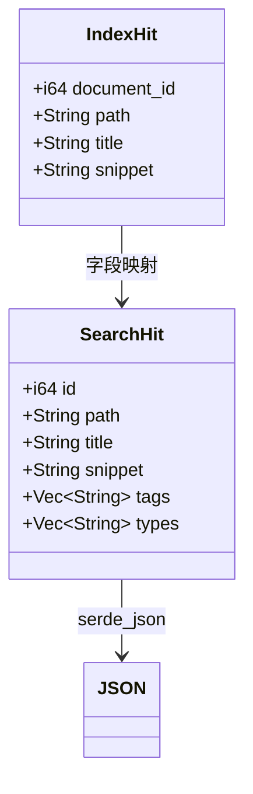
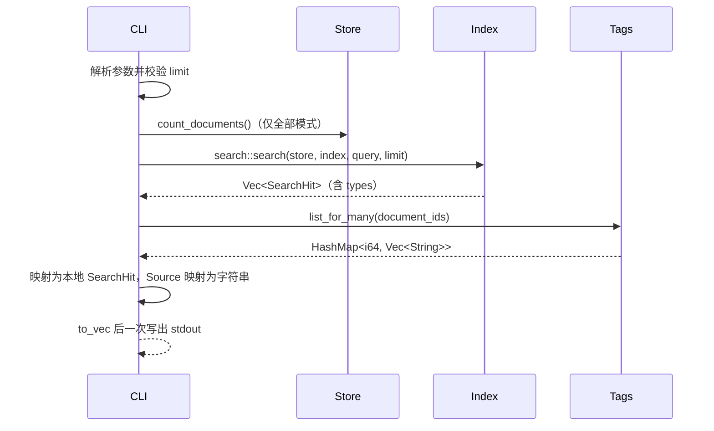

# CLI search --json 设计

- 日期：2026-11-08
- 状态：已评审（grill 已处理）；2026-11-10 追加 `types` 字段（见文末「2026-11-10 修订」）
- 范围：`knowcraft-cli` 的 `search` 与 `status` 子命令

## 2026-11-10 修订

搜索来源聚合（`2026-11-10-search-source-aggregation-design.md`）改变了 core 的搜索
语义与排序，本设计的输出契约随之追加 `types`：

- 顶层数组元素新增 `types`，作为 `tags` 之后的最后一个键；其余键名、含义与顺序不变。
- `types` 记录文档入选时的命中来源，取值为 `name`、`tags`、`fts`，固定按此顺序输出。
- `Source` 不派生 `Serialize`，CLI 层负责映射为字符串，沿用「core 不绑定 wire format」
  的原则。
- 数组顺序改为「name 命中优先，其次 tags 命中，最后仅全文命中；同一档内按标题与 id」，不再承诺全文相关性顺序。
- 原「非目标」中的「不改变搜索语法、排序」仅描述 2026-11-08 当次改动；2026-11-10
  的语法与排序变化由上述设计文档定义。

## 背景

`knowcraft-cli search` 当前只输出每行 `{id} {path}`。后续需要把搜索结果整合进
mynote.el，Emacs 侧需要结构化的 id、路径、标题、摘要与标签，而不是解析空白分隔
的文本。

本设计只增加 CLI 输出能力，不改动 mynote.el，也不改动既有文本输出。

## 目标

- 增加 `--json`，输出可被 `json-parse-buffer` 直接消费的数组。
- 增加 `--jsonl`，每行一个 JSON 对象，供 consult 等流式消费。
- 每条命中包含文档 id、路径、标题、摘要与标签。
- 增加 `--limit`，允许限制数量或取全部。
- `status --json` 输出数据目录与计数，供 mynote.el 定位知识库。
- 文本模式保持完全兼容。

## 非目标

- 不为 HTTP/MCP 设计统一输出层。
- 不改变搜索语法、排序或索引结构。
- 不输出分页游标或相关性分数。

## CLI 接口

```
knowcraft-cli search [--json | --jsonl] [--limit N] <query>
knowcraft-cli status [--json]
```

- `--json`：启用 JSON 数组输出；与 `--jsonl` 互斥。
- `--jsonl`：每行一个 JSON 对象，适合逐行流式处理；与 `--json` 互斥。
- `--limit N`：正整数限制结果数；`0` 或 `-1` 表示全部；其他负数报错；上限 10000。
- 默认限制为 50。`--help` 必须写明「0 与 -1 表示全部」。
- 参数校验在加载配置、打开数据库之前完成，非法值不产生数据目录副作用。
- `status --json` 输出单个对象；不带 `--json` 时保持既有三行文本。

## JSON 契约

顶层为数组，空结果为 `[]`。每个元素固定包含：

| 键 | 类型 | 说明 |
| --- | --- | --- |
| `id` | 整数 | 文档 id，对应 `IndexHit.document_id` |
| `path` | 字符串 | 以数据库当前记录为准；索引中的旧路径不直接输出。结果为 `data_dir` 内的绝对路径，不转换为 URI 或波浪号。数据库查不到该 id 时回退索引值 |
| `title` | 字符串 | 文档标题；空串表示无标题，消费方可回退显示文件名 |
| `snippet` | 字符串 | 纯文本摘要（约 60 字符，无高亮标记，可能含换行与控制字符，由 JSON 转义）；过滤查询没有摘要时为空串 |
| `tags` | 字符串数组 | 该文档在数据库中的标签，按 SQLite BINARY collation 升序；无标签为 `[]` |
| `types` | 字符串数组 | 命中来源，取值 `name`、`tags`、`fts`，按此固定顺序输出；仅 `kind:` 过滤时为 `[]` |

字段顺序固定为 `id`、`path`、`title`、`snippet`、`tags`、`types`。数组顺序沿用 core
搜索顺序（name 命中优先，其次 tags，最后仅全文命中；同档按标题与 id），不承诺跨版本稳定；需要固定顺序时由
消费方排序。

示例：

```json
[
  {
    "id": 12,
    "path": "/home/user/Knowledge/library/paper.pdf",
    "title": "A Paper",
    "snippet": "matching fragment",
    "tags": ["paper", "rust"],
    "types": ["name", "fts"]
  }
]
```

输出为紧凑单行 JSON，末尾恰好一个换行。编码为 UTF-8 无 BOM、LF 行尾，中文等非 ASCII
字符原样输出，不转为 `\uXXXX`。stdout 只包含 JSON，不混入日志或提示，成功时 stderr 为空。
文本模式不受 `--json` 影响，仍为每行 `{id} {path}`。

## JSONL 契约

`--jsonl` 的每个元素与 `--json` 数组元素字段相同、顺序相同，每行一个紧凑 JSON 对象，
行尾为单个 `\n`，无末尾空行；无命中时 stdout 为空，退出 0。消费方逐行
`json-parse-string` 即可，不需要把整个响应读入内存。

## status JSON 契约

`status --json` 输出单个对象：

| 键 | 类型 | 说明 |
| --- | --- | --- |
| `data_dir` | 字符串 | 配置解析后的知识库根目录绝对路径，不转换波浪号 |
| `indexed` | 整数 | 已登记且索引存在的文档数 |
| `inbox` | 整数 | inbox 中的文档数 |

示例：

```json
{"data_dir":"/home/user/Knowledge","indexed":375,"inbox":356}
```

输出为紧凑单行 JSON，末尾恰好一个换行，成功时 stderr 为空。`indexed` 与 `inbox` 分别对应
文本模式的 `indexed:` 与 `inbox:` 行。mynote.el 由 `data_dir` 派生 `notes` 目录，不再硬编码
`~/Knowledge/notes`。

Emacs 侧消费约束：`call-process` 需绑定 `coding-system-for-read` 为 `utf-8-unix`；
`json-parse-buffer` 自 Emacs 27.1 起提供，更早版本使用 `json-read`；必须检查退出码并
单独捕获 stderr。

## 结构与数据流

JSON 是 CLI 展示层契约，core 不派生 `Serialize`，避免把 wire format 绑到
`IndexHit`。CLI 定义本地输出结构并逐字段映射。





标签查询走 `Tags::list_for_many`，单条 SQL 按 `document_id IN (...)` 分组，避免 N+1；
这也是未来 HTTP/MCP 的复用点。「全部」模式的上限取 `Store::count_documents`（`COUNT(*)`），
不加载文档行。路径以数据库记录为准，索引中的旧路径只作回退。

## limit 语义

- 默认 50。
- 正整数：原样传给 `knowcraft_core::search::search`；超过 10000 视为参数错误。
- `0` 或 `-1`：以 `Store::count_documents()` 作为上限，取全部。
- 其他负数：搜索前返回参数错误，stdout 为空，退出码非零。
- 文本与 JSON 模式共用同一上限。不传 `--limit` 时文本仍为 50，与旧行为逐字节一致。
- 空库配合“全部”时上限为 0，core 直接返回空结果，不进入 tantivy。
- `knowcraft_core::Index::search_with` 对 `limit == 0` 返回空 `Vec`。tantivy 的
  `TopDocs` 要求 `limit >= 1`，core 层兜底保证不 panic。
- clap 在 `limit` 参数上设置 `allow_negative_numbers = true`，使 `--limit -1` 与
  `--limit=-1` 都可用；该属性作用于参数而非整条命令，不影响其他子命令。

## 错误处理

| 场景 | 行为 |
| --- | --- |
| 搜索失败（打开索引、解析查询、存储错误） | 错误写 stderr，非零退出，stdout 为空 |
| `--limit` 非法（小于 -1 或大于 10000） | 加载配置前报错，非零退出，stdout 为空 |
| 标签查询失败 | 整条命令失败，不用空数组掩盖错误 |
| stdout 写出失败（含 EPIPE） | 非零退出；字段仅 i64/String，不存在序列化失败，只有 IO 失败 |
| JSON 模式无命中 | 输出 `[]`，退出 0 |
| JSON 模式空库 | 输出 `[]`，退出 0；跳过文本模式的空库守卫 |
| 文本模式无命中且空库 | 保留原有 `no documents indexed yet` 报错，退出非零 |

JSON 模式先用 `to_vec` 构建完整字节再一次性写出并补换行，避免流式写出留下半截 JSON。
库内有文档但索引尚未建立时，输出同样为 `[]`；本契约不做额外区分，消费方按空结果处理。

## 复用与实现位置

方案 A：CLI 本地序列化。

- `knowcraft-cli` 增加 `serde` 与 `serde_json` 依赖。
- 定义本地 `SearchHit`，从 `IndexHit` 映射。
- 查询与过滤完全复用 `knowcraft_core::search::search`。
- 标签复用新增的 `Tags::list_for_many`。
- 全部模式复用新增的 `Store::count_documents`。
- core 不新增序列化派生，GUI 与未来 HTTP/MCP 保留各自的输出形状。

新增代码集中在 `crates/knowcraft-cli/src/main.rs` 的 `Search` 分支，core 新增两个小接口：
`Store::count_documents` 与 `Tags::list_for_many`，以及 `Index::search_with` 的 `limit == 0`
兜底。

### 替代方案与取舍

- NDJSON：`--json` 用于一次性消费数组；`--jsonl` 单独提供流式逐行输出，两者互斥，
  避免消费方猜测格式。
- core 派生 `Serialize`：把 wire 字段名绑定到内部模型，GUI/HTTP/MCP 无法各自定义形状，
  core 已依赖 serde 并非成本理由。
- 分页/游标：本期非目标；默认 50 的截断信息不进入数组，需要全量时用 `--limit 0`。
- 批量标签接口：已落入 core（`list_for_many`），不留在 CLI 壳层。

## 测试

CLI 集成测试：

- `search --json` 输出可解析数组，字段名与顺序固定，标签按 BINARY 升序。
- `types` 为来源数组，纯全文命中为 `["fts"]`，同一文档同时命中 name 与 fts 时只有一行
  且 `types` 为 `["name", "fts"]`，仅命中标签时为 `["tags"]`。
- 空库 `search --json` 输出 `[]` 且退出 0；文本模式仍报错。
- 无命中输出 `[]`；过滤查询的 `snippet` 为空串。
- `--limit 1` 只返回一条；`--limit 0` 与 `-1` 返回全部；51 条 fixture 下默认恰好 50 条。
- `--limit -2` 非零退出，stdout 为空；超过 10000 同样报错。
- 文本模式输出仍为 `{id} {path}`，带 `--limit` 时同样生效。
- JSON 输出只有一行、末尾恰好一个换行、中文原样输出。
- `--jsonl` 每行一个对象，行数与命中数一致；与 `--json` 同用时报错。
- `status --json` 输出合法对象，`data_dir` 与 `KNOWCRAFT_DATA_DIR` 一致，`indexed`/`inbox`
  与文本模式计数一致。
- dispatch 后不重建索引，JSON 仍返回数据库中的新路径。

core 测试：

- `Index::search_with(limit = 0)` 返回空结果而不是 panic。
- `Tags::list_for_many` 与逐条 `list_for` 结果一致，未打标签的文档不出现在映射中。
- `Store::count_documents` 与实际插入行数一致。

## 后续

mynote.el 接入：`mn/find-note` 用 `--jsonl` 配合 consult 异步流式展示候选，用 `path`
打开文档，用 `title` 与 `snippet` 展示；新建笔记时调用 `status --json` 取 `data_dir`
并派生 `notes` 目录。HTTP/MCP 若需要不同 envelope，在各自边界映射，不受本契约限制。
