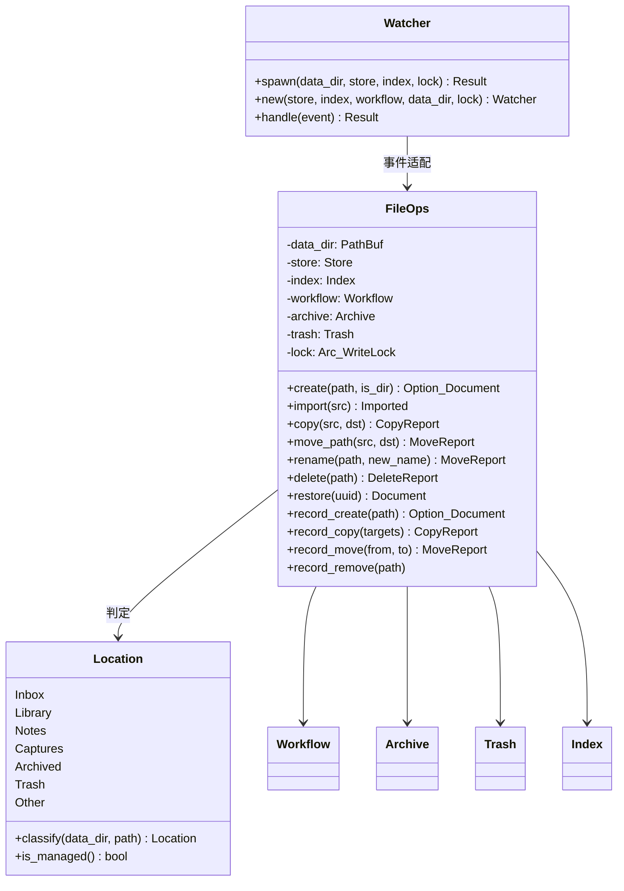
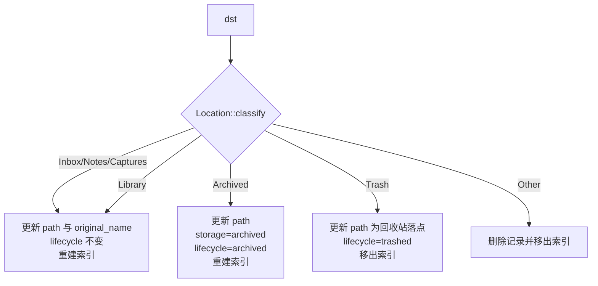
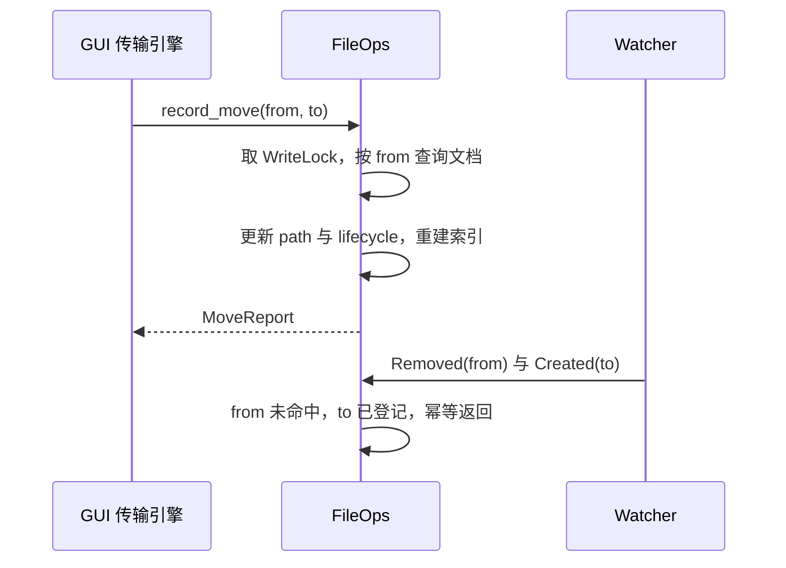

# core 统一文件操作设计

- 日期：2026-11-08
- 状态：已评审确认，待实施
- 范围：`knowcraft-core` 新增文件操作门面，GUI 与 CLI 改为调用

## 1. 背景

GUI 的文件新增、复制、移动、删除分散在 `crates/knowcraft/src/adapters/local_operations/`
（约 84k 行传输引擎）与 `crates/knowcraft/src/knowledge.rs`，索引维护依赖
`knowcraft-core::watcher` 事件。存在三个问题：

1. 记录与索引的推导规则在两处实现：`Watcher::handle_moved` 与 `Knowledge::relocate_path` 规则不一致，后者只改 path，不推导 storage/lifecycle。
2. GUI 传输完成的时刻与 watcher 收到事件的时刻存在窗口，跨进程与高频拖拽下出现索引孤儿。此前统计到 367 个索引 id 在数据库中不存在。
3. CLI 只有 `add`、`dispatch`，缺少与 GUI 对等的文件操作子命令。

## 2. 目标

1. 在 core 提供新增、导入、复制、移动、改名、删除、恢复的统一入口，索引维护只针对本次操作涉及的文档。
2. GUI 在每个操作完成点调用 core，不再自行推导记录语义。
3. CLI 提供与 core 对等的新增、复制、移动、删除、恢复子命令。
4. 记录层规则只剩一份实现，watcher 降级为事件适配器。

非目标：

- 不替换 GUI 传输引擎，不改造进度、取消、撤销、冲突处理、跨设备传输与归档解包。
- 不引入跨表事务层。
- 不触发全量索引重建。
- 不改造 ReplaceExisting 冲突策略、合并粘贴语义。
- 不涉及 Turso 或存储引擎替换。

## 3. 架构

新建 `crates/knowcraft-core/src/fileops.rs` 与 `crates/knowcraft-core/src/location.rs`。



职责划分：

- `FileOps`：唯一的文件操作业务入口，负责路径校验、文件层动作、记录层推导、索引维护、锁。
- `Location`：路径归属判定与 `is_managed` 原语，watcher 与 FileOps 共用。
- `Watcher`：notify 事件分类、去抖、合并，分支直接调用 `FileOps`。`Modified`（文本重索引、PDF 注释吸收）仍由 watcher 自己处理，不进入 `FileOps`。
- `Workflow`、`Archive`、`Trash`：保留现有职责，被 FileOps 组合调用。

复用清单：

| 现有实现 | 复用方式 |
| --- | --- |
| `Workflow::add_to_inbox` / `import_directory` | `import` 直接委托 |
| `Workflow::copy_cloned`（reflink → copy_file_range → 普通拷贝） | 提升为 `pub(crate)`，`copy` 复用 |
| `Workflow::register_document` / `register_created` | 合并为同一登记构建逻辑，`import` 保留 checksum 去重，其余登记不去重 |
| `Archive::move_file`（rename + EXDEV 回退） | 提升为 `pub(crate)`，`move_path` 复用 |
| `Archive::move_then_update` | 只复用其「移动 → 更新 → 失败反向移动」顺序；索引失败不回滚，与该方法现有行为不同，不复用函数本身 |
| `Trash::delete_document` / `move_path_to_trash` / `restore` | `delete` / `restore` 委托，内部改为单条 SQL |
| `Store::find_by_path` / `documents_under` | 记录解析与目录递归 |
| `Indexer::content` / `reindex_document`，`Index::remove` | 索引维护 |
| `Watcher` 的 `Location` 判定与 lifecycle 推导 | 提取为 `core::location` |

新增代码量估计：`fileops.rs` 约 400 行，`location.rs` 约 60 行，`store.rs` 新增约 90 行；`watcher.rs` 净减约 120 行。

## 4. 类型与接口

```rust
pub struct FileOps { /* 见上 */ }

pub enum Imported {
    File(Document),
    Directory(ImportReport),
}

pub struct CopyReport {
    pub files: usize,
    pub registered: usize,
    pub index_failed: usize,
}

pub struct MoveReport {
    pub docs: usize,
    pub index_failed: usize,
}

pub struct DeleteReport {
    pub trashed: usize,
}
```

接口约定：

- 所有 `path` 入参必须是绝对路径且位于 `data_dir` 内；唯一例外是 `import(src)` 的源路径。CLI 在解析参数后把相对路径换算为绝对路径再传入。
- 拒绝 `data_dir` 本身、五个受管根目录（`inbox`/`library`/`notes`/`captures`/`archived`）、`.trash`、`.tmp` 作为操作对象。
- 拒绝符号链接：先对最深的已存在祖先做 `canonicalize` 并校验其位于 canonical `data_dir` 内，再用 `symlink_metadata` 判定叶节点非链接。
- `create` 要求父目录已存在；`copy` 与 `move_path` 在目标父目录不存在时创建。
- 目标路径已存在时失败，不覆盖。
- `dst` 位于 `src` 之内（含相等）时拒绝。
- `.trash` 只允许在 `delete` 内部写入、`restore` 内部读取、`record_move` 的 `from`/`to` 出现。

## 5. Location 与记录推导

```rust
pub enum Location {
    Inbox,
    Library,
    Notes,
    Captures,
    Archived,
    Trash,
    Other,
}

pub fn classify(data_dir: &Path, path: &Path) -> Location;
impl Location {
    pub fn is_managed(&self) -> bool; // Inbox/Library/Notes/Captures/Archived
}
```

`Other` 覆盖 `data_dir` 本身、受管根目录、`.tmp`、以及 `data_dir` 之外。`Trash` 覆盖 `data_dir/.trash` 整棵树。

移动后的记录推导，输入是「源记录 + 目标分类」：

| 目标分类 | path | original_name | storage | lifecycle | 索引 |
| --- | --- | --- | --- | --- | --- |
| Inbox / Library / Notes / Captures | 更新 | `storage == linked` 时更新为目标文件名 | 不变 | 不变 | 重建 |
| Archived | 更新 | 不变 | `archived` | `archived` | 重建 |
| Trash | 更新为回收站落点 | 不变 | 不变 | `trashed` | 移出 |
| Other | 删除记录 | 不适用 | 不适用 | 不适用 | 移出（`lifecycle == trashed` 的记录保留） |

说明：

- 受管目录之间移动只改 path。移动不执行归档语义，归档由 `Archive::archive_record` 负责；因此把 `inbox/` 文档拖入 `library/` 时 lifecycle 保持原值。这与 `create` 在 `library/` 新建文件时直接登记为 `archived` 不一致，属既有 watcher 行为，本设计不修正，作为已知语义差异记录。
- 从 `Trash` 回到受管目录只发生在恢复。恢复目标为 `trashinfo` 记录的原路径（可能位于 `archived/` 或其余受管目录），原路径不可用时回退 `inbox/`。目标为 `Archived` 时走表中 `Archived` 一行，其余为 `lifecycle = pending`。
- 「受管 → Trash 改为置 `trashed`、保留记录」是对现有 watcher 行为的显式变更：`watcher.rs` 当前在 `to` 非受管时删除记录与索引。变更是本设计要求的，删除保留记录会破坏按 UUID 恢复。

新建（`create`）按位置决定初始状态，与 watcher `handle_created` 保持一致：

| 位置 | lifecycle | storage |
| --- | --- | --- |
| Inbox | pending | linked |
| Library / Notes / Captures | archived | linked |
| Archived | archived | archived |
| Trash / Other | 拒绝 | 拒绝 |



## 6. 操作语义

### 6.1 create

1. 校验路径：受管目录内、非 `.trash`、非符号链接、父目录存在。
2. 目录用 `create_dir`，文件用 `create_new`。目标已存在则失败。
3. 文件按第 5 节状态表登记；登记不做 checksum 去重（空文件与同内容文件各有独立路径与记录）。
4. 登记后立即建索引，空内容也建立条目，`index_status = indexed`。
5. 目录不登记，返回 `None`。

### 6.2 import

直接委托 `Workflow::add_to_inbox` 与 `import_directory`，保留 checksum 去重与 COW 拷贝，
随后对登记成功的文档建索引。返回 `Imported`。整个调用持写锁，因为去重读取与登记不可
拆分；大文件导入期间其他进程的写入最多等待 5 秒后失败（见第 12 节）。

### 6.3 copy

1. 校验 `src` 与 `dst` 均为受管目录内的文件或目录，两处均非 `.trash`，`dst` 不在 `src` 内，`dst` 不存在。
2. 在 `data_dir/.tmp/<uuid>/` 暂存：文件用 `Workflow::copy_cloned`；目录递归复制，保留相对层级，跳过隐藏项。
3. 暂存完成后对 `dst` 做一次原子 `rename`；失败则清理暂存并返回错误。`dst` 不会出现半拷贝内容。
4. 扫描 `dst` 下全部普通文件，逐个登记为新文档：新 uuid、重新计算 checksum、重新提取标题、`created_at` 为当前时间（登记逻辑与 6.7 共用）。
5. 每个新文档立即建索引。
6. 不做 checksum 去重：副本是独立文档，拥有独立标签与注释。

### 6.4 move_path 与 rename

1. 校验源与目标：均在 `data_dir` 内，均非 `.trash`，`dst` 不在 `src` 内，`dst` 不存在。目标父目录不存在时创建。
2. 单文件：`Archive::move_file`；随后单条 `Store::relocate` 更新记录；store 失败则反向 `move_file` 回原位并返回错误。索引失败不回滚，置 `index_status = pending` 并计入 `index_failed`。
3. 目录：单次 `rename`；随后 `Store::documents_under(src)` 取后代，按前缀换算新路径，用 `Store::rebase_paths(old, new)` 单事务全部更新。事务失败则反向 `rename` 目录并返回错误。
4. `rebase_paths` 在同一事务内先删除目标前缀下不属于本次搬迁的孤儿记录（目标目录此前不存在，这些记录必然指向缺失文件），再改写路径，避免 `documents.path` 的 UNIQUE 冲突。
5. 搬迁成功后逐文档重建索引；单个索引失败继续处理，汇总到 `index_failed`。
6. `rename` 为同目录 `move_path` 的薄包装。

### 6.5 delete

1. 校验路径：`data_dir` 内、非 `data_dir`、非受管根、非 `.trash` 本身、非符号链接。
2. 文件：命中记录走 `Trash::delete_document`；未登记文件先按所在位置登记（6.7），再走 `delete_document`，保证可按 UUID 恢复。
3. 目录：递归处理其下普通文件（已登记逐个 `delete_document`，未登记逐个登记后删除），最后 `remove_dir` 移除空目录。
4. `Trash::delete_document` 顺序：移入 `.trash/files/<uuid>.<ext>` → 单条 `Store::trash_document`（path + lifecycle）→ 移出索引。store 失败则反向移回原路径并返回错误。
5. `Trash::move_to_trash` 同时写 `.trash/info/<uuid>.<ext>.trashinfo`：

   ```
   [Trash Info]
   Path=%2Fhome%2Fuser%2FKnowledge%2Finbox%2Ffoo.pdf
   DeletionDate=2026-11-08T20:00:00
   ```

   `Path` 为百分号编码的绝对原路径。GUI 的回收站视图按 `.trash/files` 目录浏览，
   恢复目标由该 `trashinfo` 推导；不写该文件时 GUI 恢复会因「原始位置不可用」而
   失败（当前实现即如此）。
6. 记录保留，供 `restore` 按 uuid 使用。

### 6.6 restore

1. `restore(uuid)` 查记录，要求 `lifecycle == trashed` 且 `path` 位于 `.trash`。
2. 读取 `trashinfo` 得到原路径；原路径仍在受管目录内则作为目标，否则回退到 `inbox/<original_name>`（重名追加 `(n)`）。
3. 文件移回目标 → 单条 `Store::restore_document`（path + lifecycle = pending）→ 删除 `trashinfo` → 重建索引。store 失败则反向移回回收站并返回错误。
4. 目标为 `Archived` 时 `storage = archived`、`lifecycle = archived`；否则 `storage` 不变、`lifecycle = pending`。

### 6.7 record_* 入口

供 GUI 传输引擎在文件层动作完成后调用，全部在锁内按路径重新查询：

| 入口 | 语义 |
| --- | --- |
| `record_create(path)` | 目录直接返回 `None`；已登记则确保 `index_status = indexed` 后返回；未登记则按位置登记（不去重）并建索引 |
| `record_copy(targets)` | 对每个目标：文件已登记则刷新 size、checksum、title 并重建索引；未登记则登记并建索引；目录递归扫描 |
| `record_move(from, to)` | 只做记录层搬迁与索引，不动文件；`from` 未命中时按 `record_create(to)` 处理 |
| `record_remove(path)` | 删除记录并移出索引，不动文件；`lifecycle == trashed` 的记录保留 |

`record_move` 细则：

1. `from == to` 直接返回。
2. `find_by_path(from)` 未命中：若 `to` 是受管目录内的普通文件，走 `record_create(to)`；否则返回 0。这保留了现有 `handle_moved` 在源端未命中时回落 `handle_created(to)` 的语义。
3. 命中：按第 5 节目标分类更新。目标端已有另一条记录时，在同一事务内先删除目标记录及其索引，再搬迁源记录，避免 UNIQUE 冲突。
4. 目标为 `Other` 时删除记录并移出索引；`lifecycle == trashed` 的保留。

## 7. 锁与并发

`WriteLock` 由进程内 `Mutex` 与跨进程 `flock` 组成：同一线程重复获取是 `Mutex` 自死锁
（不会超时），不同线程或不同进程获取时最多轮询 5 秒，超时返回
`Error::Store("another instance is writing...")`。

`FileOps::new` 接收 `Arc<WriteLock>`。GUI 复用 `Knowledge` 已有实例；CLI 自行构造。
`Watcher::spawn` 增加 `Arc<WriteLock>` 参数，`Watcher::new` 用同一实例构造 `FileOps`，
并删除 `Watcher::new` 内自建的 `Arc::new(WriteLock::new(...))`。`handle_pdf_modified`
传给 `PdfAnnotations` 的仍是同一个实例。改造后进程内只有一个 `WriteLock` 实例。

| 操作 | 持锁范围 |
| --- | --- |
| `create` / `move_path` / `rename` / `delete` | 全程（元数据操作） |
| `copy` | 仅登记与索引阶段；暂存与拷贝阶段不持锁 |
| `import` | 全程（去重读取与登记不可拆分） |
| `record_*` | 全程 |

并发与幂等：

- 同一路径的并发操作由 `WriteLock` 串行化。
- `record_*` 在锁内重新查询路径，GUI 与 watcher 对同一事件的重复调用表现为幂等。
- watcher 的 `handle` 不持锁；需要写记录时由 `FileOps` 各自取锁，避免同一线程重入。
- Linux inotify 常把 rename 拆成 `RenameMode::From`（记为 `Removed`）与 `RenameMode::To`（记为 `Created`）。GUI 已显式调用 `record_move` 时，随后两条事件分别因源端记录已不存在、目标端记录已存在而幂等返回。没有显式调用的外部改名仍表现为「删除 + 新建」，文档身份会变，属既有行为，不在本设计内修正。
- `record_copy` 在 watcher 与 GUI 竞争时刷新已登记记录，修正「watcher 先登记了尚未写完的文件」留下的错误 checksum。



## 8. 失败处理

| 失败点 | 处理 |
| --- | --- |
| 文件层失败 | 立即中止；清理本次新建的暂存目录或半成品，不触碰既有文件 |
| `copy` 落位失败 | 清理 `.tmp` 暂存，`dst` 不出现 |
| 单文件 `move_path` 的 store 失败 | 反向 `rename` 回原位；回滚失败返回合并错误 |
| 目录 `move_path` 的 `rebase_paths` 失败 | 事务回滚；反向 `rename` 目录回原位 |
| `delete` 的 store 失败 | 反向移回原路径；回滚失败返回合并错误 |
| `restore` 的 store 失败 | 反向移回 `.trash`；回滚失败返回合并错误 |
| 索引写入失败 | 不回滚记录；`set_index_status(id, "pending")`，计入 `index_failed`，写 warn 日志 |
| 目录批量索引 | 逐文档独立处理，单个失败不影响其余，汇总到报告 |

`Store::relocate`、`Store::rebase_paths`、`Store::trash_document`、
`Store::restore_document` 均在单个 SQLite 事务内完成路径与状态更新，避免
「path 已改、lifecycle 未改」的半更新。

## 9. GUI 接入

GUI 保留传输引擎，只替换完成点的调用。所有接入点都在浏览器事件层，使用现有的 `std::thread::spawn` + `tracing::warn` 模式，避免在 GTK 主线程执行阻塞 IO。

| GUI 位置 | 事件 | 改为 |
| --- | --- | --- |
| `adapters/local_operations/environment.rs:56` `System::trash` | 删除 | `Knowledge::delete_path` 内部改调 `FileOps::delete`（签名不变） |
| `ui/browser/events.rs:162` `ItemRelocated{from,to,merged}` | `ItemMoved`（逐项携带 from/to） | `FileOps::record_move(from, to)`；保留 `contains` 过滤 |
| `app/browser/operation_events.rs:441` `finish_transfer` 的 `created_locations` | `TransferProgress.created_location` 累计 | `FileOps::record_copy(&created)`；复制粘贴的目标路径在此，`Pasted.locations` 是源路径，不可用于登记 |
| `app/browser/operation_events/background.rs:162` / 前台 `Merged` | `Merged{created, placed}` | `record_copy(&created)`，再对 `placed` 的键做 `record_copy`（目录会被递归扫描，文件直接登记） |
| `app/browser/file_operations.rs:169` `publish_placement` | `EntryPlaced`（`place_entry` 不发 `ItemMoved`） | `new_item` 时 `record_create(placed.last())`，否则 `record_move(original, placed.last())`；不需要改事件结构 |
| `app/browser/operation_events/outcome.rs:215` `EntryCreated{location}` | 新建文件 | `record_create(location)` |
| `app/browser/operation_events/outcome.rs` `Created` | 指定名新建（无 location） | `OperationEvent::Created` 增加 `location` 字段后同样调 `record_create` |
| `app/browser/operation_events.rs:299` `ItemRestored` | 回收站恢复 | 事件增加 `from: Option<Location>`；`from` 为 `Some` 时 `record_move(from, location)`，`None` 时不处理 |
| 删除完成的 `Deleted` / `CompletedWithErrors` | 永久删除 | `completion.deletion_permanent` 为真时对 `locations` 逐个 `record_remove` |
| `ItemTrashed` | Replace/cleanup 移入回收站 | 不调用 `FileOps`。`System::trash` 已在 `delete_path` 内改好记录；事件本身不含回收站落点，无法可靠更新 path |
| `ItemKept` | 合并撤销保留项 | 不调用 `FileOps`，路径未变 |

已删除的旧实现：`Knowledge::relocate_document` 及其递归改写逻辑、
`Knowledge::relocate_path` 内的目录推导。`Knowledge::delete_path` 保留为一行委托。

`Knowledge` 作为薄壳，额外负责标题缓存与索引状态缓存失效，并在调用 `FileOps` 期间持有 `index_guard()`（与现有 `relocate_document` 一致）：

```rust
pub(crate) fn relocate_path(&self, from: &Path, to: &Path) -> Result<usize, String> {
    let _guard = index_guard();
    let report = self.fileops.record_move(from, to).map_err(|e| e.to_string())?;
    clear_title_cache();
    with_status_cache(|cache| { /* 搬移缓存条目 */ });
    Ok(report.docs)
}
```

`ItemRestored` 与 `Created` 的字段补充是本设计对 GUI 事件结构仅有的改动：

- `ItemRestored`：`restore_items.rs` 的发射点填 `from: Some(source(&entry))`（`.trash/files/<name>`）；`restore/merge_undo.rs` 填 `from: None`（该路径下原记录未被搬入回收站，目标端已存在记录，`record_move` 即使被调用也只会幂等刷新）。
- `Created`：`create_entry.rs` 的发射点已有 `location`，直接补入。

`record_move` 的 `from` 若在 `data_dir` 外（GIO 系统回收站恢复），浏览器层先用 `Knowledge::contains(to)` 过滤，不调用 core。

## 10. CLI 子命令

新增扁平子命令，全部经 `FileOps` 执行，内部自行取写锁：

| 命令 | 参数 | 行为 | 输出 |
| --- | --- | --- | --- |
| `create <path> [--dir]` | 库内路径 | 新建并登记 | `created: path=<p> id=<id>` |
| `copy <src> <dst>` | 均在库内 | 复制并登记副本 | `copied: files=<n> registered=<m>` |
| `move <src> <dst>` | 均在库内 | 移动或改名 | `moved: docs=<n> index_failed=<m>` |
| `delete <path>` | 库内路径 | 移入回收站 | `trashed: path=<p>` |
| `restore <uuid>` | uuid | 恢复 | `restored: path=<p>` |

现有 `add <path>` 保留为库外导入入口，内部改调 `FileOps::import`，补齐索引维护，输出格式不变。

不加 `--json`，脚本需求由 `status` 与 `search --json` 覆盖。失败按现有错误传播，非零退出。输出单行、字段顺序固定。

`restore` 的目标取 `trashinfo` 的原路径（受管目录内），否则回退 `inbox/`，与 GUI 恢复保持一致。

## 11. 测试

core 新增 `crates/knowcraft-core/tests/fileops.rs`：

| 用例组 | 覆盖点 |
| --- | --- |
| 路径校验 | 库外路径拒绝；`data_dir` 与受管根拒绝；`.trash` 用于非删除操作拒绝；符号链接拒绝；`dst` 位于 `src` 内拒绝；目标父目录自动创建 |
| create | 文件按位置登记；目录不登记；同名已存在失败且不覆盖；同内容空文件可并存 |
| copy | 已登记文件产生新 uuid 与独立记录；未登记文件也登记；目录递归；暂存失败不留半成品；连续复制互不冲突 |
| move | 受管目录间只改 path；移入 `library/` 不改 lifecycle；移入 `archived/` 置 storage=archived 与 lifecycle=archived；目录搬迁单事务更新全部后代；目标端存在孤儿记录时先删再迁；移入 `.trash` 置 trashed 且保留记录 |
| delete | 已登记保留记录并置 trashed、移出索引；未登记先登记后删除；目录删除；store 失败反向移回 |
| restore | 恢复到原路径或 inbox、lifecycle=pending、索引重建、`trashinfo` 被删除；非回收站 uuid 报错；store 失败反向移回 |
| 幂等 | `record_move` 重复调用；`Removed(from)` + `Created(to)` 叠加在显式 `record_move` 之后不产生重复记录；`Created(to)` 先于 `Moved` 不触发 UNIQUE 冲突 |
| 索引 | 索引失败时 `index_status=pending`；`record_copy` 刷新已登记记录的 checksum |
| 锁 | 两个并发 `FileOps` 操作串行；`Watcher` 与 `FileOps` 共享同一锁实例时不出现 5 秒超时 |

CLI 新增用例：`create/copy/move/delete/restore` 各一条成功路径与一条错误路径（库外路径、uuid 不存在），断言输出行与非零退出码。

验证顺序：

```
cargo build
cargo test -p knowcraft-core
cargo test -p knowcraft-cli
```

GUI 不跑全量；手工验证拖拽移动、重命名、新建、粘贴副本、合并粘贴、冲突替换、删除、回收站恢复八条链路，确认记录与索引同步。

## 12. 风险与已知局限

| 项目 | 影响 | 应对 |
| --- | --- | --- |
| `record_create` 不再按 checksum 去重 | 外部工具向库内写入相同内容的多份文件会产生多条记录 | 以路径为身份；`import` 仍保留去重 |
| Linux rename 拆成 From/To 单边事件 | 无显式调用的外部改名会变成「删除 + 新建」，uuid 变化 | 显式调用路径已覆盖；外部改名维持现状 |
| `import` 全程持锁 | 大文件导入期间其他进程写入会在 5 秒后失败 | 与现有 `add_to_inbox` 行为一致；后续可拆分暂存阶段 |
| ReplaceExisting 的落地内容无显式登记 | 依赖 watcher `Created` 兜底 | 事件 `created_location` 在替换时为空，属传输引擎语义，不在本设计内改造 |
| 合并粘贴的 `placed` 只带位置 | 目录键需要递归扫描 | `record_copy` 对目录递归 |
| `ItemTrashed` 不含回收站落点 | 无法直接更新记录 path | 记录更新已在 `System::trash` 内完成，事件不再处理 |
| 84k 行传输引擎只改调用点 | 遗漏某个完成点会回到依赖 watcher | 逐一核对事件变体，见第 9 节 |
| 索引失败不回滚 | 记录与索引短暂不一致 | `index_status=pending` + watcher/cleanup 收敛 |

## 13. Grill 评审处理记录

三份报告共 36 条，按代码核实后处理如下。

| 问题 | 来源 | 处理 |
| --- | --- | --- |
| `Pasted.locations` 是源路径，不能用于 `record_copy` | kimi | 采纳。复制目标改取 `created_locations`（`progress.rs:137` 累计 `TransferProgress.created_location`） |
| 剪切粘贴产生永久重复记录 | doubao | 采纳。剪切粘贴走 `ItemMoved{from,to}` → `record_move`；`record_move` 目标端先删后迁，避开 `documents.path` UNIQUE |
| `Created(dst)` 先于 `Moved` 触发 UNIQUE | kimi | 采纳。同上的「先删目标记录再迁源记录」；`record_create` 对已登记路径幂等 |
| `record_move` 源端未命中直接返回会丢登记 | kimi | 采纳。源端未命中回落 `record_create(to)`，保留 `watcher.rs:296-299` 语义 |
| 目录移动部分失败后 `cleanup` 删旧记录 | kimi | 采纳。目录分支改为 `rebase_paths` 单事务，失败即反向 rename，不产生半更新 |
| 单文件移动回滚只恢复文件不恢复字段 | kimi | 采纳。`Store::relocate` 单条 SQL 更新，失败反向 rename；不存在字段半更新 |
| 删除失败后 watcher 级联删记录 | kimi | 采纳。`delete_document` store 失败反向移回原路径，不留给 watcher 删记录 |
| 路径校验未排除 `data_dir`、受管根、复制到自身后代 | kimi | 采纳。第 4 节明确拒绝 |
| `copy` 可能留下半拷贝内容 | 本设计自审 | 采纳。`.tmp` 暂存后原子 rename |
| restore 在 path 更新后失败不可重试 | kimi | 采纳。`Store::restore_document` 单条 SQL，失败反向移回回收站 |
| `MoveReport` 缺 store 失败字段 | kimi | 采纳。事务化后不存在部分 store 失败，不增字段 |
| `Merged` 未接入 | deepseek | 采纳。第 9 节接入 `created` 与 `placed` |
| `ItemTrashed` 未接入 | deepseek | 部分采纳。核实后 `System::trash` 已调用 `knowledge.delete_path`，记录已更新；事件无回收站落点，不接入 |
| `Deleted` 永久删除未接入 | deepseek | 采纳。`deletion_permanent` 为真时 `record_remove` |
| `EntryPlaced` 应改接 `ItemMoved` | deepseek | 拒绝。`place_entry.rs` 只发 `EntryPlaced`，不发 `ItemMoved`；在 `publish_placement` 内直接调用，且该处已有 `original`、`placed.last()`、`new_item`，无需改事件 |
| `ItemRestored` 对 GIO 回收站无效 | doubao | 部分采纳。事件补 `from: Option<Location>`；GIO 恢复的源/目标在库外时浏览器层过滤 |
| `ItemRestored` 完全移除 | 前次设计稿 | 修正。核实 `restore_items.rs:148` 是 `.trash` 视图恢复的唯一完成事件，恢复必须经它接入；merge undo 填 `from: None` |
| 锁：`Watcher::new` 自建锁未拆 | deepseek | 采纳。`Watcher::new` 接收共享 `Arc<WriteLock>`，删除 `watcher.rs:57` 自建实例，`watcher.rs:266` 改用同一实例 |
| 重入是自死锁而非 5 秒超时 | deepseek | 采纳。第 7 节按实际行为描述 |
| 长操作持锁与 5 秒超时冲突 | doubao、kimi | 部分采纳。`copy` 的暂存与拷贝阶段不持锁；`import` 因去重与登记不可拆分而全程持锁，列为已知局限 |
| `cleanup` 不收敛记录层半更新 | doubao、kimi | 采纳。改由事务消除半更新，索引失败走 `pending` 与 `reconcile` |
| checksum 去重边界 | doubao、deepseek | 采纳。仅 `import` 去重；`create`/`record_create`/`record_copy` 不去重 |
| 未登记文件删除不可按 UUID 恢复 | deepseek | 采纳。删除前先登记 |
| 「受管→Trash 从删记录改为置 trashed」未标注 | deepseek | 采纳。第 5 节显式标注为行为变更 |
| Trash→Archived 分支不可达 | deepseek | 拒绝。恢复目标取 `trashinfo` 原路径，从 `archived/` 删除的文档恢复时该分支可达 |
| `register_created` 去重语义静默改变 | doubao | 采纳。风险表与环境说明中标注 |
| `fileops.rs` 300 行估计偏低 | doubao | 采纳。调整为约 400 行 |
| Modified/PDF 写回无接口，锁内会重入 | doubao | 采纳。第 3、9 节明确 `FileOps` 不接管 Modified/PDF 写回，watcher `handle` 不持锁 |
| GUI 恢复目标解析依赖 trashinfo | 本设计核实 | 采纳。`Trash::move_to_trash` 写 `.trash/info`，否则现有 GUI 恢复必然报「原始位置不可用」 |
| `entry` 字段与 `PlacedSnapshot` 可读性 | 自审 | 采纳。第 9 节只用 `placed` 的键做登记 |

## 14. 实施顺序

1. 提取 `core::location`，`watcher.rs` 改用，保持现有行为。
2. `Store` 新增 `relocate`、`rebase_paths`、`trash_document`、`restore_document`。
3. `Workflow` 登记逻辑合并并加去重开关，`copy_cloned` 提升为 `pub(crate)`。
4. `Trash` 写 `trashinfo`、`empty` 同步清 info、`restore` 使用单条 SQL 与反向回滚。
5. 新增 `core::fileops::FileOps` 及 core 测试。
6. 改造 `watcher.rs` 为 FileOps 适配器，`spawn` 增加共享写锁参数。
7. 改造 `Knowledge` 与 GUI 八条链路，`ItemRestored` 补 `from`、`Created` 补 `location`。
8. 增加 CLI 子命令与用例。
9. 运行 `cargo build`、core 与 CLI 测试，手工验证 GUI 八条链路。
