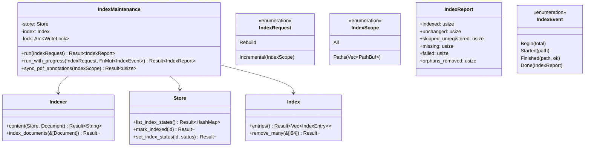
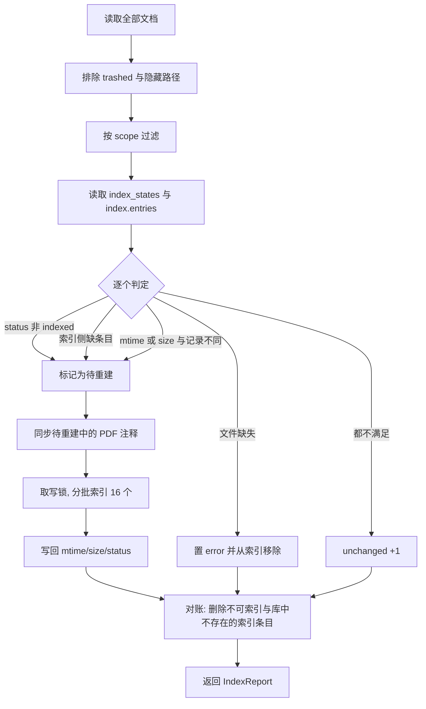

# CLI `index` 增量重建设计

日期：2026-11-09
状态：设计待实现

## 意图

当前 `knowcraft-cli index` 无参数时先同步 PDF 注释，再执行 `Indexer::rebuild()`：
清空 tantivy 索引并按数据库全量重写。大库上代价高，且没有“只处理变化部分”的入口。

GUI 启动时的 `warm_index()` 走另一套逻辑：只索引 `index_status != "indexed"`
的文档，完全不看文件内容是否变化。文件在外部被修改后，GUI 与 CLI 都不会自动重建
该文档的索引。

本设计把“索引任务编排”收敛到 core，提供三种入口语义：全量重建、指定路径重建、
无参数增量（未建过或文件已变化），CLI 与 GUI 共用同一实现。

## 目标

- core 新增索引编排服务，CLI 与 GUI 只做薄壳。
- `index --reindex`：彻底重建整个索引。
- `index <path>`：只重建该文件或目录范围内的已登记文档。
- `index`（无参数）：增量，重建满足以下任一条件的文档：
  - `index_status` 不是 `indexed`；
  - 索引侧没有该文档条目；
  - 文件的 mtime 或 size 与索引时记录不同。
- 增量同时做对账：移除数据库已不存在的索引孤儿条目，以及不可索引文档的条目。
- 记录索引时文件的 mtime 与 size，供后续增量判定。
- GUI 启动 warm-up 与右键单文件重建改用 core 服务，行为与本设计一致。

## 非目标

- 不扫描文件系统发现库外或未登记的新文件；登记仍由 `add` 与 GUI warm-up 负责。
- 不做定时增量、后台常驻索引任务。
- 不改变 tantivy schema 字段，不改变提取逻辑。
- 不引入向量索引或 embedding 相关能力。
- 不为 `index` 增加 JSON 输出（现有命令中 `ls`/`status`/`search` 有，属独立需求）。

## 反目标（即使能跑也算失败）

- CLI 与 GUI 各自实现一遍增量判定，导致两处规则漂移。
- 长时间持有写锁阻塞 GUI 的交互写入。
- 用索引条目的存在性代替内容新鲜度判断，导致文件改动后仍返回旧结果。

## 约束

- core 不 panic，对外只返回 `Result<_, Error>`。
- 写操作遵循唯一写者与 `WriteLock` 串行（见 `docs/adr/0001`）。
- 隐藏文件与隐藏目录不进入索引；回收站（`lifecycle == "trashed"`）文档不索引。
- 路径匹配按路径组件前缀，不使用字符串前缀。
- GUI 为薄壳，不复制业务逻辑。
- 文档与提交信息用中文。

## 方案与取舍

### A. 扩展 `Indexer`

在 `indexer.rs` 给 `Indexer` 增加 `index(request)` 与报告结构，CLI/GUI 直接调用。

- 复用：`rebuild`、`reindex_document`、`reconcile`、`content` 全部可保留，新增代码少。
- 代价：`Indexer` 同时承担“内容组装/写入”与“任务编排/策略”，违反单一职责；
  测试需要同时覆盖两层意图。

### B. 新增 core 服务模块 `index_maintenance`

`Indexer` 保持单文档/批量原语，新增服务层编排“枚举 → 变更判定 → 同步注释 → 索引 →
对账 → 报告”。

- 复用：`Indexer::content`/`index_documents`、`is_indexable`、`Index::entries`、
  `PdfAnnotations::sync_from_pdf`、现有 CLI 与 GUI 入口全部复用。
- 新代码：约 150-250 行服务层 + `Index::remove_many` + 存储列与批量状态方法。
- 代价：多一层模块；旧库首次增量会把全部旧记录视为未索引而重建一遍（一次性）。

### C. CLI 内编排，core 只补 mtime 字段

新增代码最少，但增量逻辑留在壳层；GUI 必须再写一遍，直接违反“动作先落 core”与
DRY。不采纳。

选定 B。

## 设计

### 类型与依赖



`IndexRequest` 用枚举把“重建 + 路径范围”这种非法组合从类型上排除；CLI 的互斥校验只
负责给出友好错误，core 不表达该非法状态。

### 增量流程



要点：

- 判定所需的索引条目集合通过 `Index::entries()` 一次取得，不在循环里查询索引。
- `skipped_unregistered` 仅在目录 scope 时统计：遍历该目录下文件（跳过隐藏项），
  库中无记录者加一。单文件 scope 若文件未登记也加一；`All` 恒为 0。
- 文件缺失判定使用 `std::fs::metadata`，失败即视为缺失。
- 先同步 PDF 注释再索引，保证注释文本进入内容；完成后记录的是同步之后的 mtime，
  避免下一轮被误判为已变化。
- 对账范围随 scope：`All` 清理全库孤儿；`Paths` 只清理该路径范围内（按索引条目中
  的 path 做组件前缀匹配）的孤儿与不可索引条目，scope 外一律不动，保证“指定路径
  只影响指定范围”。
- PDF 注释同步的逐文档失败只记录日志并继续，不中断整轮；`sync_pdf_annotations`
  整体只在取锁失败等致命情况返回 `Err`。

### 全量流程

1. 取 scope 内全部可索引文档（`Rebuild` 的 scope 恒为 `All`）。
2. 对每个文档先 `std::fs::metadata` 判定存在性：文件缺失者置 `error`、计入
   `missing`、不进入重建集合，避免产生“已索引但内容为空”的条目。
3. 同步范围内 PDF 注释（逐文档失败只记日志）。
4. 组装内容，`Index::replace_all` 单次提交重建。
5. 对全部成功写入的文档调用 `Store::mark_indexed(id)` 回写 mtime/size 与
   `index_status = indexed`。
6. 返回 `indexed`、`missing`、`failed`，`orphans_removed` 恒为 0（重建本身已清空
   旧条目）。

### 判定规则

判定按表中顺序短路，文件缺失先于 mtime 比较。

| 顺序 | 条件 | 动作 | 计数 |
|------|------|------|------|
| 1 | `lifecycle == "trashed"` 或隐藏路径 | 移除索引条目（若有） | orphans_removed |
| 2 | 文件不存在 | 置 `error`，移除索引条目 | missing |
| 3 | `index_status != "indexed"` | 重建 | indexed |
| 4 | 索引侧无该 id | 重建 | indexed |
| 5 | `indexed_mtime`/`indexed_size` 为 NULL | 重建 | indexed |
| 6 | mtime 或 size 与记录不同 | 重建 | indexed |
| 7 | 以上皆否 | 跳过 | unchanged |

`index_status` 取值保持现有 `pending`/`indexed`/`error`，不新增状态值；文件缺失复用
`error`，GUI 徽标已有映射（`index_badge` 的 `error` → 红色类）。

### 存储变更

`documents` 新增两列，`SCHEMA_VERSION` 3 → 4，通过既有 `ensure_column` 迁移：

| 列 | 类型 | 含义 |
|----|------|------|
| `indexed_mtime` | INTEGER | 索引时文件的 mtime（纳秒，自 UNIX_EPOCH） |
| `indexed_size` | INTEGER | 索引时文件的字节数 |

- 两列为 NULL 表示旧记录从未记录过索引新鲜度，首次增量视为待重建。
- `Document` 结构体不新增字段，避免改动约 20 处构造点。新增
  `IndexState { indexed_mtime: Option<i64>, indexed_size: Option<i64> }`，
  由 `Store::list_index_states()` 一次返回 `HashMap<i64, IndexState>`。
- 新增 `Store::mark_indexed(id)`：stat 文件后在同一 UPDATE 内写入
  `indexed_mtime`、`indexed_size`、`index_status = 'indexed'`。所有“成功写入索引”
  的路径统一调用它，而不只是在 `IndexMaintenance` 内调用，否则 GUI 导入、归档、
  watcher 等路径写下的文档会一直缺 mtime，下一轮启动被重复重建。涉及调用点：
  `FileOps::index_document`、`Watcher::handle_modified`/`handle_pdf_modified`、
  `Knowledge` 归档后的索引、`IndexMaintenance` 本身。文件在索引后缺失时改调
  `set_index_status(id, "error")`。
- 已知一次性代价：迁移后旧记录没有 mtime，首次增量会重建一遍全库；此后正常。

### 失败隔离

- 单个文档的提取失败或索引写入失败只影响该文档：置 `error`，计入 `failed`，继续
  下一批。
- PDF 注释同步失败只记录日志，该文档仍按现有内容索引，不计入 `failed`；注释同步
  不等同于索引失败，避免把两类问题混成一个计数。
- 只有存储/索引不可用（打开失败、锁不可获取）这类致命错误让整轮返回 `Err`。
- 批量写入失败时降级为逐文档重试，与现有 GUI warm-up 的做法一致。

### 锁策略

- 增量：按批（16 个文档）取 `WriteLock`，批间释放，避免长时间阻塞其他进程的写入。
- 全量重建：整段持锁。维护操作，允许较长占用。
- PDF 注释同步内部已按文档取锁，由服务串行调用。
- 进程内 tantivy 写锁（GUI 的 `INDEX_LOCK`/`index_guard`）仍由 GUI 外壳持有：
  `IndexMaintenance` 只负责跨进程 `WriteLock`，不依赖 GUI。GUI 调用服务时在整轮
  外层持 `index_guard()`，与现有 warm-up 一致。因此按批释放 `WriteLock` 只放宽跨
  进程交错，GUI 进程内其他写路径在 warm-up 窗口内仍排队等待，这是既有行为，
  不在本次改变。

### CLI

```
knowcraft-cli index                     # 增量
knowcraft-cli index --reindex           # 全量重建
knowcraft-cli index <path>              # 该文件/目录范围内增量
```

- `<path>` 经 `location::resolve` 解析，支持 `inbox:/` 等别名；`trash:/` 报错。
- `<path>` 先转绝对路径（复用现有 `absolute` 辅助）；必须位于 `data_dir` 之内，
  否则报错退出，防止对任意目录做遍历或误导性计数。`data_dir` 内不存在的路径
  不报错，按空范围返回全零计数。
- `--reindex` 与 `<path>` 同时出现时报错退出。
- 输出单行计数：
  `indexed: N unchanged: N skipped_unregistered: N missing: N failed: N orphans_removed: N`
- 无参数时行为由“全量重建”改为“增量”，这是本设计的核心行为变更。

### GUI

- `knowledge.rs::warm_index()` 保留“扫描知识目录并登记新文件”，删除其后的
  pending-only 索引循环，改调 `IndexMaintenance::run(Incremental { All })`；
  运行后清空 `STATUS_CACHE`，保留 `clear_title_cache()`。
- `WarmReport` 的 `registered/indexed/failed` 由 `IndexReport` 映射。
- `reindex_path()` 保留“未登记则先登记”，改调
  `IndexMaintenance::run(Incremental { Paths(vec![path]) })`；有失败时仍返回错误字符串。
- `collect_pending` 中“inbox 文档标题变化则置 `pending`”的逻辑保留：标题进入全文
  索引，变化需要触发重建，该步骤排在调用服务之前。
- 不新增工具栏入口；启动仍走 `spawn_warm_index()` 后台线程。

### 测试计划

core（`crates/knowcraft-core/tests/` 或服务内联测试，临时库 + 临时索引）：

- 未变化文件走增量，`unchanged` 计数正确，不重写索引条目。
- 修改文件 mtime 后增量重建，`indexed` 加一，搜索命中新内容。
- 仅改 size（mtime 保持）也触发重建。
- 索引条目被人为删除后增量补回。
- `index_status == "pending"` 即使 mtime 未变也重建。
- 文档移入回收站或变成隐藏路径后，增量移除其索引条目。
- 库中删除记录后，增量移除孤儿条目。
- 文件被删除后置 `error` 且移除条目，计入 `missing`。
- 单文件 scope 只影响目标文档；目录 scope 只影响其下文档（验证 `inbox/a` 不匹配
  `inbox/ab`）。
- `Rebuild` 清空陈旧条目并回写全部 mtime/size。
- `Rebuild` 遇到缺失文件计入 `missing`，不产生空内容条目。
- `Paths` scope 的对账不动范围外孤儿条目；`All` 才清理全库孤儿。
- 迁移：旧库（v3）打开后升级到 v4，列存在且值为 NULL，首次增量按待建处理。
- `Store::mark_indexed` 在文件已删除时返回错误而不写入元数据。
- watcher 修改后 `mark_indexed` 生效：随后增量不再重建该文档。

CLI：

- `--reindex` 与路径互斥的错误；
- `trash:/` 作用域报错；
- `data_dir` 之外的路径报错；
- 计数行格式；
- 目录 scope 的 `skipped_unregistered` 统计。

GUI：

- `knowledge/tests.rs` 现有 warm_index 断言保持通过；
- 新增“文件被外部修改后 warm_index 重建”的断言。

## 留给实现者的决定

- 分批大小是否固定 16（与现有 GUI warm_index 一致），还是按文档大小自适应。
- `IndexEvent` 具体字段命名与 GUI 进度条对接方式。
- 迁移是否需要把 `indexed_mtime` 回填为当前文件 mtime（本设计选择不回填，保持
  “旧记录视为未索引”的确定性）。
- 错误日志措辞与 `tracing` 字段。
