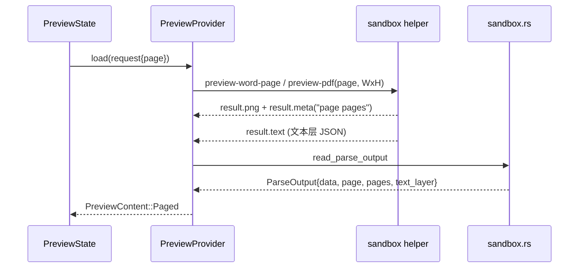
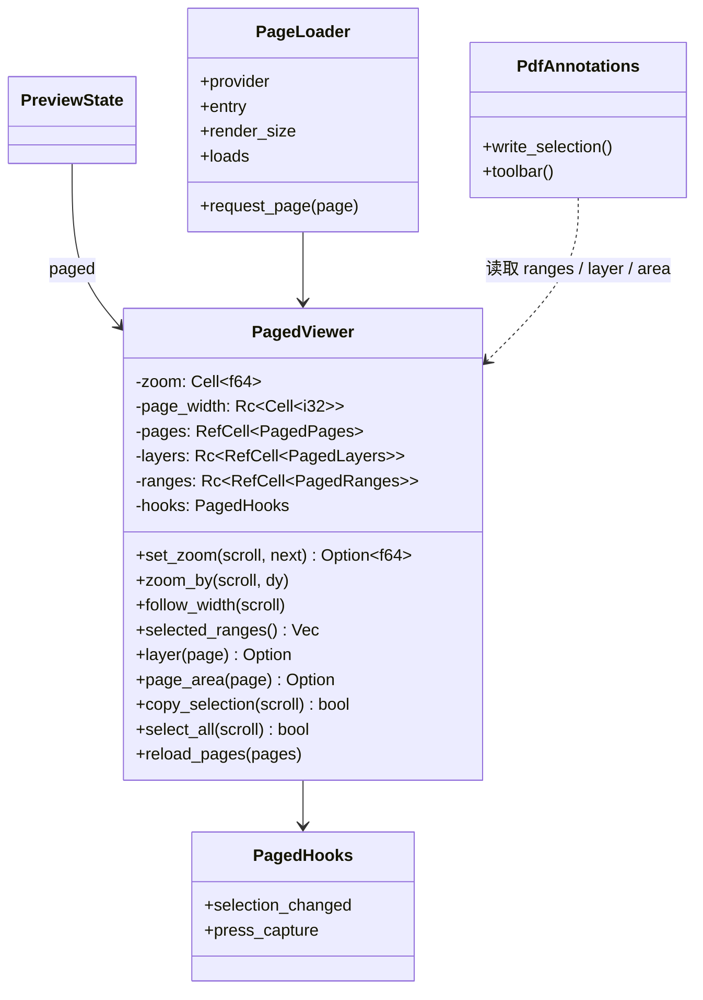
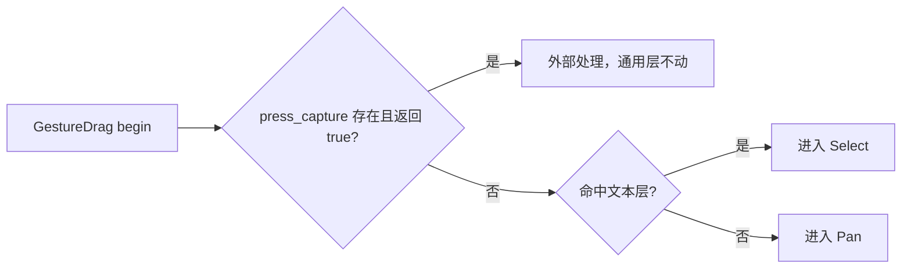
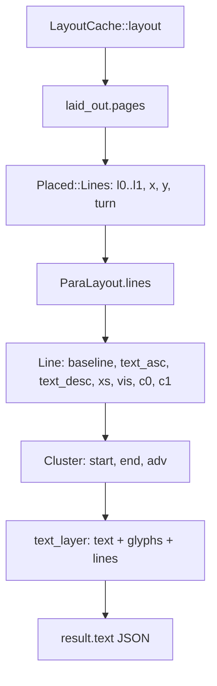

# 预览页面列表统一（PDF 与 Word）设计

- 日期：2026-11-11
- 状态：待 grill 审查
- 关联：`docs/superpowers/specs/2026-11-07-preview-text-annotations-design.md`、提交
  `d076c4ff3`（doc/docx 改用 wordcraft 单页 PNG）

## 1. 背景

两类文档预览的交互不一致：

- PDF：`PreviewContent::Pdf` 走 `render_pdf_viewer`，`gtk::ListView` 装载全部页面，每页按绑定
  按需渲染；滚轮连续纵向滚动，Ctrl+滚轮缩放，支持文本选中、复制与批注
  （`crates/knowcraft/src/ui/preview/pdf.rs`、`preview/pdf/pages.rs`、`preview/pdf/zoom.rs`）。
- Word（doc/docx）：`PreviewContent::DocumentPage` 走 `render_document_page`，单张
  `gtk::Picture` 包在 `ScrolledWindow`，只有顶部「上一页 / 页码 / 下一页」栏；图片
  `ContentFit::Contain` 且 vexpand，容器内没有可滚动高度，滚轮无反应
  （`crates/knowcraft/src/ui/preview/document_page.rs`）。

数据层已经支持按页渲染：`PreviewRequest.pdf_page` 同时被 PDF 与 Word 使用，
`sandbox_helper/word_page.rs` 接收 `format:page:WxH`，返回单页 PNG 与 `page pages` 元数据。
缺的是 UI 层与 Word 文本层。

## 2. 目标

- Word 页面预览改为与 PDF 相同的连续页面列表：滚轮纵向滚动、Ctrl+滚轮缩放、缩放重置、
  键盘选区与复制。
- 抽取通用页面预览 widget，PDF 与 Word 共用同一实现；后续页面型文档格式只需提供
  按页 PNG、页数与可选文本层。
- Word 生成可选中文本层，选中文档文字后可复制。
- PDF 现有行为保持不变：批注写入、命中菜单、编辑与删除、外部保存同步、跨页选中。

## 3. 非目标

- ODT 继续走 `Rendered` 文本虚拟预览，不进入页面 widget。
- Word 不支持批注。页面 PNG 没有持久化锚点机制，`2026-11-07` 的统一标注设计只覆盖
  `virtual_preview` 与 PDF。
- 竖排与旋转文字（表格单元格的非水平 `TextDirection`）不生成文本层，不可选中。
- 不增加布局缓存、页面预取或后台预渲染。
- 不新增键位，不改动作组名 `pdf`，不改 CSS 类名 `preview-pdf-list` / `preview-pdf-scroll`。

## 4. 约束与现状

- `WriteLock` 与索引链路不参与本变更；变更仅在 GUI 壳与 sandbox helper 内。
- sandbox helper 输出经 `MAX_TEXT_LAYER_BYTES` 限制；Word 文本层受同一上限约束。
- `keyboard.rs` 依赖 `preview-pdf-scroll` 类名做预览面板键盘路由
  （`crates/knowcraft/src/ui/preview/keyboard.rs:310`），类名必须保留。
- 每页渲染成本与现状相同：请求一次就重新读取文件、布局并光栅化一页。
  `HeavyPreviewQueue` 并发上限为 1。
- PDF 批注点击依赖 `GestureDrag` 的 Capture 阶段，必须在通用选区手势之前处理。
- `wordcraft_layout` 已提供文本层所需信息（见 6.3），不需要改 vendor。

## 5. 方案比较与选定

### 方案 1：抽取通用 `PagedPreview`，PDF 与 Word 都迁入（选定）

- 复用面最大：页面工厂、按需渲染、请求取消、缩放与视图中心保持、选区逻辑全部成为通用实现。
- 新增代码约 300–450 行（通用 widget），Word 适配约 80–120 行；PDF 以迁移为主。
- 原则取舍：DRY 与开闭原则最优，新增页面型格式不需要再分支 UI。代价是一次改动同时触及
  PDF 与 Word，PDF 的批注链路回归面最大。
- 风险集中在 PDF 批注与选区依赖 `PdfViewer` 的 `pages/layers/ranges` 映射。对策是把能力
  以回调注入（见 6.2），通用层只保留只读 API。

### 方案 2：只抽页面列表骨架，PDF 与 Word 各自薄外壳

- 复用滚动、缩放与按页渲染，选区和批注仍各自实现。
- 代码量居中，但「选区」是 PDF 与 Word 行为一致的关键部分，不复用就仍然分叉。
- 原则取舍：KISS 较好，DRY 与 OCP 较差。

### 方案 3：不抽，直接把 PDF 的 listview 复制给 Word

- 改动最小，风险最低。
- 两套近似实现并存，后续加第三种页面型格式时要再复制一份；OCP 最差。
- 原则取舍：短期 KISS，长期 DRY 与可维护性最差。

选定方案 1。理由：目标是「行为一致」且明确要为将来文档格式提供统一入口，复制实现会在
下一次新增格式时立刻付出代价；PDF 的选区几何本身是可复用的纯逻辑，留在两处是重复。

## 6. 模块设计

### 6.1 模块 1：服务层数据契约统一

现状两条分支：`PreviewContent::Pdf { png, page, pages, text_layer }`（PDF 专用）与
`PreviewContent::DocumentPage { png, page, pages }`（Word，无文本层）。widget 要通用，先统一数据。

改动：

- `PreviewContent` 合并为 `Paged { png, page, pages, text_layer: Option<Arc<PageTextLayer>> }`；
  `Pdf` 与 `DocumentPage` 删除。
- `PdfTextLayer` 改名 `PageTextLayer`（字段不变：`width/height/text/glyphs/scale/crop/rotation/
  user_unit/lines`）。`crop/rotation/user_unit` 对 Word 固定为 `[0.0; 4]`、`0`、`1.0`，
  只有 PDF 批注几何会读它们。
- `PreviewRequest.pdf_page` 改名 `page`。它本来就被两个格式共用，旧名是历史遗留。
- `sandbox.rs` 的 `read_text_layer` 门槛从「仅 `PreviewPdf`」放宽到「`PreviewPdf` 或
  `PreviewWordPage`」；Word helper 复用现有 `Rendered.text_layer` 通道写 `result.text`。
- `adapters/local_preview/load.rs`：Word 分支不再单独构造 `DocumentPage`，与 PDF 一起返回
  `Paged`；`render.rs` 两个 match 臂合并。
- `content_family`、`entry_supports_quick_preview`、`PreviewState` 中对 `Pdf` 的匹配一并更新。

加载数据流：



取舍：不引入 `PagedKind` 之类的判别字段。widget 不需要知道是 PDF 还是 Word，能力差异由
调用方传入的钩子表达（6.2）。代价是 PDF 独有的 `crop/rotation/user_unit` 留在通用结构里，
以注释明确「只有 PDF 批注几何使用」。

### 6.2 模块 2：通用页面预览 widget

新建 `crates/knowcraft/src/ui/preview/paged/`，从 PDF 现状迁移骨架：

| 文件 | 内容 | 来源 |
|---|---|---|
| `paged.rs` | `PagedViewer`、`render_paged`、`PagedFirstPage`、`PagedHooks`、选区状态机、zoom/pointer/keys 安装 | 新写 + `pdf.rs` 迁移 |
| `paged/pages.rs` | `PageLoader`、`PageWidgets`、`PageTarget`、`page_factory` | `pdf/pages.rs` 迁移 |
| `paged/zoom.rs` | 页宽计算、缩放、视图中心保持 | `pdf/zoom.rs` 迁移 |
| `paged/ranges.rs` | 文本命中、区间派生、选区文本 | `pdf/selection.rs` 迁移 |
| `page_text.rs` | 纯文本层几何函数 | `pdf_text.rs` 改名 |

能力用回调注入，不用布尔矩阵：

```rust
pub(super) struct PagedHooks {
    /// 选区变化后的外部反应；PDF 用它显示/隐藏注释浮条，Word 传 None。
    pub selection_changed: Option<Rc<dyn Fn()>>,
    /// 按压先交给外部处理（PDF 批注命中）；返回 true 则不进入选区或平移。
    pub press_capture: Option<Rc<dyn Fn(&gtk::ScrolledWindow, (f64, f64)) -> bool>>,
}
```

复制与 Ctrl+A 不设开关：无文本层或选区为空时 `copy_selection` 返回 false，快捷键自然无效。
外部文件轮询留在 `pdf.rs`，直接调用 `PagedViewer::reload_pages`，通用层不感知文件变化。



约束与取舍：

- PDF 的批注写入、浮条、外部文件轮询留在 `pdf.rs`，通过 `PagedViewer` 的只读 API 取选区
  与文本层。通用层不出现 `document_id`、`AnnotationKind` 等 PDF 概念，符合接口隔离。
- `PreviewState`：删除 `document_page` 字段，改为 `paged: RefCell<Option<Rc<PagedViewer>>>`；
  `pdf_loads` 改名 `paged_loads`，两种格式共用。
- CSS 类名保留 `preview-pdf-list` / `preview-pdf-scroll`：`keyboard.rs:310` 与
  `ui/preview/tests/pdf.rs` 按类名路由键盘和查找控件，改名会牵连键盘分发、主题与既有测试，
  收益为零。
- 动作组名保留 `pdf`，`pdf.reset-zoom` 键位绑定不变，避免用户键位配置失效。

按压分派顺序：



### 6.3 模块 3：Word 适配与文本层生成

1. `render.rs` 合并后统一走 `render_paged(entry, PagedFirstPage, pages, hooks)`。hooks 由内容
   类型决定：
   - `application/pdf` → 带批注与 `press_capture` 的 PDF hooks。
   - 其它（doc/docx 页面）→ `selection_changed: None`、`press_capture: None`。

2. `sandbox_helper/word_page.rs` 在渲染 PNG 后追加文本层输出，写入现有 `result.text` 通道：
   - 遍历 `page.items`、`page.header`、`page.footer` 中的 `Placed::Lines`，用
     `doc.para(story, path)` 取段落文本。
   - 横向坐标 = `placed.x + line.cl_left(k)`；`cl_left(k)` / `cl_right(k)` 在 LTR 行（`xs`）
     与双向行（`vis`）上都成立，避免手工分支。
   - 纵向坐标按 `display/lines.rs` 的同一套换算：行顶 `top = placed.y + (line.top -
     lines[l0].top)`，基线 `base = top + (line.baseline - line.top)`，字符带取
     `base - line.text_asc` 到 `base + line.text_desc`；再乘以 `bounded_surface_dimensions`
     的 `scale`，与光栅像素对齐。
   - 文本按行拼接：对 `c0..c1` 的每个 `Cluster`，取段落文本 `cluster.start..cluster.end` 的
     字节切片，逐字符追加；同一簇覆盖 n 个字符时，n 个字符共用该簇的矩形。行末追加 `\n`，
     并同样追加一个零宽矩形与行号，以维持三量相等。
   - 维护与 PDF 相同的不变量：`text.chars().count() == glyphs.len() == lines.len()`。
     不成立时不附带文本层，页面照常显示，只是不可选中。
   - `sandbox_helper/operations.rs` 的 `preview_word_page` 改为接收三元组并填入
     `Rendered.text_layer`，由既有 `Rendered::write` 写 `result.text`。

3. 明确限制：竖排/旋转文字（表格单元格 `TextDirection` 非水平）在 v1 不生成文本层，该部分
   文字不可选。原因是需要按 `turn_point` 做旋转坐标变换，风险高于收益。水平文字（含 RTL）
   完整支持。

4. 页码上限沿用既有 clamp；初始页与首屏 PNG 沿用 `initial` 机制。

文本层坐标来源：



文本层生成是本设计风险最高处，测试按纯逻辑做：在代码中构造 wordcraft 文档与表格，布局后
生成文本层，断言文字与矩形数量、顺序、行号。不依赖外部 docx 文件。

### 6.4 模块 4：PDF 迁入通用 widget

迁入通用层（`pdf.rs` 删除对应实现）：

- 页面列表与工厂、按需渲染、缩放与页宽同步、视图中心保持
- 拖选、双击/三击词与行、Shift 扩展、跨页选区、Ctrl+A / Ctrl+C
- `current_page`、`reload_pages`、`text_at`、命中测试几何

留在 PDF 模块：

- 批注读写：`annotation_access`、`annotation_writable`、`write_selection`、`annotation_at`、
  菜单、便签、删除、`sync_from_pdf`
- 浮动工具条 `toolbar.rs`，通过 `selection_changed` 钩子显示/隐藏
- `press_capture` 钩子做批注命中
- 外部文件轮询留在 `pdf.rs`，内部仍走 `sync_from_pdf` 与 `PagedViewer::reload_pages`
- PDF 用户空间换算：`layer_geometry`、`view_glyphs_to_quads`

类型改名：

| 旧 | 新 |
|---|---|
| `PdfPages` / `PdfLayers` / `PdfRanges` | `PagedPages` / `PagedLayers` / `PagedRanges` |
| `PdfDrag` / `PdfPress` | `PagedDrag` / `PagedPress` |
| `pdf_text` 模块、`PdfLine` | `page_text`、`TextLine` |
| `set_pdf_page_texture` | `set_page_texture` |
| `PdfFirstPage` | `PagedFirstPage` |

回归控制：

- `crates/knowcraft/src/ui/preview/tests/pdf.rs` 只改 `PreviewContent::Pdf` → `Paged`，断言与
  行为不变。
- `pdf_ranges_tests.rs` 在类型改名后必须原样通过。
- PDF 手工检查清单见第 10 节。

### 6.5 模块 5：测试与验证

自动化测试：

- 纯逻辑：`paged` 的缩放换算、页宽换算、页码 clamp 各一个单元测试；迁移后的
  `pdf_ranges_tests` 原样通过。
- 文本层构建（`word_page.rs`）：构造 wordcraft 文档、布局、生成文本层，断言字符数、矩形数、
  行号三者一致；文字顺序与段落一致；同行的矩形 y 一致、x 单调递增（LTR）；空段落与纯空格
  行不破坏不变量；RTL 段落文本正确、矩形不重叠。
- widget（`gtk_test`）：把现有 `ui/preview/tests/pdf.rs` 的 Ctrl+A / Ctrl+C 用例复制成 Word 版
  （`report.docx` + `Paged` 内容 + 文本层），断言复制出正确文字；补一个分页用例，断言
  `ListView` 的 model 项数等于 `pages`（不依赖行是否已经实现）。
- 键位：确认 `pdf.reset-zoom` 在 Word 预览上同样生效（动作组名保留 `pdf`）。

命令：

- `cargo build`
- `cargo test -p knowcraft preview`（GUI 只跑相关模块，不跑全量；core 未改动）

手工验证：

- 真实 docx：滚轮连续翻页、Ctrl+滚轮缩放、缩放重置、跨页选中复制。
- 真实 PDF：走完第 10 节批注清单。

## 7. 文件映射

| 文件 | 变更 |
|---|---|
| `services/preview.rs` | `PreviewContent::Paged`；`PageTextLayer`；`PreviewRequest.page` |
| `services/preview/tests.rs` | 按新变体与字段更新匹配 |
| `sandbox.rs` | `read_text_layer` 门槛放宽 |
| `sandbox_helper/operations.rs` | `preview_word_page` 填写 `text_layer` |
| `sandbox_helper/word_page.rs` | 生成并写回文本层 |
| `adapters/local_preview/load.rs` | Word 与 PDF 都产出 `Paged` |
| `adapters/local_preview.rs` | `preview_content_size` 匹配 `Paged` |
| `ui/preview/loading.rs`、`adapters/local_preview.rs` | `pdf_page` 字段调用点改 `page` |
| `ui/preview/render.rs` | 两个 match 臂合并为 `render_paged` |
| `ui/preview.rs` | `document_page` → `paged`；`pdf_loads` → `paged_loads` |
| `ui/preview/document_page.rs` | 删除 |
| `ui/preview/pdf.rs` | 只保留批注、工具条、外部变更与 PDF 几何 |
| `ui/preview/pdf/*` | `pages.rs`、`zoom.rs`、`selection.rs` 迁往 `paged/` |
| `ui/preview/pdf_text.rs` | 改名 `page_text.rs` |
| `ui/preview/paged/*` | 新增通用 widget |
| `ui/preview/tests/pdf.rs` | 更新内容构造方式；新增 Word 用例 |
| `ui/preview/keyboard.rs` | 不改（依赖类名保持） |

## 8. 关键不变量

1. 任意时刻 `text.chars().count() == glyphs.len() == lines.len()`；不成立则不附文本层。
2. 文本层坐标与页面 PNG 像素同尺度：由 `bounded_surface_dimensions` 的 `scale` 统一换算。
3. 选区以（页号，字符区间）为唯一表示；跨页选区由有序页号序列表达。
4. 页码始终 `0 <= page < pages`；`pages == 0` 时不进入列表。
5. 通用层不持有 PDF 专有状态；PDF 专有状态只通过钩子与只读查询访问。
6. 每页只有一个渲染请求在途；重建列表时旧请求取消。

## 9. 风险与对策

| 风险 | 影响 | 对策 |
|---|---|---|
| PDF 批注链路回归 | 高 | 保留 `press_capture` 钩子；手工清单逐项验证；`tests/pdf.rs` 断言不变 |
| Word 文本层坐标偏差 | 高 | `scale` 单点换算；纯逻辑测试断言同行 y 一致、x 单调；真实 docx 手工核对选中高亮 |
| 跨字形/连字宽度推导错误 | 中 | 簇覆盖多字符时共用矩形；以 `Cluster.start/end` 为准，不按字形切分 |
| 大文档滚动卡顿 | 中 | 本设计不加缓存；实测后再决定补缓存或预取 |
| 首屏 PNG 与后续页渲染尺寸不一致 | 中 | 首屏与后续页都走同一 `bounded_surface_dimensions` 与 `render_size` |
| 外部变更轮询误触发重建 | 低 | 仅 PDF 轮询外部文件；Word 不轮询 |

## 10. 手工检查清单

PDF：

- 选中一段文字后浮条出现，创建 highlight/underline/strikeout/note。
- 点击已有批注弹出菜单，编辑便签、删除。
- 外部保存 PDF 后预览同步，滚动位置保持。
- 跨页选中并复制，文字顺序正确。
- Ctrl+滚轮缩放，`pdf.reset-zoom` 回到适配宽度。

Word：

- 滚轮连续滚动，不在页边停顿。
- Ctrl+滚轮缩放，重置回到适配宽度。
- 跨页拖选、双击选词、三击选行、Shift 扩展。
- Ctrl+A 选中已加载页面的全部文本层文本（与 PDF 相同）；滚动加载后续页后再次 Ctrl+A
  覆盖已加载页；Ctrl+C 复制文字正确。
- 表格内水平文字可选中；竖排单元格文字不可选中且不崩溃。

## 11. 留给实施者的内容

- 迁移时先做类型改名与 `Paged` 合并，让编译通过，再移动文件；不要一次性重写。
- `PageLoader` 的请求序号分配沿用 `next_request.get().saturating_add(10_000)` 的既有约定，
  Word 首屏 PNG 与 PDF 共用同一机制。
- 动作组名、CSS 类名、键位不改；`keyboard.rs` 无需改动。
- 文本层失败不阻断页面渲染，只在日志记录原因。
- ODT 不在本次路径内，`DocumentFormat::Odt` 仍返回错误，由上层走 `Rendered`。
- 不引入新依赖；文本层构建只用 `wordcraft_layout` 与既有 `serde` 结构。
