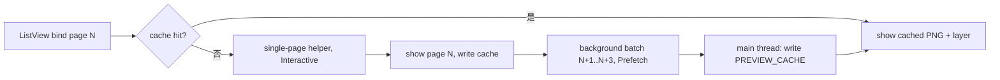

# Word 页预览缓存与后台预取设计

- 日期：2026-11-11
- 状态：待审查
- 关联：`docs/superpowers/specs/2026-11-11-preview-paged-widget-design.md`

## 1. 背景

Word 页预览比 PDF 慢。同机 debug 构建实测单页 helper 调用：

| 渲染尺寸 | Word | PDF |
|---|---|---|
| 100x100 | 0.39 s | 0.04 s |
| 400x533 | 0.47 s | 0.11 s |
| 900x1200 | 0.71 s | 0.40 s |
| 1800x2400 | 1.09 s | 0.77 s |
| 缺失输入（进程启动） | 0.03 s | 0.03 s |

结论：

- PDF 的解析成本接近零，成本主要是光栅化。
- Word 每页有约 0.35 s 固定成本：读取 docx、ZIP/XML 解析、全文
  `wordcraft_layout::layout`、`FontDb::global()` 初始化。
- 光栅化增量两者接近（900 到 1800 均约 0.37 s）。

多页文档实测（13 页 docx，900x1200，debug）：

| 请求 | 耗时 | 摊薄 |
|---|---|---|
| 单页 | 1.90-2.02 s | 1.90 s/页 |
| 批量 4 页 | 5.27-5.47 s | 1.33 s/页 |
| 批量 3 页 | 4.36 s | 1.45 s/页 |

批量把每页成本压低约 25%-30%。布局成本随页数增长，收益低于「固定成本完全摊薄」的
理想值。

额外放大因素：

- `MAX_CONCURRENT_HEAVY_PREVIEWS = 1`，慢页串行排队。
- Word 页走 `parse_sandboxed`，不写 `PREVIEW_CACHE`；`unbind` 后回滚必须整页重算。
  PDF 页走 `render()`，命中缓存后瞬回。

## 2. 目标

- Word 页结果进入现有内存缓存，回滚与重复请求不再渲染。
- 页请求完成后，后台批量渲染后续页并写缓存，连续滚动尽量命中。
- 后台预取不得拖延用户的页请求。
- PDF 行为与性能不变。

## 3. 非目标

- 不做常驻 helper 进程。单个请求页的等待下限仍是「固定成本 + 该页光栅化」约 0.67 s，
  本设计不改变它。
- 不做首图优先、低分辨率占位、`PreviewRequest` 新字段。
- 不改页请求的取消模型与 `LoadHandle` 生命周期。
- 不改 PDF 渲染与文本层路径。
- 不改变缩放行为：现状是缩放时拉伸已有纹理，不按新尺寸重渲染。手工清单按现状描述。

范围取舍的由来：首图优先需要改页请求的 `LoadHandle` 生命周期（收到 `Ready` 即取消），
占位需要给 `PreviewRequest` 增加首屏标记与显式渲染尺寸。两者都会外溢到 PDF 与页列表公共
路径。本设计选择不碰这两块，只拿缓存与预取的收益。

## 4. 方案比较

### 方案甲：页缓存 + 低优先级后台预取批次（选定）

- 页请求命中缓存直接返回；未命中走现有单页 helper，完成后写缓存。
- 页请求返回后，adapter 在后台发起 `page+1..page+3` 的批量渲染，结果写缓存。
- heavy permit 队列改为全局锁并支持优先级：页请求 `Interactive`，预取 `Prefetch`。
- 取舍：需要把 thread-local permit 队列改为全局；收益是不动请求与取消模型。

### 方案乙：预取与页请求共用同一优先级

- 实现更少，但预取先入队时，用户滚到下一页要排在整批之后，反而更慢。否决。

### 方案丙：仅页缓存

- 回滚瞬回，但首次连续滚动每页仍重算。收益约为甲的六成，改动最小。

选定甲。理由：批量摊薄固定成本是主要收益，优先级保证不拖慢交互。

## 5. 模块设计

### 5.1 helper 批量协议

新增操作 `preview-word-pages`：

```
knowcraft --preview-helper preview-word-pages <input> <result.png> <value> <backend>
value = <format>:<start>:<count>:<WxH>
```

- `format` 为 `docx` 或 `doc`；`start` 起始页；`count` 请求页数，helper clamp 到
  `1..=WORD_BATCH_MAX`（新常量，值 4）与文档剩余页数。
- 输出：
  - `result.png`：第一个输出页，文件名沿用 `output_name()`。
  - `result.1.png` … `result.3.png`：后续输出页，按输出序号命名，不是页号。
  - `result.meta`：`<first_page> <pages>`。
  - `result.pages`：JSON 数组
    `[{ "page": i32, "png": "result.png", "text": "result.text" }, ...]`。
- 一次 `read_document`、一次 `layout`，循环渲染各页。
- 每页先后写 PNG 与文本层；文本层失败只省略该页文本层。
- 整批结束后进程退出，不需要首图优先。

`ParseOperation` 增加：

```rust
PreviewWordPages {
    format: DocumentFormat,
    size: PdfRenderSize,
    count: u32,
},
```

同步点：

- `image_limits()` 返回 `size.image_limits()`。
- `output_name()` 返回 `result.png`。
- `reports_failure` 不含该变体。
- `read_text_layer` 不含该变体。

### 5.2 sandbox 读取与校验

```rust
pub(crate) struct PagedOutput {
    pub(crate) page: i32,
    pub(crate) png: Vec<u8>,
    pub(crate) text_layer: Option<crate::services::PageTextLayer>,
}

pub(crate) struct ParseOutput {
    // 现有字段不变
    pub(crate) batch: Vec<PagedOutput>,
}
```

`read_paged_batch(operation, output) -> Result<Vec<PagedOutput>, String>`：

- 读 `result.meta` 得 `first_page/pages`，读 `result.png` 得首图。
- 读 `result.pages`，大小上限 `MAX_OUTPUT_BYTES / 16`。
- 文件名字符串只接受 `result.png` 或 `result.<1..=WORD_BATCH_MAX-1>.png`，以及对应的
  `result.text` / `result.<n>.text`；拒绝绝对路径、`..`、子目录、其它扩展名。
- 每页 PNG 用 `read_private_output`（已拒绝符号链接与非普通文件），再用
  `valid_output` 同一尺寸上限校验；文本层受 `MAX_TEXT_LAYER_BYTES`。
- 页号严格递增且在 `0..pages`；条目数不超过 `WORD_BATCH_MAX`。
- 任一页失败：整批失败，返回错误，不写缓存。

`read_parse_output` 对 `PreviewWordPages`：`data` 填首图（供通用校验与缩略图），
`page/pages` 来自 meta，`batch` 填全部页，`text_layer` 为 `None`。

单页 `PreviewWordPage` 保留并继续用于页请求。

### 5.3 全局 heavy permit 队列

现状 `HEAVY_PREVIEW_QUEUE` 是 `thread_local!`，permit 在后台线程释放会减错队列。
改为：

```rust
enum Prio {
    Interactive,
    Prefetch,
}

static HEAVY_PREVIEW_QUEUE: OnceLock<Mutex<HeavyPreviewQueue>> = OnceLock::new();
```

- 队列结构不要求 `const fn`，用 `OnceLock` 初始化。
- `request_heavy_preview_permit(prio)`：交互请求插到所有 `Prefetch` 之前；同优先级保持 FIFO。
- 已在运行的预取不排队，而是被交互请求取消：`parse_sandboxed` 与 `acquire_heavy_permit`
  在取 permit 前调用 `cancel_prefetches()`，取消所有在途预取的 `Cancellation`，现有
  `wait_for_renderer` 随即 kill helper 并释放 permit。
- `HeavyPreviewPermit::drop` 在任意线程加锁、`running -= 1`、唤醒队首。
- 锁中毒用 `into_inner()` 继续，不 panic。
- 现有调用点（`load.rs` 的 `parse_sandboxed` 与 `render`）传 `Interactive`。
- 测试 `tests/heavy_queue.rs` 改为直接加锁断言；并发上限仍为 1。

不变式：全局同时最多一个 heavy helper；交互请求不会被预取无限饥饿（预取只在无交互请求时启动）。

### 5.4 adapter：缓存与预取

`parse_sandboxed()` 页请求：

1. 计算缓存键 `(path, mtime, page, render_size)`；命中直接返回 `PreviewContent::Paged`。
2. 未命中：单页 `PreviewWordPage` + `Interactive` permit。
3. 结果写 `PREVIEW_CACHE`。
4. 返回后触发预取（见下）。

预取：

- 触发点在 `LocalPreviewProvider::load` 的 `emit` 包装层：收到 `PreviewEvent::Ready` 且
  `content` 为 `Paged`、文件是 Word 页面时，取 `content.page/pages` 与请求的
  `media_size` 发起预取。`PreviewLoad` 本身不改。
- 范围 `start = page + 1`，`count = min(WORD_BATCH_MAX - 1, pages - start)`。
- 在途去重：`prefetch_inflight: RefCell<Vec<(i32, i32)>>` 记录覆盖区间；目标区间已完全
  覆盖时跳过。批次完成后移除。
- 缓存检查：逐页检查，已缓存或已在途的页跳过；全部命中则不发起。
- 交互请求会取消在途预取，见 5.3；被取消的批次不写缓存。
- 后台执行：`spawn_blocking` 调 helper，`Prefetch` permit；结果通过
  `glib::MainContext::spawn_local` 回主线程写缓存（`PREVIEW_CACHE` 是 thread-local）。
- 写入前重新检查文件 mtime；文件已变则丢弃整批。
- 不绑定页 `LoadHandle`，不主动取消；文件切换后由 mtime 检查丢弃。
- 预取不 emit `PreviewEvent`，GUI 无感知。

缓存键：

- `PreviewCacheKey.pdf_page` 改名 `page`，类型仍为 `Option<(i32, PdfRenderSize)>`。
- `render()` 与 `parse_sandboxed()` 共用同一键与同一 `PREVIEW_CACHE`。
- 抽出 `remember_paged(key, content)` 与 `cached_paged(key)`。

页号与总页数：页请求返回的 `page/pages` 用于计算预取范围；`pages == 0` 时不预取。

### 5.5 GUI

无结构改动。`PagedViewer` 与 `PageLoader` 不感知缓存与预取。

### 5.6 数据流



## 6. 关键不变量

1. 全局同时最多一个 heavy helper；`Interactive` 排在任何 `Prefetch` 之前。
2. 批次页号严格递增、在 `0 <= page < pages` 内，条目数 `<= WORD_BATCH_MAX`。
3. 缓存键含渲染尺寸；不同尺寸不互相覆盖。
4. 预取不改变页请求的返回内容与时序。
5. 文件名来自 helper 的 JSON 时按不可信输入处理，只接受固定模式。
6. 预取失败不影响已显示页面与已存在的缓存。
7. PDF 路径不经过新增代码分支。

## 7. 风险与对策

| 风险 | 影响 | 对策 |
|---|---|---|
| 全局 permit 队列改动影响所有预览 | 高 | 并发上限与 FIFO 语义保持不变；补跨线程取放测试 |
| 锁中毒导致预览挂起 | 中 | `into_inner()` 恢复，不 panic |
| 预取抢占交互请求 | 中 | 优先级队列；交互请求取消在途预取并立即取 permit |
| 快速滚动产生重复批次 | 中 | 在途区间去重；缓存命中跳过；交互请求取消在途预取 |
| 文件切换后旧批次写入错误缓存 | 中 | 写前比对 mtime，不一致丢弃 |
| helper 输出文件名被构造为路径穿越 | 高 | 白名单模式校验；`read_private_output` 的 NOFOLLOW 兜底 |
| 缓存 128 MB 被大图占满 | 低 | 键含尺寸；超限 LRU 淘汰，与 PDF 相同 |

## 8. 测试

自动化：

- helper 批量：两页文档 `start=0,count=4` 输出两页，meta 为 `0 2`，页号连续；
  `start=1,count=4` 输出一页。
- helper 批量：`count=0` 与 `count>4` 被 clamp。
- 文件名校验：`../x`、绝对路径、`result/a.png`、`result.png.bak` 整批拒绝。
- 缓存：同一键第二次请求不再 spawn helper（注入计数器渲染器）。
- 缓存键：不同渲染尺寸产生不同键。
- 预取：页请求后发起 `page+1..`；目标页已缓存时跳过；在途区间不重复发起。
- 预取失败：整批丢弃，缓存不变。
- 优先级：预取在途时发起交互请求，交互请求先完成（可控渲染器）。
- 全局队列：两个线程各取一个 permit，第二个等待；释放后唤醒。
- 回归：PDF 单页与多页行为不变。

命令：

- `cargo build`
- `cargo test -p knowcraft preview`
- `cargo test -p knowcraft word_page`

说明：当前 master 的 GUI 测试二进制有 69 个既有编译错误，与本次变更无关。测试树未修复前
只能以 `cargo build` 验证，需在测试树修复后补跑上述用例。

## 9. 手工检查清单

- 真实多页 docx：首次每页仍约 0.7 s（现状，不承诺更快）。
- 停在一页约 1-2 s 后继续滚动：后续页立即显示。
- 向上、向下回滚已看过的页：立即显示。
- 快速连续滚动：不卡死，最终画面与页号一致。
- 缩放：与改动前一致，拉伸已有纹理；缩放后不误用旧尺寸缓存。
- 扫描版 PDF：行为与改动前一致，无文本层时快捷键无效。
- PDF 批注：创建、编辑、删除、外部保存同步均不回归。

## 10. 留给实施者的内容

- 实施顺序：全局 permit 队列与测试 → helper 批量与读取校验 → adapter 缓存与预取。
- `WORD_BATCH_MAX` 放 `sandbox/mod.rs`，值 4；预取使用其中 3 页。
- 预取范围先只做向后；向上滚动依赖已缓存页。
- 若全局 permit 队列的跨线程改造在测试中暴露非预期阻塞，先只做页缓存（方案丙），
  单独报告预取部分未完成。
