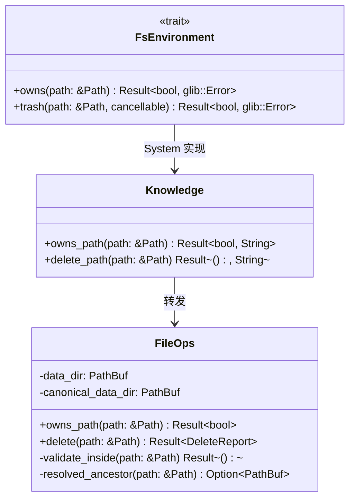
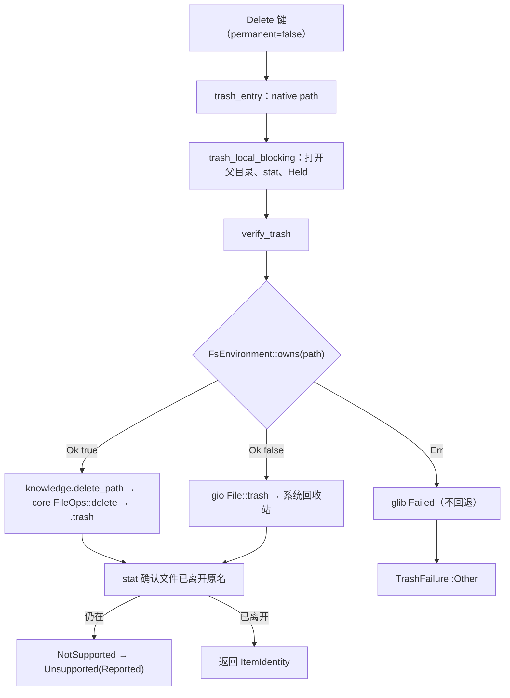

# 库外文件删除走系统回收站 设计

## 背景与目标

`TODO.md` 记录一条未做项：删除位于知识库目录之外的文件时，应走原始流程，放进系统回收站。

现状（读链路得出，未实机复现）：

1. `Delete` 键 → `Browser::delete`（`permanent = false`）→ `LocalFileSystem::delete` →
   `deletion::run::Deleter::delete` → `trash_support::attempt` → `SystemTrash::trash` →
   `trash::trash_entry` → `trash_local_blocking` → `verify_trash` → `fs().trash()` →
   `FsEnvironment::trash for System`（`crates/knowcraft/src/adapters/local_operations/environment.rs:56`）
   → `knowledge.delete_path` → core `FileOps::delete` → `validate_inside`
   （`crates/knowcraft-core/src/fileops.rs:1138`）。
2. `validate_inside` 要求路径规范化后位于 `data_dir` 内，库外路径返回
   `path resolves outside the data directory`。该错误转成 `glib::Error(Failed)`，
   `classify` 归入 `TrashFailure::Other`，而 `deletion/run.rs:387` 只把 `Unsupported`
   记为可重试，因此 UI 只报删除失败，不提供永久删除兜底。
3. `FsEnvironment::can_trash`（`environment.rs:51`）判断的正是「路径是否在 data_dir 内」，
   有三个调用者：`archive/compression.rs:208`、`replacement/plan.rs:164`、
   `replacement/merge.rs:70`。它们要的是「能否用知识库自己的回收站」——替换与合并的撤销
   依赖 `.trash` 内的条目，库外路径必须继续返回 false。
4. strata 上游的系统回收站实现仍在：`trash.rs:49-56` 的 else 分支调用 `file.trash_async()`，
   当前不可达。库外永久删除（Shift+Delete）走 `permanently_delete_maybe_local`，不经 core，本来可用。

目标：

1. GUI 里删除库外文件或目录时，成功移入系统回收站（freedesktop Trash），不再报错。
2. 库外路径进入回收站后，当前目录视图经既有刷新机制移除该条目，删除操作整体成功结束。
3. 库外路径所在的文件系统不支持 Trash 时（FUSE、部分网络挂载），报「此位置不支持回收站」，
   并给出永久删除入口。

## 非目标 / 反目标

- 不实现库外条目的撤销（Ctrl+Z）。库外文件进系统回收站后由文件管理器负责。
- 不让应用内回收站视图显示系统回收站内容。
- 不让 app 之外的环境（CLI、MCP）具备删除库外文件的能力；`kc rm` 对库外路径仍拒绝，
  core 的 `validate_inside` 仍是写操作的安全边界。
- 不改库内删除路径：库内文件仍移入 `data_dir/.trash` 并维护数据库记录。
- 不为库外删除新增配置项或开关。

## 约束

- core 只依赖 `glib`，没有 `gio`，无法在 core 内实现 freedesktop Trash 协议。系统回收站是
  桌面环境能力，归 GUI 适配层。
- core 对外只返回 `Result<_, Error>`，不 panic。
- 判据必须单一事实源：core 的 `validate_inside` 与 GUI 的分派判断不能各写一份。
- 改动保持外科手术式：只动删除分派路径与必要契约，不顺手重排相邻代码。

## 方案

### 方案 A：分派点放在 FsEnvironment::trash 实现

`System::trash` 先问归属，再选后端。库内保持现状调用 `knowledge.delete_path`；库外调用
`gio::File::for_path(path).trash(cancellable)`（gio 0.22.10 的同步 `FileExt::trash`，经核实存在）。
该函数本就在 deletion worker 线程执行，同步调用不阻塞 UI。

复用分析：复用 `FsEnvironment` 这个既有 seam 与 `verify_trash` 全链，把「后端选择」参数化；
新增 `owns` 供分派使用，`can_trash` 退化为它的谓词包装。新增约 11 行。
新增代码量：约 11 行（不含测试）。

### 方案 B：分派点放在 trash::trash_entry

`trash_entry` 在 native path 分支前判断归属，库外直接走上游现成的 `file.trash_async` 分支。

复用分析：复用 `trash_entry` 已有的 else 分支。新增约 6 行。
代价：库外路径跳过 `verify_trash`，失去 GLib #4060「报成功但没动」的检测；归属判据写进
`trash.rs`，与 core 判据形成两处实现。
新增代码量：约 6 行（不含测试）。

### 方案 C：分派点放在 Deleter::delete

`Deletion::Deleter::delete` 按路径归属决定走 `trash_support::attempt` 还是直接 GIO trash。

复用分析：新增一层分派，库外路径复用 GIO trash，但绕开 `trash_local_blocking` 与
`verify_trash`；错误分类需要在新分支重写。新增约 15 行。
新增代码量：约 15 行（不含测试）。

### 选定与理由

选方案 A。

- 判据与后端分派集中在 `FsEnvironment::trash` 一个实现里，`verify_trash` 对库内、库外两条
  路径同时生效。`trash_local_blocking` 存在的唯一理由就是 GLib #4060，B 与 C 让库外路径退回
  上游无验证行为。
- 改动面最小：只改分派函数体，trait 加一个方法、`can_trash` 转默认实现，不触碰
  `deletion/run.rs` 的批次、进度、取消与错误汇总逻辑。
- 方案 B 的优势是少 2 行，但它把归属判据复制到 adapter 层，与 core 形成两处实现，违反
  单一事实源；方案 C 的优势是可对库外路径定制错误语义，但当前不需要定制。

## 设计

### 数据模型

无新增类型，无数据库 schema 变化。`TrashFailure::Unsupported` 与 `UnsupportedReason::Reported`
由「不可达」变为可达；`UnsupportedReason::FuseRefused` 仍无构造点。

### 接口与契约

四点契约：

1. `FileOps::owns_path(&self, path: &Path) -> Result<bool>` 是三态而非布尔：`Ok(true)` 在库内、
   `Ok(false)` 确定在库外、`Err` 判定失败（最深已存在祖先 canonicalize 失败）。压成 bool 会让
   canonicalize 失败被当成「库外」，把 data_dir 内的文件移入系统回收站并留下数据库不一致。
   GUI 侧对 `Err` 直接报失败，不回退。
2. `validate_inside` 与 `owns_path` 共用抽出的 `resolved_ancestor`（找最深已存在祖先并
   canonicalize），归属判定只写一处。`validate_inside` 额外保留三项检查：绝对路径、不含 `..`、
   叶节点非符号链接。这三项回答「能否操作」，不是「归属」，不进 `owns_path`。
3. 新增 `owns(&self, path: &Path) -> Result<bool, glib::Error>` 作为 trait 的必需方法；
   `can_trash` 保留为默认实现 `self.owns(path).unwrap_or(false)`。三处调用者要的是「能否用
   知识库回收站」，而 merge 与替换的撤销链只在 `.trash` 内找条目，所以库外路径必须继续返回
   false。判定失败也取 false：宁可退回无回收站的替换策略，也不用撤销链覆盖不到的路径。
4. `knowledge::owns_path` 在 `knowledge::init()` 返回 `None` 时返回 `Ok(false)`：没有知识库就
   没有归属关系，文件照常进系统回收站，不需要 core 在场。

### 主流程

分派点只有 `verify_trash` 里那一次 `fs().trash()`。验证在分派之后，两条路径共用，因此库外路径
同样受「trash 之后 stat 确认文件已离开原名」的保护。

### 错误与边界

1. `classify`（`trash_support.rs:155`）增加 `Io::NotSupported => TrashFailure::Unsupported(
   UnsupportedReason::Reported)`。兜底链路其余部分现成：`deletion_error_message`
   （`local_operations.rs:461`）已有 `Unsupported` 分支，文案 `%{name}：此位置不支持回收站。`
   在 `data/locales/messages/zh-CN.json:81` 与 `en.json:81` 都存在，不需要改 i18n。
2. `UnsupportedReason::FuseRefused` 仍无构造点（`unsupported_reason_for*` 恒返回 `None`）。
   `Reported` 活起来后，`#[expect(dead_code)]` 不能整块留在 enum 上，改为单独挂在
   `FuseRefused` 变体上。三个恒空桩函数原样不动，记入未决问题。
3. 目标已在系统回收站内（用户浏览 `~/.local/share/Trash/files` 并删除）：GIO 拒绝，归类
   `Other`，报失败。不特殊处理。
4. 取消：`cancellable` 透传给 `gio::File::trash`，`Cancelled` 分类沿用现有逻辑，中断半途的
   条目归入 `cut_off`。
5. 库外删除成功后的 identity 走已有的 `trashed_instead()`（`trash.rs:171`），从
   `~/.local/share/Trash` 与挂载点的 `.Trash-<uid>` 反查 trashinfo 得到；查不到返回 `None`，
   此时不 emit `ItemTrashed`，删除结果不受影响。
6. 目录：GIO 对目录是一次整体 rename，`verify_trash` 的 stat 检查同样成立，不递归、不逐文件。
7. 被 pin 的库外目录删除后从 PINNED 组消失：`record_deleted` → `deleted_pins` 链不区分库内外，
   自动成立，不改。
8. `knowledge::init()` 返回 `None` 而 `data_dir` 实际存在（例如数据库打不开）时，`owns` 返回
   `Ok(false)`，库内文件会被移入系统回收站，数据库留下未标 trashed 的记录。判断为可接受：
   init 失败时 GUI 主界面基本不可用。这是本设计唯一的不一致窗口，不做额外防御。

### 兼容与迁移

- core 只新增 `owns_path`，`validate_inside` 行为不变，现有 core 测试应全绿。无配置项、无数据
  格式变化、无迁移。
- GUI 行为变化两处：库外 `Delete` 从「失败」变为「进系统回收站」；库外所在文件系统不支持
  Trash 时，从「失败且无兜底」变为「提示后可选永久删除」。
- `kc rm` 对库外路径仍然拒绝，行为不变。
- `FsEnvironment` 新增 `owns`，`can_trash` 变成它的默认实现；影响 `System` 与测试 fake
  （`tests/fs_quirks/environment.rs`），后者为编译依赖的被动改动，测试脚手架的 `Op::CanTrash`
  变体随之删除。

## 复用分析

| 方案 | 复用 | 新增 |
|---|---|---|
| A（选定） | `FsEnvironment` seam、`verify_trash`、`trashed_instead`、`deletion_error_message` 的 Unsupported 分支与现成中英文案、gio 0.22.10 同步 `FileExt::trash` | 约 8 行分派 |
| B | `trash_entry` 的 else 分支 | 约 6 行，另丢验证保护 |
| C | GIO trash | 约 15 行，另需重写错误分类 |

core 侧复用 `validate_inside` 的 canonicalize 判定，抽成 `resolved_ancestor` 供两处调用，
不复制逻辑。

## 验证方式

| 项 | 命令或操作 | 通过判据 |
|---|---|---|
| 编译 | `cargo build` | 通过 |
| core 全量 | `cargo test -p knowcraft-core` | 全绿 |
| `owns_path` 单测 | 新增：inbox 内路径、`/tmp` 路径、`data_dir` 自身、`/data/../etc/passwd`、data_dir 走符号链接 | 依次 `Ok(true)`、`Ok(false)`、`Ok(true)`、`Ok(false)`、`Ok(true)` |
| GUI 相关 | `cargo test -p knowcraft` 中 trash、deletion、fs_quirks 相关用例 | 通过 |
| 手动：库外 | GUI 浏览 `/tmp` 删除一个文件 | 文件出现在 `~/.local/share/Trash/files`；应用内不报错，列表刷新后该条目消失 |
| 手动：库内 | GUI 浏览 `~/Knowledge/inbox` 删除一个文件 | 文件出现在 `~/Knowledge/.trash`，数据库记录标 trashed，列表条目消失 |
| 手动：不支持 Trash | 在 FUSE 或明确不支持 trash 的挂载点上删除文件 | 报「此位置不支持回收站」并给出永久删除入口 |

不新增 GUI 集成测试：真 GIO trash 需要操作用户真实 XDG Trash 目录，且 `knowledge::init()` 是
全局单例，注入成本高于收益。

## 未决问题

1. `trashed_instead()`（`trash.rs:171`）在 GIO trash 之后能否命中 trashinfo，只读过实现、未实机
   验证。命中失败的结果是 identity 为 `None`、不 emit `ItemTrashed`，删除本身仍成功。手动验证
   时留意日志。由实现者验证。
2. `unsupported_reason_for`、`unsupported_reason_for_directory`、`forget_all` 三个函数恒返回
   `None` / `()`，`unsupported_reason_for_directory` 仅被 `native.rs:225` 调用且结果恒为 `None`。
   它们是死代码，本次不动，后续是否删除由维护者决定。
