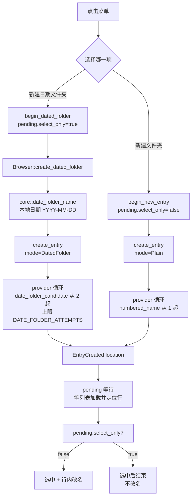

# 日期文件夹新建 设计

## 背景与目标

窗格头部的新建按钮现在是 `pane_new_folder_button`（`crates/knowcraft/src/ui/browser/pane_header.rs:21`）：一个普通 `gtk::Button`，点击后进入行内命名，默认名由 `create_new_folder` 生成。主窗口浏览器与文件选择对话框共用同一函数（分栏 `ui/browser/columns/append/header.rs:127`、图标 `ui/browser_modes/icons_pane.rs:75`、列表 `ui/browser_modes/list_pane.rs:103`）。

目标：

1. 该按钮改为菜单按钮，单击展开菜单，含「新建文件夹」与「新建日期文件夹」两项；主窗口与文件选择对话框行为一致。
2. 「新建文件夹」保持现有行为：进入行内命名，可编辑后确认。
3. 「新建日期文件夹」不进入命名：按当天本地日期直接创建 `YYYY-MM-DD` 目录，并在文件列表中选中它。
4. 同名目录已存在时按 `2026-11-15 (2)`、`2026-11-15 (3)` 递增。普通新建的既有编号从 `(1)` 起（`create_entry.rs:32-45`），日期目录按用户要求从 `(2)` 起；两者共用同一 ` (N)` 格式，仅起点不同。
5. CLI 提供等价入口：`kc mkdir <PARENT> --date`，序列与上限与 GUI 相同。
6. 键盘快捷键保持不变：`new_folder`（`Ctrl+Shift+N`，`ui/keys/bindings/window.rs:16`）直接新建普通文件夹并进入行内命名，不经过菜单。

判定标准：菜单两项均可点击且结果如上；同一目录下连续两次日期新建得到 `2026-11-15` 与 `2026-11-15 (2)`；`kc mkdir X --date` 与 GUI 在同一目录下产生相同的名字序列，且两者在尝试 100 次后都停止。

## 非目标 / 反目标

- 不做日期格式自定义（不读 `date_format` 偏好，不提供 `yyyymmdd`、`MM-DD` 等变体）。
- 不新建「昨天/上周」等其他时间文件夹，菜单不扩展为模板列表。
- 不把「新建文件」并入该菜单。
- 不改普通新建的进入行内命名、`(1)` 起编号、undo 语义。
- 不在 GUI 内建定时任务或后台归档；日期目录只是普通目录。
- 本次不追求 UI 测试通过结果：按用户要求 GUI 测试只写不跑，交付以 `cargo build` 为准。

## 约束

- 业务动作按 AGENTS.md 落 core，GUI 与 CLI 只做薄壳；日期名、编号序列与尝试上限的定义都在 core。
- core 无 UI 依赖，但已依赖 `glib`（`crates/knowcraft-core/Cargo.toml`），本地日期取 `glib::DateTime::now_local()`，不引入 `chrono`。
- ` (N)` 格式串单一来源（core），避免 GUI 与 CLI 各写一份。
- GUI 侧创建走既有 GIO 异步 provider，保持取消、进度、undo 与 `knowledge_sync` 路径不变。
- 新增文案需同步 `crates/knowcraft/data/locales/{en,zh-CN}.json` 与 `messages/{en,zh-CN}.json`，zh-CN 键序与 en 一致。

## 方案

### 方案 A：复用排序菜单的构造方式（选定）

把 `pane_new_folder_button` 改为 `pane_new_folder_menu`，返回 `gtk::MenuButton` + `gtk::Popover`，与 `column_sort_menu`（`pane_header.rs:245`）同一写法：`pane_header_action` 统一按钮样式、`install_menu_keys` 提供 Esc 关闭与 vim 方向移动，菜单行是 `menu_action_with_detail` 生成的普通按钮。

「新建文件夹」行用 `menu_action_with_detail`（`ui/controls.rs:373`），副行显示 `Ctrl+Shift+N`；「新建日期文件夹」行同形，副行显示当天日期。

复用分析：复用 `column_sort_menu` 的 Popover 构造、`pane_header_action`、`install_menu_keys`、`menu_action_with_detail`、`accessibility::set_label`；三处调用点只改函数名。日期目录落盘复用 `Browser::create_entry` + `NewEntry`（`app/browser/file_operations.rs:589`）与 provider 的创建循环；选中复用 `Browser::select_entries_by_name_at`。
新增代码量：约 80 行 GUI + 约 35 行 core + 约 25 行 CLI（其中测试约 45 行）。

### 方案 B：GMenu/GAction + `gtk::PopoverMenu`

用 `gio::Menu` 声明两项，`PopoverMenu` 消费。复用分析：不复用仓库既有的自定义 Popover 菜单代码，理由是既有菜单都在 Popover 内手工搭行（`column_sort_menu`、`appearance_menu.rs` 的 `MenuShell`），无一使用 `GMenu`；引入后键盘导航、无障碍与 CSS 类都要按第二种范式再写一套，`menu-heading` 之类样式不适用。
新增代码量：约 80 行（其中测试 20 行）。

### 方案 C：chooser 与 browser 各自实现

文件选择对话框与主窗口分别实现按钮。复用分析：完全不复用，重复一份约 60 行代码；两处 gating（`interactive || chooser_allows_create`、最近位置隐藏）会漂移。
新增代码量：约 120 行。不推荐。

### 选定与理由

选方案 A。它 KISS：与仓库唯一既有范式一致（DRY 命中 `column_sort_menu`），改动集中在 `pane_header.rs` 一个函数与三处调用点；菜单扩展只需再加行，不引入新概念。方案 B 增加第二种菜单范式（OCP 收益为零，菜单项固定两项）；方案 C 违反「动作先落 core、多壳复用」。

## 设计

### 数据模型

core `crates/knowcraft-core/src/util.rs`：

- `pub fn number_suffix(number: u64) -> String`：返回 `" (2)"` 形式，编号格式唯一来源。GUI `adapters/local_operations/names.rs:130` 的 `numbered_name` 改为 `fix::fit(stem, &number_suffix(number), extension, limit, is_directory)`，字节截断逻辑不变、普通新建的 `(1)` 起点不变。
- `pub fn date_folder_name_for(now: &glib::DateTime) -> Result<String>`：按 `%Y-%m-%d` 格式化。
- `pub fn date_folder_name() -> Result<String>`：取 `glib::DateTime::now_local()` 后调用前者；`now_local` 失败返回 core `Error`。
- `pub fn date_folder_candidate(date: &str, attempt: u64) -> String`：`attempt == 0` 返回 `date`，否则返回 `format!("{date}{}", number_suffix(attempt + 1))`，即第二次冲突为 `… (2)`。
- `pub const DATE_FOLDER_ATTEMPTS: u64 = 100`：两壳共用的尝试上限。

services 层（`crates/knowcraft/src/services/operations.rs`）：

- `pub enum NewEntryMode { Plain, DatedFolder }`（`Default = Plain`）。
- `CreateDirectoryRequest`（`:142`）增加 `mode: NewEntryMode`，现有调用点填 `Plain`。

app / UI 层：

- `NewEntry`（`app/browser/file_operations.rs:589`）增加 `mode: NewEntryMode`，`create_dated_folder` 填 `DatedFolder`。
- 「只选中不改名」的意图保存在 UI 侧：`PendingEntryRename`（`ui/browser/inline_edit/new_entry.rs:14`）增加 `select_only: bool`，在点击菜单时随 pending 一起记录；`OperationEvent` 与 `BrowserEvent` 结构不变。
  理由：等待列表刷新、`(2)` 编号、Columns 下的 reveal 都由既有 `CreatedEntryWatch` 处理，意图留在发起端比穿透两层事件更少代码、也更不容易漏构造点。

### 接口与契约

- `Browser::create_dated_folder(parent: Location)`：取当天日期名，`create_entry(NewEntry::dated(parent, name))`（`mode = DatedFolder`、`unique_name = true`）。
- `Browser::create_new_folder(parent)`：`mode = Plain`，行为不变。
- 「只选中」由 UI 侧 `PendingEntryRename.select_only` 决定，不随事件传递。
- provider 创建循环（`adapters/local_operations/create_entry.rs:32-127`）：`mode == DatedFolder` 时候选名取自 `core::util::date_folder_candidate(&name, suffix)`，`suffix` 从 0 递增到 `DATE_FOLDER_ATTEMPTS - 1`；`Plain` 保持现有 `numbered_name` 序列。成功时发 `OperationEvent::EntryCreated { location, .. }`（结构不变）。
- CLI `kc mkdir <PARENT> --date`：`--date` 与多路径互斥，只接受一个已存在的受管父目录；依次尝试 `date_folder_candidate(date, attempt)`（`attempt` 0..`DATE_FOLDER_ATTEMPTS`），每次调 `FileOps::create(path, true)`；`target already exists` 视为冲突继续下一个候选，其余错误立即失败；成功后输出 `created: path=<path> id=-`，全部候选冲突时按既有失败汇总格式报错。
- UI 选中契约：菜单点击时写入 `PendingEntryRename { select_only: true }`；`BrowserEvent::EntryCreated` 到达后走既有 `rename_created_entry` → `CreatedEntryWatch` tick：等列表加载、定位新建行、选中（Columns 用 `reveal_created_entry`，其余 `select`），随后因为 `select_only` 取走 pending 并结束，**不打开改名输入框**。5 秒内列表没出现或导航代际变化时按既有 `created_entry_expired` 静默放弃。
- `select_only = false` 路径保持现状：选中后进入行内改名。

### 主流程

读图：候选名生成在 provider 按 `mode` 分叉；「选中还是改名」由发起时写入的 `pending.select_only` 决定，事件本身只带位置。

### 错误与边界

- 本地时区不可用：`now_local` 报错，GUI 以 `emit_operation_failed` 呈现 core 错误文本且不建目录；CLI 退出非零。
- 同名候选耗尽（100 次）：GUI 由 provider 循环停止并报失败；CLI 同样停止并汇总失败。上限为 core 常量，非可配置项。
- 目标不可创建：只读挂载、权限不足、最近位置、回收站，沿用 `may_create_in` 与 provider 既有拒绝，菜单项不做额外预检。
- 竞态：点击后用户导航走开时，选中静默放弃（见「接口与契约」）；文件仍会创建，不会回滚。
- 快捷键与菜单并发：都走 `try_begin_operation`，已有操作在跑时后者被拒，行为与现状一致。
- 100 次上限在 CLI 侧是文件系统探测、在 GUI 侧是 GIO 异步探测，两者都可能有极少数竞态下的编号跳号（另一进程同秒创建同名目录），不额外加锁。

### 兼容与迁移

- 无持久化格式变化，无配置迁移。
- 事件结构加字段属于内部 API：`OperationEvent` 与 `BrowserEvent` 仅在本 crate 内消费，构造点集中在 `app/browser/operation_events/outcome.rs` 与 provider。
- `CreateDirectoryRequest` 加字段需一次性更新所有构造点（provider 实现与其测试替身）。
- 磁盘上已有的日期目录不受影响；普通新建行为完全保留（含 `(1)` 起点）。
- CSS 类 `chooser-new-folder` 目前无样式规则（全仓只有 `pane_header.rs:35` 一处设置），迁移到 `MenuButton` 后仍保留该类，避免 QA 目标漂移。

## 复用分析

| 用途 | 复用对象 | 结论 |
|---|---|---|
| 菜单构造 | `column_sort_menu`（`pane_header.rs:245`） | 直接照搬结构，仅行内容不同 |
| 菜单行 | `menu_action_with_detail`（`ui/controls.rs:373`） | 复用，副行承载快捷键/日期 |
| 按钮样式 | `pane_header_action` | 复用，`MenuButton` 已被 `column_sort_menu` 验证可行 |
| 键盘 | `install_menu_keys`（`pane_header.rs:77`） | 复用 |
| 创建链路 | `Browser::create_entry` + `NewEntry` + provider 循环 | 复用，仅加 `mode` 分支 |
| 编号格式 | 新增 `core::util::number_suffix`，GUI `numbered_name` 改为调用它 | 参数化复用，消除两份格式串 |
| 日期候选序列 | 新增 `core::util::date_folder_candidate` + `DATE_FOLDER_ATTEMPTS` | 新增，理由：既有 `numbered_names` 起点固定为 1 且绑定 name-limit 截断，无法参数化成「从 2 起」 |
| 选中 | `rename_created_entry` + `CreatedEntryWatch` + `select_created_entry` | 复用整条「等列表 → 定位行 → 选中」链路，只加 `select_only` 跳过改名 |
| CLI 落盘 | `FileOps::create`（`core/src/fileops.rs:189`） | 复用；候选生成与上限来自 core |

## 验证方式

- core：`cargo test -p knowcraft-core --lib util::tests`，覆盖 `number_suffix`、`date_folder_name_for`（固定 `glib::DateTime::new` 本地时间，验证补零、跨年、午夜边界）、`date_folder_candidate`（0 → 原名、1 → `(2)`、99 → `(100)`）。（已执行，4 项通过）
- CLI：`cargo test -p knowcraft-cli --bin kc`，覆盖 `mkdir --date` 首次创建与第二次得到 `(2)`；多路径拒绝由 `--date takes exactly one parent directory` 手工验证。（已执行，9 项通过）
- GUI：`cargo build` 通过，`cargo build --tests` 通过（只编译）；`adapters/local_operations/tests/create_entry.rs` 新增 `dated_creation_starts_numbering_at_two` 覆盖 provider 的 `(2)` 起点。按用户要求不运行 GUI 测试。
- 手工：`kc mkdir <inbox> --date` 连续两次得到 `<日期>` 与 `<日期> (2)`；菜单两项与选中行为需在 GUI 里手点验证。

## 未决问题

- 菜单项英文文案定为 `New Folder for Today`（中文「新建日期文件夹」），为本设计判断，用户未指定文案。
- 日期目录从 `(2)` 起、普通新建仍从 `(1)` 起：用户已确认接受这一不一致。
- GUI 测试只写不跑的既有基线失败（HEAD 上 4 项偏好测试失败）不在本次范围。
