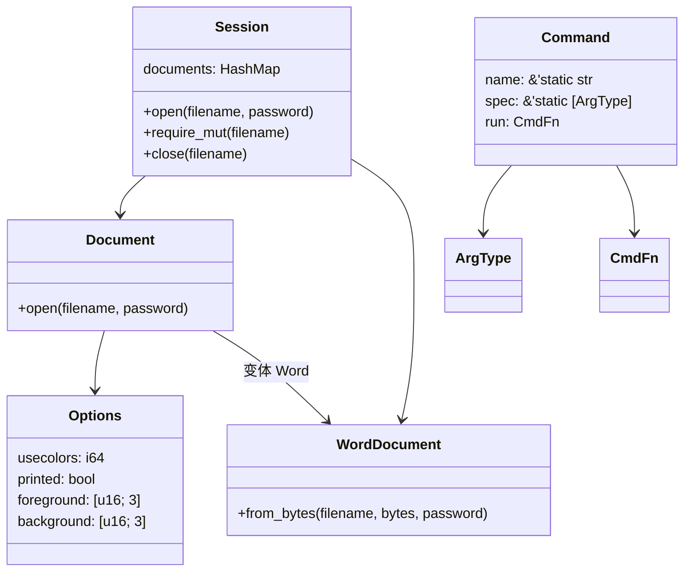
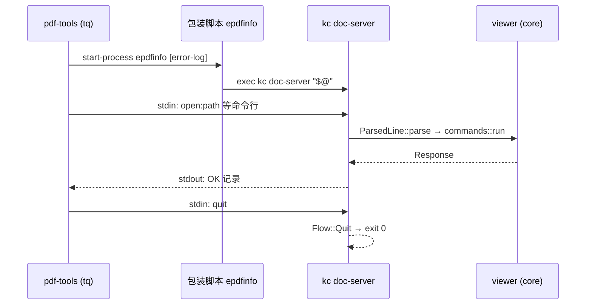

# kc doc-server 设计

## 背景与目标

pdf-tools（Emacs PDF 查看器）的后端 server `epdfinfo` 是独立 Rust 工程（位于
`~/.emacs.d/elpaca/sources/pdf-tools/server`），与 knowcraft 共用同一套 storytold
依赖栈：pdfcraft（render/cos/annot，kc 走 `crates/vendor` 本地 path，epdfinfo 走 git
rev）与 wordcraft（doc/docbin/docx 已 vendored，layout/render 未引）。两处依赖重复，
且 epdfinfo 的代码量约 5600 行，独立维护成本高。

目标：把 epdfinfo 的文档查看服务功能并入 knowcraft workspace，作为 `kc doc-server`
子命令提供，Emacs 的 pdf-tools 通过包装脚本零改动接入。epdfinfo 工程退役。

判定达成：`cargo build`（默认成员）通过；`kc doc-server` 协议冒烟通过（ping /
renderpage / quit）；Emacs 端 `pdf-info-check-epdfinfo` 通过；Emacs 实际打开 PDF 与
docx 渲染正常、注释与 SyncTeX 功能可用。

## 非目标 / 反目标

- 不改 pdf-tools 的 Elisp 端代码（vendor 目录，被 elpaca 管理，改动会被覆盖）。
- 不初始化 data_dir、不碰 SQLite/tantivy/写锁：doc-server 是纯文档服务，与知识库写路径正交。
  CLI 分派时 doc-server 与 Init/Upgrade 同级，在 `Config::load` 与 `Store::open` 之前提前返回。
- 不重写 viewer 逻辑：全部代码从 epdfinfo 拷贝，协议格式逐字节一致；渲染输出以 golden 对照验证为准。
- 不把 protocol/commands 之外的模块暴露给 CLI 或未来调用方之外的任何壳。
- 不做 GUI 复用改造：viewer 落 core 是为未来复用留门，本次不接 GUI。

## 约束

- core 已有 build.rs（版本派生），synctex C 编译并入其中，不新建。
- core 现有依赖已含 pdfcraft-render/annot/cos、wordcraft-doc/docbin/docx；缺
  wordcraft-layout、wordcraft-render、png、pcre2-sys、libc（系统 pcre2 10.49 已装）。
- core 的 build.rs 需追加 `[build-dependencies] cc`：编译 synctex 时
  `SYNCTEX_NO_DEPRECATED` 宏、`cargo:rustc-link-lib=z`、rerun-if-changed 覆盖
  `synctex_parser.c` 与 `synctex_parser_utils.c`。
- 依赖版本一致性是「协议格式逐字节」承诺的前提：实施第 0 步核对 vendor 快照与
  epdfinfo pin rev（pdfcraft c02341f6、wordcraft a34c94e4），有漂移时以 golden
  对照暴露并明确「调 vendor」还是「改拷贝代码」。
- AGENTS.md：「动作先落 core，多壳复用」「core 对外仅 `Result<_, Error>`，不 panic」。
  viewer 作为独立服务域豁免 Error 惯例（错误文本即协议响应），豁免理由见设计-错误与边界。
- 新增 CLI 子命令须按功能分组插入 `Cmd` 枚举对应位置。doc-server 属「外部集成」
  或独立服务组，按分组顺序插入，不追加到末尾。
- Emacs 端 `pdf-info-epdfinfo-program` 是单个可执行文件路径，`start-process` 只追加
  一个可选 error-log 参数——必须用包装脚本把 `kc doc-server` 呈现为单个可执行文件。

## 方案

### 方案 A：代码拷贝进 kc，viewer 落 core，协议循环做 kc doc-server

从 epdfinfo 工程把 `src/`（session/document/options/recolor/region/image/png/tempfile/
word/synctex/pdf/*/commands/*/protocol/*）整体拷入 `knowcraft-core/src/viewer/`，
`server/synctex/` 下的 `*.c`/`*.h` 拷入 `knowcraft-core/src/synctex/`（cc 编译）。
CLI 新增 `kc doc-server` 子命令，照搬 epdfinfo main.rs 主循环。

复用分析：复用 epdfinfo 全部现成实现，零重写；依赖全部走 kc 本地 vendor，不再有 git
依赖。新增代码量：约 5600 行（其中绝大部分为拷贝，新增约 100 行：lib.rs 导出、
CLI 子命令、build.rs 追加）。

### 方案 B：epdfinfo 转库，kc 依赖它

复用分析：复用 epdfinfo 工程原位代码。但 elpaca 目录非 workspace 成员，机器迁移或
重装 elpaca 即断构建；依赖重复未消除。不推荐。

### 方案 C：core 重写实现

复用分析：新增，约 5000+ 行重写。违背用户「相关代码直接拷贝」的指示，工作量翻倍，
且重写引入行为偏差风险。不推荐。

### 选定与理由

选定方案 A。理由：消除依赖重复（kc vendor 全本地）、代码零重写（协议行为逐字节继承）、
符合「动作先落 core」的架构约定。方案 B 的 elpaca 目录依赖脆弱性不可接受；方案 C 的
重写风险与成本无收益。

## 设计

### 数据模型



读图说明：`Session` 是按文件名缓存已开文档的表；`Document` 是枚举（PDF 的
`PdfDocument` 与 Word 的 `WordDocument` 两个变体），`WordDocument` 由 wordcraft
布局/渲染支撑。`Command` 表是命令分派的核心，`spec` 决定参数解析，`run` 执行并写
`Response`。全部类型从 epdfinfo 原样拷贝，不新增类型层次。

### 接口与契约

core 的 lib.rs 公开给 CLI 的符号：

- `viewer::Session`（`new`/`open`/`require_mut`/`close`/`clear`）
- `viewer::commands::run(&mut Session, name: &str, raw: &[String]) -> Result<(Response, Flow), String>`
- `viewer::protocol::ParsedLine`（`parse(&str) -> Option<Self>`）
- `viewer::commands::Flow`（Continue/Quit）
- `viewer::protocol::encode::Response`（`new`/`err`/`buf`）——主循环错误分支
  `response.err(&message)` 需要它，原样导出，不做窄接口包装（保持照搬）。

CLI 子命令契约：

```
kc doc-server [ERROR-LOGFILE]
```

- 无参数时 stderr 重定向到 `/dev/null`（与 epdfinfo 默认一致）；排障需带
  ERROR-LOGFILE 参数。
- 有参数时 stderr 以 O_APPEND 追写该文件（`redirect_stderr` 照搬）。
- 从 stdin 逐行读协议命令，响应写 stdout 后 flush；`quit` 命令或 stdin EOF 后
  退出码 0，读错误退出码 2。
- 不初始化 store，不碰 data_dir，不获取写锁；分派与 Init/Upgrade 同级提前返回。

协议格式契约（逐字节继承 epdfinfo）：行解析 `split`、参数解析 `parse_arg`（Doc 类型
隐式 open）、响应编码 `Response`（OK/ERR/转义规则：换行 `\n`、反斜杠、冒号转义）。
Emacs 的 tq 队列与 `pdf-info` 按此解析，任何偏差都会破坏 pdf-tools，故禁止改写。

### 主流程



读图说明：Emacs 只与包装脚本交互，脚本 exec 进 kc 进程，此后协议完全走 kc 的
stdin/stdout。主循环逐行处理，单命令出错返回 ERR 记录但不退出进程（协议语义）。

### 错误与边界

- 命令错误：返回 `Err(String)`，主循环写 `ERR\n<msg>\n.\n` 后继续读下一行（照搬）。
- 打开文档失败：`Session::open` 把「密码保护」错误归一为 `Document is encrypted`（照搬）。
- 未开文档引用：`require_mut` 返回 `Document not open: <name>`（照搬）。
- 行异常（空行/缺换行）：跳过并记 stderr（照搬）。
- stdin EOF：退出码 0；读错误：退出码 2（照搬 main.rs 行为）。
- 超长输入、并发：不处理。理由：协议来自 Emacs 单客户端，tq 串行；与 epdfinfo
  行为一致，保持逐字节兼容。
- viewer 内部用 `Result<_, String>` 而非 core 的 `Error`：协议错误文本即响应内容，
  包一层 Error 无增益；此为独立服务域豁免，写入本 spec 约束节。

### 兼容与迁移

- 协议：逐字节兼容，Emacs 端零改动。
- `tempfile` 前缀从 `epdfinfo` 改为 `kc`：临时文件仅服务器自身使用；实现前 grep
  pdf-tools Elisp 确认无按前缀匹配的逻辑。临时 PNG 的清理责任在 Elisp 侧（沿用
  epdfinfo 语义，服务器不回收）。
- 依赖：与 epdfinfo 共用同一 vendor 栈（pdfcraft/wordcraft），消除重复依赖与
  独立工程维护；上游 craft-libs 等 git 依赖保留（已存在于 kc Cargo.lock），
  不再承诺「零 git 依赖」。
- 退役顺序：先固化 golden 基线（epdfinfo 退役前最后一次构建并保存命令序列输出）
  → 再切换包装脚本 → 最后退役 epdfinfo 工程（不删除、不再构建、不再使用）。
- 包装脚本落位：`~/.local/bin/epdfinfo`，脚本内 `kc` 靠 PATH 解析（用户决定）；
  Emacs 环境 PATH 需含 kc 所在目录，从 Emacs 实际环境验证。
- viewer 依赖（pcre2-sys/png/wordcraft-layout/render）为 core 硬依赖，不做 feature
  gate（用户决定）；代价是 GUI 与全部 core 消费方链接系统 pcre2。

## 复用分析

见「方案」各条。选定方案 A 的复用来源：epdfinfo 全部 Rust/C 源码（git 历史保留在
elpaca 源目录，不复制提交历史，文件头部保留出处注释）。

## 验证方式

0. 依赖核对：对比 vendor 快照与 epdfinfo pin rev（pdfcraft c02341f6、wordcraft
   a34c94e4）的差异，结论写入实施记录；有漂移先定「调 vendor」还是「改拷贝」。
1. `cargo build`（workspace 默认成员）通过。
2. 协议冒烟：管道命令序列进 `kc doc-server`，预期输出逐一比对（路径类输出先
   规范化再比较）：
   `ping:xxx` → OK；`open:<empty.pdf>`（用 pdf-info 的 empty-page-data）→ OK；
   `number-of-pages:<path>` → 页码；`renderpage:<path>:1:100` → 临时 PNG 生成；
   `getannots:<path>:1:0`、`search-string:<path>:1:0:keyword:0`、
   `synctex-forward-search:<path>:<tex>:1:1` 各一条；`quit` → 退出码 0。
3. golden 对照：epdfinfo 退役前最后一次构建，跑同一命令序列固化 golden 输出，
   与 `kc doc-server` 输出 diff（路径类字段规范化）；先固化基线、再切包装脚本、
   最后退役工程。
4. Emacs：`(pdf-info-check-epdfinfo t)` 返回正常；打开一个 PDF 与一个 docx，
   翻页、选择文本、注释面板、TeX SyncTeX 各点一次（人工兜底）。
5. 写锁隔离：GUI 运行态下启动 `kc doc-server` 正常响应（不等待写锁、不初始化
   store）。

## 未决问题

无。包装脚本落位与 kc 路径、feature gate 取舍均已定（见兼容与迁移、约束节）。
