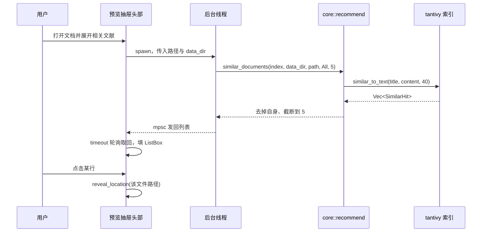

# 相关文献推荐 设计

日期：2026-11-22
状态：待确认

## 背景与目标

`Index::similar_to_text`（tantivy `MoreLikeThisQuery`，`crates/knowcraft-core/src/index.rs:310`）
目前只有归档分类一个消费者：`crates/knowcraft/src/knowledge.rs:550` 用它算 top-3 分类推荐。
阅读时的「相关文献」没有入口。语义相似推荐已有设计
（`docs/superpowers/specs/2026-11-05-semantic-similarity-design.md`），但依赖云端 embedding，
文档内容要出网，成本与隐私门槛高，尚未实现。

本设计只做纯 BM25 版本，复用现有索引，不新增依赖，不出网。

目标：

1. 给定一个路径，返回 Top-K 相关文档，排除自身，默认 K=5。
2. GUI 预览抽屉头部提供入口，列出结果，点击定位到该文档。
3. CLI 提供 `kc similar <path> [--limit N] [--json|--jsonl]`。
4. 归档分类推荐与相关文献共用同一份 core 实现，不复制逻辑。

## 非目标 / 反目标

非目标：

- 不做语义或向量检索，那是 2026-11-05 spec 的后续阶段。
- 不做引用图谱、作者关联等强关系。
- 不做 chunk 级切分，保持文档级相关度。
- 不新增索引结构或数据库字段。

反目标：

- 为相关文献引入外部服务或新依赖，视为失败。
- 在 GUI 或 CLI 里复制 core 逻辑，视为失败。

## 约束

- 业务逻辑在 `knowcraft-core`，GUI 与 CLI 只做薄壳。
- core 对外只返回 `Result<_, Error>`，不 panic。
- 复用现有 tantivy 索引，不重建、不迁移。
- 本功能只读索引，不获取写锁，唯一写者模型不变。
- i18n 键同步 zh-CN 与 en（`data/locales/` 下两个文件与 `messages/` 子目录）。
- CLI 子命令按分组插入 `Cmd` 枚举，`similar` 属于检索与浏览组，排在 `Search` 之后。
- 文档与提交信息用中文。

## 方案

### 方案 A：core 新增 `recommend` 模块

核心动作放 `crates/knowcraft-core/src/recommend.rs`，对外一个函数，输入路径与范围，
输出 `Vec<SimilarHit>`。GUI 与 CLI 各调一次，归档分类改为调它。

复用分析：复用 `Index::similar_to_text`（`index.rs:310`）、`SimilarHit`（`index.rs:47`）、
`extract::extract_title` 与 `extract::extract_text`；新增文件约 60 行，其中测试约 30 行。

### 方案 B：各壳直接调 `Index::similar_to_text`

GUI 与 CLI 各自做文本提取、自身排除、范围过滤。

复用分析：复用 `Index::similar_to_text`，但提取与过滤逻辑要写两遍，归档分类是第三遍。
新增代码量约 40 行，分布三处，与 DRY 冲突，也与「动作先落 core」的约定冲突。

### 方案 C：按 2026-11-05 spec 做语义版

云端 embedding + usearch + RRF 混合召回。

复用分析：复用该 spec 的全部设计，但引入 usearch 依赖与云端调用；新增代码约 400 行以上，
且需要你先接受文档内容出网。

### 选定与理由

选方案 A。B 会把同一段过滤逻辑复制到三处，C 的成本与隐私前提都不满足当前需求。
用户已明确选纯 BM25 版本、GUI 与 CLI 都要，core 一个接口供两者复用。

## 设计

### 数据模型

复用 `SimilarHit { path: String, title: String, score: f32 }`（`index.rs:47`），不新增类型。
新增一个范围枚举，用来区分两个调用方的候选集：

```rust
pub enum Scope {
    /// 全部已索引文档
    All,
    /// 仅 data_dir/library 下的文档，归档分类用
    Library,
}
```

### 接口与契约

core：

```rust
// crates/knowcraft-core/src/recommend.rs
pub fn similar_documents(
    index: &Index,
    data_dir: &Path,
    path: &Path,
    scope: Scope,
    limit: usize,
) -> Result<Vec<SimilarHit>>
```

行为顺序：

1. 标题用 `extract_title(path)`，取不到时回落文件名；正文用 `extract_text(path)`，
   取不到用空串（沿用 `knowledge.rs` 原有口径）。
2. 标题与正文都为空，直接返回空列表（沿用 `index.rs:316` 的早退）。
3. 调 `Index::similar_to_text(&title, &content, limit * 8)`，候选放大后再过滤，保证结果条数。
4. 丢弃 `hit.path == path.to_string_lossy()` 的自身命中。
5. `Scope::Library` 时丢弃 `strip_prefix(data_dir/library)` 失败的命中。
6. 截断到 `limit`。

CLI：

```text
kc similar <path> [--limit N] [--json|--jsonl]
```

`--limit` 缺省 5，取值 1 到 `MAX_LIMIT`，越界报错退出。JSON 对象字段与顺序：
`path`、`title`、`score`；文本模式每行输出 `路径: 标题`。

GUI：

预览抽屉底部新增常驻区块（`similar_section()`）：小标题“相关文献”加可滚动的行列表，最多
8 行、超出滚动。区块只对数据根目录内的文件显示；库外文件、以及拿不到本地路径的条目整体隐藏
（`refresh_similar` 先用 `knowledge::data_dir_path()` 判断前缀）。选中变化后防抖 500ms 再查，查询在后台线程，回主线程填列表，范式照
`crates/knowcraft/src/ui/preview/ai.rs:23-58`（`std::thread::spawn` + `mpsc` +
`glib::timeout_add_local` 轮询 + `Rc::downgrade`）。

每行单行显示标题（标题为空回落文件名），完整路径进 tooltip。单击只选中行，不打开预览；
双击在浏览器中定位该文件，预览随之打开；右键弹菜单四项：预览、在新标签页中打开、打开、
打开方式…，复用浏览器右键菜单的三件套 `context_menu_option` / `context_menu_popover` /
`show_context_popover`（`ui/browser/context_menu/`），图标沿用既有菜单选择（EYE、PLUS、
EXTERNAL_LINK、APP_WINDOW）。动作同样复用：`win.open-tab-at`（`ui/window/composition/tabs.rs:581`）、
`ui/browser/desktop.rs` 的 `open_location` 与 `show_open_with_fallback`。

### 主流程



读图说明：计算全程在后台线程，主线程只做轮询与填表；点击不触发索引查询，只走现有定位机制。

### 错误与边界

| 情况 | 处理 |
| --- | --- |
| 路径不存在或不可读 | 提取返回空串，进早退分支，返回空列表 |
| 文档未被索引 | 仍可查询，它作为查询文本来源，不进结果 |
| 索引为空 | 返回空列表，不报错 |
| 路径形态不一致 | 自身排除按字符串比较，与 `knowledge.rs:559` 现状相同；非 canonical 路径可能漏排除，已知局限 |
| 文件在数据根目录之外 | GUI 不显示相关文献区块，也不发起查询；CLI `similar` 仍接受任意路径作为查询输入 |
| 结果不足 limit | 原样返回，不补齐 |
| `limit` 为 0 | 返回空列表 |
| 并发 | 只读；每次查询新建 reader，与现有搜索路径一致 |

GUI 侧：查询失败不弹错，列表留空并 `tracing::warn`，与 `knowledge.rs:552-556` 的现有做法一致。
CLI 侧：失败走 `anyhow` 退出码，与其他子命令一致。

### 兼容与迁移

- `Index::similar_to_text` 签名不变。
- `suggest_categories`（`knowledge.rs:537`）改为调 `recommend::similar_documents`，
  传 `Scope::Library`，对外行为不变：仍是 top-3、排除自身、只取 library 内候选。
- 无数据库与索引格式变化，无需迁移，无需重建索引。
- 旧版本读新数据目录不受影响。

## 复用分析

| 复用对象 | 位置 | 用途 |
| --- | --- | --- |
| `Index::similar_to_text` | `crates/knowcraft-core/src/index.rs:310` | 检索本体，不改 |
| `SimilarHit` | `crates/knowcraft-core/src/index.rs:47` | 结果类型，不改 |
| `extract::extract_title` / `extract_text` | `crates/knowcraft-core/src/extract.rs` | 查询文本来源 |
| AI 面板范式 | `crates/knowcraft/src/ui/preview/drawer/header.rs:134` | 头部入口结构 |
| 后台计算范式 | `crates/knowcraft/src/ui/preview/ai.rs:23-58` | 线程与主线程回传 |
| `Browser::reveal_location` | `crates/knowcraft/src/ui/browser.rs:453` | 点击定位 |

新增代码量估计：core 约 60 行（含测试约 30 行），CLI 约 50 行，GUI 约 150 行，
i18n 键 2 到 3 条，各语言同步。

## 验证方式

- `cargo build`（workspace 全量编译通过）。
- `cargo test -p knowcraft-core`，全量通过；新增 `crates/knowcraft-core/tests/recommend.rs`：
  自身被排除、`Scope::Library` 只返回 library 内候选、超量结果被截断到 limit、空索引返回空列表。
- CLI 手测：`cargo build -p knowcraft-cli` 后 `kc similar <已索引文档路径> --json`，
  观察字段为 `path`、`title`、`score`，且结果不含该路径自身。
- GUI：手动打开一篇库内文档，展开入口看列表与点击定位。GUI 测试不跑全量，
  只跑受影响的 `ui::preview::drawer::header` 相关用例。

## 已定判断

以下四项在 spec 评审时由我提出、你确认，实现按此执行：

1. 面板显示 5 条，只显示标题与相对路径，不显示分数。
2. 面板候选用 `Scope::All`（含 inbox 与 notes），归档分类用 `Scope::Library`。
3. 点击条目调 `reveal_location` 在浏览器中定位并选中，不替换预览内容。
4. 子命令名为 `similar`，与 core 侧函数名一致。

## 实现记录

- core：`crates/knowcraft-core/src/recommend.rs`（新增），`lib.rs` 注册模块。
- core 测试：`crates/knowcraft-core/tests/recommend.rs`，4 个用例（自身排除、范围过滤、
  截断、空索引与不可读路径）。测试目录避开 `TMPDIR`：索引跳过隐藏路径，而本机
  `TMPDIR` 指向 `.hermes` 下。
- GUI：`ui/preview/similar.rs`（新增：底部区块 + 后台查询 + 双击/右键交互）、
  `ui/preview.rs`、`ui/preview/drawer.rs`、`ui/preview/lifecycle.rs`、`knowledge.rs`。
- 为复用打开相关代码，`ui/browser.rs` 的 desktop 再导出追加 `open_location` 与
  `show_open_with_fallback`，后者由私有改为 `pub(in crate::ui)`。
- i18n 复用既有键：`Related documents`、`No related documents`（本次新增）、
  `Preview`、`Open`、`Open in New Tab`、`Open With…`（既有）。
- CLI：`crates/knowcraft-cli/src/main.rs`，`Similar` 变体插在 `Search` 之后。
