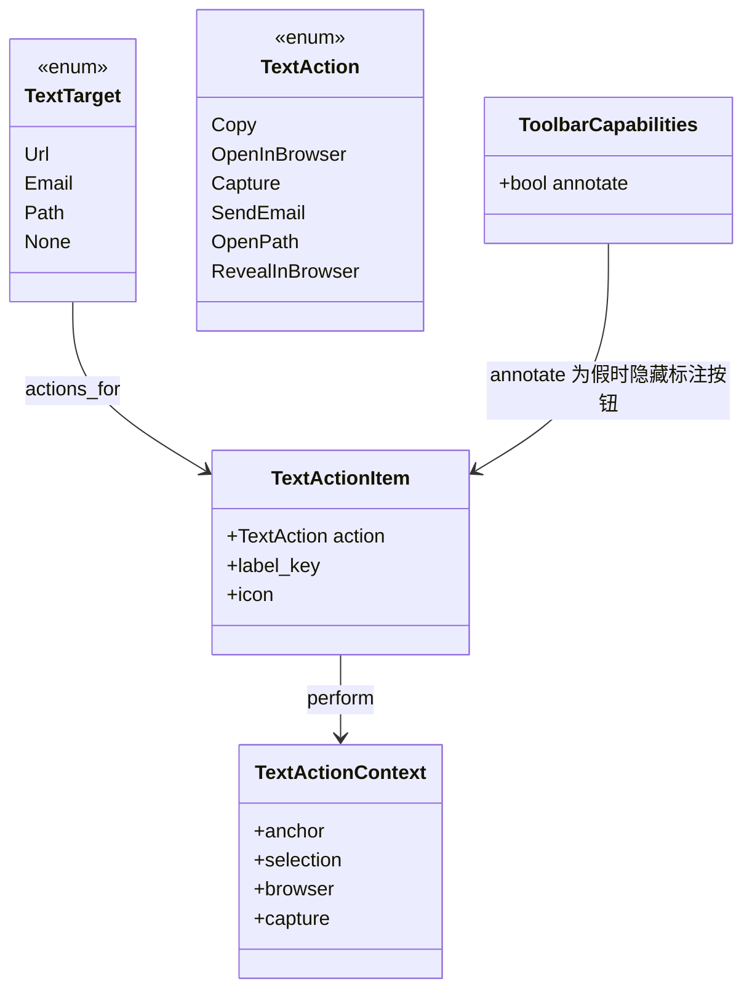
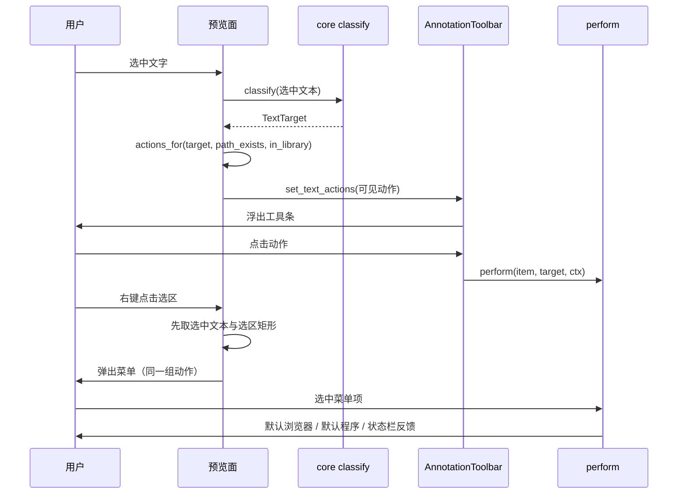
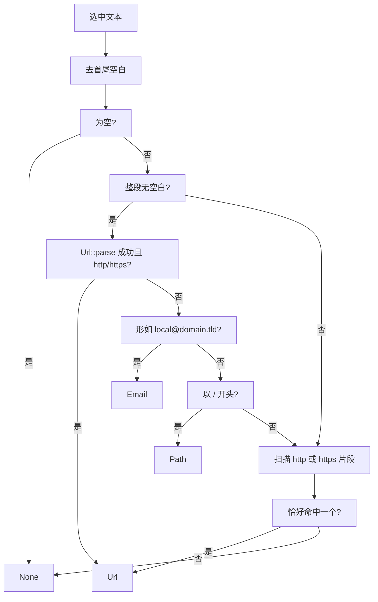

# 预览面板选中文字动作 设计

日期：2026-11-23
状态：待确认

## 背景与目标

预览的文档、PDF、源码三个面共用同一个选中工具条 `AnnotationToolbar`
（`crates/knowcraft/src/ui/annotation.rs:62`），选中后浮出 Highlight / Underline /
Strikeout / Note / Copy 五个动作。工具条只在文档已登记进库时出现：`document_id` 为空时
`settle` 直接收起（`ui/virtual_preview.rs:503`、`ui/preview/source_view.rs:323`）。

预览里的 markdown 链接可直接打开：文档片段渲染成 `DocumentSpanStyle::Link(uri)` 后，单击走
`open_web_link` → `gio::AppInfo::launch_default_for_uri`
（`ui/virtual_preview/pointer.rs:135,312`）。这条路径只对渲染期识别出的链接生效，任意选中文本
里的 URL 没有入口。

抓取网页已有完整链路：Capture URL 对话框 → `Knowledge::capture_url`
（`crates/knowcraft/src/knowledge.rs:519`）→ core `capture::Capture::fetch`
（`crates/knowcraft-core/src/capture.rs:34`）。

本设计给选中文字加一层类型识别，把已有动作挂到识别结果上。

目标：

1. 选中 http/https URL 时，工具条出现「在浏览器中打开」，点击后在默认浏览器打开。
2. 选中 URL 时出现「抓取」，点击后该 URL 进 captures，走现有抓取链路。
3. 选中邮箱时出现「发送邮件」，交给系统默认邮件程序处理。
4. 选中本地路径时出现「用默认程序打开」；路径位于知识库数据根目录内时另有「在浏览器中定位」。
5. 选中文字右键出现同一组动作（含复制），顺序与工具条一致。
6. 无识别结果时保持现状：已登记文档照旧弹标注工具条，库外与未登记文件既不弹工具条、
   也不弹右键菜单。

## 非目标 / 反目标

非目标：

- 不做 embark 式键盘候选面板。
- 不识别 DOI、arXiv 编号、标签、代码标识符。
- 不给非 URL 的选中文本做抓取。
- 不新增图标资产，全部复用 `crates/knowcraft/src/assets.rs` 的现有常量。
- 不改三个面已有的标注行为与快捷键。

反目标：

- 在 GUI 里重写类型识别或抓取逻辑，而非复用 core 与现有链路，视为失败。
- 识别规则放宽到会误判普通句子，视为失败。

## 约束

- 识别是纯逻辑，落 `knowcraft-core`，GUI 只做动作接线（AGENTS.md「动作先落 core」）。
- core 对外只返回 `Result<_, Error>`，不 panic。
- 抓取写入经 core 与写锁，预览层不直接访问数据库。
- i18n 键同步 `data/locales/` 与 `data/locales/messages/` 下的 zh-CN 与 en，共四份，键序一致。
- 不跑全量测试；`cargo build` 必须通过，收尾 `cargo clippy --workspace --all-targets` 零告警。

## 方案

### 方案 A：core 识别加单一动作表，工具条与右键菜单都从表渲染

core 新增 `text_action` 模块，只做类型判定。GUI 新增一张动作表，工具条与右键菜单都按同一张表
生成按钮与菜单项，执行路径各自复用既有函数。

复用分析：复用 `open_web_link`、`browser::open_location`、`BrowserView::reveal_location`、
`Knowledge::capture_url`、`browser::context_menu` 的菜单构造，以及 `annotation::AnnotationToolbar`
的浮层。core 新增约 80 行（含测试），GUI 新增约 250 行。

### 方案 B：只做工具条

工具条加按钮，不做右键菜单。省掉菜单模块与三个面的次要键控制器，新增量约为 A 的六成。

复用分析：同 A，去掉 `text_menu` 与三处次要键控制器。与需求不符：本次要求工具条与右键菜单
两条都要。

### 方案 C：embark 式键盘候选面板

选中后按键弹出可筛选的动作列表，键盘选择执行。交互最接近 embark，但要新建浮层、键盘导航与
筛选输入，并与现有工具条风格分叉。

复用分析：可复用 core 识别与动作表，浮层与键盘导航需新增约 400 行。本期不做。

### 选定与理由

选 A。三个面已经共用同一个工具条，动作表数据驱动时，加类型或加动作都是单点改动；右键菜单复用
`browser/context_menu` 的既有 helper，不新造样式。

## 设计

### 数据模型

core `crates/knowcraft-core/src/text_action.rs`：

```rust
pub enum TextTarget {
    Url(String),
    Email(String),
    Path(PathBuf),
    None,
}

pub fn classify(text: &str) -> TextTarget;
```

GUI `crates/knowcraft/src/ui/preview/text_actions.rs`：

```rust
pub(super) enum TextAction { Copy, OpenInBrowser, Capture, SendEmail, OpenPath, RevealInBrowser }

pub(super) struct TextActionItem { action: TextAction, label_key: &'static str, icon: &'static str }

pub(super) fn actions_for(
    target: &TextTarget,
    path_exists: bool,
    in_library: bool,
) -> Vec<TextActionItem>;
```



### 接口与契约

core：`classify` 无副作用、无 IO，输入任意 UTF-8 字符串，输出四种目标之一。它没有失败路径，
直接返回 `TextTarget` 而非 `Result`；「core 对外只返回 `Result<_, Error>`」这条约束针对可能失败的
接口，此处不适用。

`actions_for` 是纯函数，返回顺序即显示顺序：

| 识别结果 | 动作顺序 |
| --- | --- |
| Url | 在浏览器中打开、抓取、复制 |
| Email | 发送邮件、复制 |
| Path 且存在 | 用默认程序打开、在浏览器中定位（仅库内）、复制 |
| Path 且不存在 | 复制 |
| None | 复制 |

工具条 `AnnotationToolbar` 接口（`ui/annotation.rs`）：

```rust
pub(super) struct ToolbarCapabilities { pub annotate: bool }

pub(super) fn new(
    capabilities: ToolbarCapabilities,
    on_action: Rc<dyn Fn(AnnotationToolbarAction)>,
    on_copy: Rc<dyn Fn()>,
    on_text_action: Rc<dyn Fn(TextAction)>,
) -> Self;

pub(super) fn set_text_actions(&self, visible: &[TextAction]);
```

`SendEmail` 拼 `mailto:` 后交给 `open_web_link`，与 URL 走同一条 `launch_default_for_uri`；
`Email` 本身只存裸地址。

`actions_for` 留在 GUI 层：它是呈现策略，决定给用户看哪些动作，CLI 与后续 MCP 不走这条交互路径，
所以不落 core。这条是刻意取舍，不是漏做。

智能动作按钮按固定顺序预建五个：用浏览器打开、抓取、发送邮件、用默认程序打开、在浏览器中定位。
顺序与 `actions_for` 的返回顺序一致，`set_text_actions` 只控制显隐，不重建 popover。
`annotate: false` 时隐藏四个标注按钮，保留复制与智能动作。

执行上下文：

```rust
pub(super) struct TextActionContext {
    pub anchor: gtk::Widget,
    pub selection: String,
    /// 路径动作的执行句柄。`open_location` 要 `&Rc<Browser>`
    /// （`ui/browser/desktop.rs:25`），从 `BrowserView::browser()` 取；
    /// `reveal_location` 直接在 `BrowserView` 上（`ui/browser.rs:453`）。
    pub browser: Option<BrowserView>,
    pub capture: Option<Rc<dyn Fn(String)>>,
}

pub(super) fn perform(item: &TextActionItem, target: &TextTarget, ctx: &TextActionContext);
```

`capture` 为空时不显示抓取按钮，`browser` 为空时不显示路径类动作。`path_exists` 与 `in_library`
不进上下文：它们只参与动作表裁剪，由调用面在构造动作表前算好，前者用 `Path::exists()`。

`PathBuf` 到 `Location` 的转换点用 `Location::local(path)`（`crate::model::Location`，同款用法见
`ui/preview/similar.rs:409`）；两个路径动作的调用式分别是
`browser::open_location(&Location::local(path), anchor, &browser)`（`ui/browser/desktop.rs:25`）与
`browser_view.reveal_location(Location::local(path))`（`ui/browser.rs:453`）。

库内判定落 core：`knowcraft-core` 的 `text_action::is_inside(data_dir, path)` 做前缀匹配，不做 IO、
不做规范化；GUI 传 `knowledge::data_dir_path()` 的结果，不在壳层重写这段判断。core 里既有的
`FileOps::validate_inside` 是 `fileops.rs` 的私有方法（`:1163`），外部拿不到。
`is_inside` 只看前缀：含 `..` 的路径与符号链接不展开，可能被判成库内。这个判断只决定动作显示与否，
不承担安全职责，不额外做规范化。

抓取回调由窗口组装层注入：`knowledge_dispatch::run_capture`
（`ui/window/knowledge_dispatch.rs:572`）提为 `pub(crate)`，`knowledge_actions::install`（已持有
window、browser、footer）把它包成 `Rc<dyn Fn(String)>` 写入预览抽屉。`refresh` 用浏览器刷新、
`feedback` 用状态栏，与 Capture URL 对话框的既有做法一致
（`ui/window/knowledge_dispatch.rs:542-554`）；抓完不跳转、不额外刷新预览。

右键菜单 `crates/knowcraft/src/ui/preview/text_menu.rs`：

```rust
pub(super) struct TextMenuEnv { pub path_exists: bool, pub in_library: bool }

pub(super) fn popup_text_menu(
    anchor: &impl IsA<gtk::Widget>,
    rect: (f64, f64, f64, f64),
    target: &TextTarget,
    env: TextMenuEnv,
    on_action: Rc<dyn Fn(TextAction)>,
);
```

菜单项取 `actions_for` 的全量，结构照 `preview/similar.rs:294 popup_similar_menu`：`menu_box()`
加 `folder-context-menu` class、共享 popover 槽让每项点完自收、`context_menu_popover` 与
`show_context_popover` 负责样式与键盘导航。

### 主流程



### 错误与边界

识别规则：

1. 去首尾空白后为空 → `None`。
2. 整段无空白，剥去尾部标点后 `Url::parse` 成功、scheme 为 http 或 https → `Url`，
   返回剥离后的字符串，不做其它规范化。
3. 整段无空白，形如 `local@domain.tld`（单个 `@`，域名含点）→ `Email`，只存裸地址。
   判定前先剥掉 `mailto:` 前缀，尾部标点剥离集合与第 2、5 条相同：`a@b.com)` 存成 `a@b.com`。
4. 整段无空白，以 `/` 开头 → `Path`（绝对路径）。`~/` 需要 HOME 展开、`./` 与 `../` 需要基准目录，
   两者 core 都拿不到（`classify` 无 IO），且相对路径按进程 CWD 解析会打开错文件，本期一律不认。
   `api/v1/users` 这类相对片段同样不认。
5. 以上都不中时从 `http://` 或 `https://` 起点向右取字符，遇到首个不属于 URL 的字符即停
   （URL 字符集取 RFC 3986 的 unreserved 与 reserved，再加 `%`），然后剥去尾部标点再校验；
   恰好命中一个 → `Url`，否则 `None`。尾部标点集合含 ASCII 的 `.,;:!?)]}'"` 与中文的
   `。，、；：！？）】》""`。
   先截断再剥标点是有必要的：只剥尾部标点覆盖不了 `见https://example.com。我们`，这种句子里
   URL 后面还有全角文字，`Url::parse` 会因全角字符失败，整条降级成 `None`。



其余边界：

- 路径不校验存在性。`path_exists` 为假时动作表去掉「用默认程序打开」。
- 无选区时右键不弹菜单，不引入「光标下词」语义。
- 右键控制器用 `PropagationPhase::Capture` 加 `set_button(BUTTON_SECONDARY)`，在 pressed 时先取
  选中文本与选区矩形；否则 GTK 处理右键时会先清掉选区，取不到文本。`DocumentTextView` 的父类是
  `gtk::TextView`，自带文本菜单（Cut/Copy/Paste），pressed 里要 `Stop` 传播把它屏蔽掉。
- 三面的右键控制器落点：

  | 面 | 挂在哪 | 既有手势 |
  | --- | --- | --- |
  | 文档 | virtual preview 的列表 | `click_controller`，已 `set_button(1)` |
  | 源码 | `SourcePreviewView::view` | 未限定按键，需改成 `BUTTON_PRIMARY` |
  | PDF | 与既有 drag 同一个 `ScrolledWindow` | `GestureDrag`，已 `set_button(1)` |

  依据：文档面 `ui/virtual_preview/pointer.rs:38-41`，源码面 `ui/preview/source_view.rs:245-262`，
  PDF 面 `ui/preview/paged.rs:473-474`、`:504`。文档面与 PDF 面既有的手势已经限定主键，只有源码面
  需要改；不改的话右键释放会走 `settle` 弹标注工具条，与菜单同时出现。
- 抓取失败沿用 `run_capture` 的错误路径，经状态栏反馈显示，不弹模态，不自动重试；用户可再次点击。
- 选区超长（例如 PDF 整篇选中）不设长度上限：识别只对整串做一次线性扫描，命中多个 URL 时仍返回
  `None`。
- PDF 跨页选区的文本由 `PagedViewer::selected_text()`（`ui/preview/paged.rs:137`）拼接，识别
  按拼好的整串处理。
- 识别在主线程执行，无锁；抓取走 `std::thread::spawn` 加 mpsc 回主线程，沿用既有范式。
- 「用默认程序打开」复用 `open_location`，对可执行文件会走既有的运行确认
  （`ui/browser/desktop.rs:94`）。这与字面上的「打开」不同，属于既有行为，本次不改。

### 兼容与迁移

- i18n 新增三键，四份文件同步：`Open in Browser`（在浏览器中打开）、`Send Email`（发送邮件）、
  `Reveal in Browser`（在浏览器中定位）。复制、抓取、打开复用既有键 `Copy`、`Capture`、`Open`。
- 目录归属已核实：`build.rs:48` 调 `rust_i18n_support::load_locales("data/locales", |_| false)`，
  该函数用 `{path}/**/*.{yml,yaml,json,toml}` 递归匹配
  （`rust-i18n-support-4.2.4/src/lib.rs:101`），顶层 `<lang>.json` 与 `messages/<lang>.json`
  合并进同一张 locale 表。`Open`、`Capture`、`Unable to open link` 虽只在顶层两份文件里，预览的
  `tr()` 同样取得到；新键仍按 AGENTS.md 的要求写进四份。
- 行为变化：库外与未登记文件在识别出动作时开始弹工具条与右键菜单，此前两者都不弹。
  门控规则：`annotate` 为真（已登记且可标注）时照旧弹；为假时仅当 `classify` 给出 Url、Email
  或 Path 才弹，浮层只含该动作与复制；识别不出时不弹。
- 三个面的工具条门控各不相同，放开点分别在：

  | 面 | 现有门控 | 放开点 |
  | --- | --- | --- |
  | 文档（virtual_preview） | `document_id().is_none()` 即收起（`virtual_preview.rs:503`） | 只看能力集，识别出动作即可弹 |
  | 源码（source_view） | 同上（`source_view.rs:323`） | 同上 |
  | PDF | `annotations_allowed` 为假（见下） | 标注按钮仍按该值；动作与复制看选区 |

  PDF 面的 `annotations_allowed` 由 `annotation_access` 算出（`ui/preview/pdf.rs:500-518`）：未登记、
  只读、加密、签名的文件一并为假；同结构的另两个字段见 `ui/preview/pdf.rs:20-24`。

- `annotations == None` 时工具条根本不构造（`ui/virtual_preview.rs:416-419`），放开门控前要一并处理。
- PDF 面还有一层 `PdfToolbar` 包装（`ui/preview/pdf/toolbar.rs:11-20`），`new` 的签名与
  `set_text_actions` 的透传都要跟着改；三处构造点分别是 `ui/virtual_preview.rs:417`、
  `ui/preview/source_view.rs:228`、`ui/preview/pdf/toolbar.rs:18`。
- 数据格式、CLI 接口、配置项无变化，不涉及迁移。

## 复用分析

| 复用对象 | 位置 | 用途 |
| --- | --- | --- |
| `open_web_link` | `ui/virtual_preview/pointer.rs:312` | URL 与 `mailto:` 同一路径打开 |
| `browser::open_location` | `ui/browser/desktop.rs:25` | 路径用默认程序打开 |
| `BrowserView::reveal_location` | `ui/browser.rs:453` | 在浏览器中定位 |
| `Knowledge::capture_url` | `knowledge.rs:519` | 抓取 URL |
| `run_capture` | `ui/window/knowledge_dispatch.rs:572` | 后台抓取加反馈，提为 `pub(crate)` |
| `AnnotationToolbar` | `ui/annotation.rs:62` | 三个面共用的浮出工具条 |
| `context_menu_option` 等 | `ui/browser/context_menu/` | 右键菜单构造与样式 |
| `assets::icons` | `src/assets.rs:15` | 全部图标复用现有常量 |

动作到图标的映射，不新增 SVG 资产：

| 动作 | 图标常量 |
| --- | --- |
| 在浏览器中打开 | `GLOBE` |
| 抓取 | `DOWNLOADS` |
| 发送邮件 | `SEND_HORIZONTAL`（assets 里没有邮箱图标） |
| 用默认程序打开 | `EXTERNAL_LINK` |
| 在浏览器中定位 | `FOLDER_OPEN` |
| 复制 | `COPY` |

## 验证方式

- `cargo test -p knowcraft-core`：`classify` 的用例（URL、带 ASCII 尾随标点的 URL、中文句尾 URL、
  邮箱、`mailto:` 前缀、绝对路径、`~/x` 不认、相对片段不认、整句不认、句中两个 URL 返回 `None`、
  无空白双 URL `http://a.com,http://b.com` 的期望值要钉死）。
- `cargo test -p knowcraft --bin knowcraft <过滤串>`：库外文件工具条能力集、三个面的门控。
- `actions_for` 是纯函数，用例放在不依赖 GTK 的单测里，不挂到 bin 测试上。
- `cargo build`，收尾 `cargo clippy --workspace --all-targets`。
- 分三步落地，每步单独跑测试：core `classify` 与单测 → 工具条动作与能力集（含 PDF 面）→
  三面右键菜单。`pub mod text_action;` 按字典序插在 `tags` 与 `text_annotations` 之间
  （`crates/knowcraft-core/src/lib.rs`）。
- 只能实机确认：按钮图标渲染、右键菜单锚点位置、PDF 选区右键坐标、`launch_default_for_uri`
  对 `mailto:` 的实际行为、未登记文件在 PDF 面的表现。
- 必做手工检查：选中后右键，菜单动作集合与顺序等于 `actions_for` 的全量；Capture 相位 press 时
  确实取到选中文本与选区矩形，选区没有被 GTK 先清掉。

## 未决问题

- `mailto:` 依赖系统默认邮件程序，本机未配时的行为未验证，属实机项。
- `~/`、`./`、`../` 路径本期不识别。要支持得先定展开责任与基准目录：core 无 IO 展不开 HOME，
  相对路径的基准也只能由 GUI 提供，需要时另开需求。
