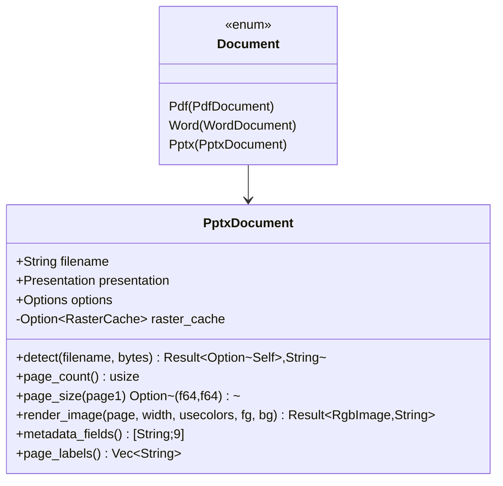
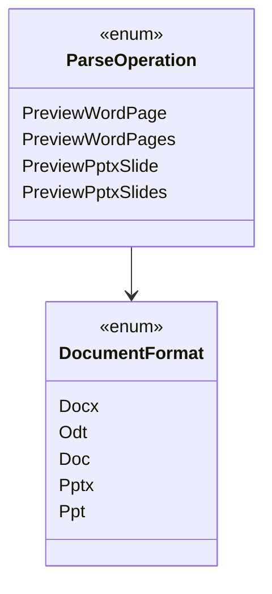
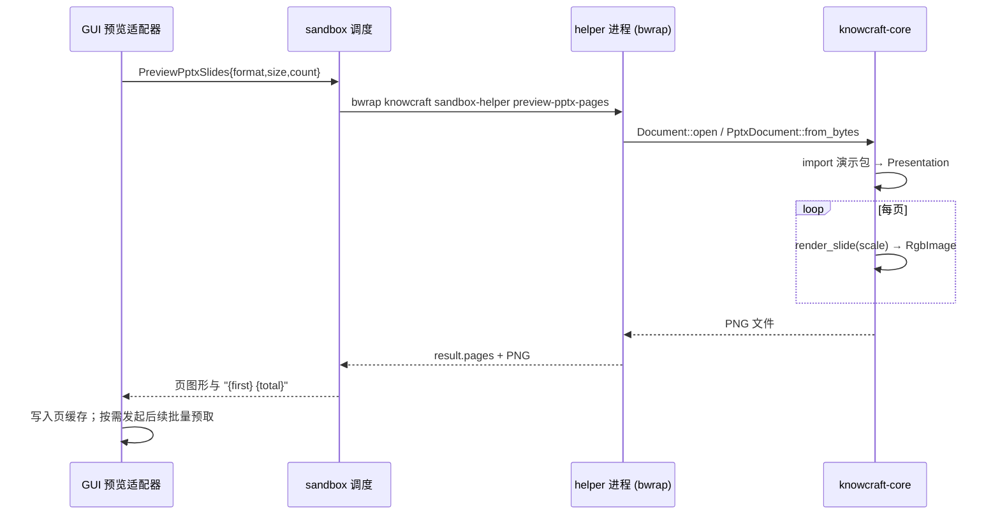

# pptx 预览设计

- 日期：2026-11-26
- 状态：待评审
- 关联：ADR 0002（pdfcraft/wordcraft 引入方式）、ADR 0006（预览常驻）、ADR 0007（预览文本标注）

## 背景与目标

知识库里的演示文稿既不能预览，也没有正文索引。`crates/knowcraft-core/src/extract.rs` 按扩展名分派，
`pptx` 落进 `_ => Ok(String::new())`；预览侧 `crates/knowcraft-core/src/viewer/document.rs::Document`
只有 PDF 与 Word 两个后端，`Document::open` 判完 `%PDF-` 之后一律当 Word 试，演示包走到 Word 解析失败。
GUI 的 `crates/knowcraft/src/ui/browser/entry.rs:303` 已经给 `ppt/pptx/pps/ppsx/odp` 配了 PRESENTATION 图标，
说明文件类型识别到位，缺的是后端。

目标，每条都可判定：

1. GUI 预览面板与 `kc doc-server` 都能逐页查看 `.pptx/.pptm/.ppsx/.potx/.ppt/.pot/.pps`，翻页与缩放行为
   与 PDF/Word 预览一致。
2. 演示文稿正文进 tantivy 索引：形状文字（含表格单元格与组合内形状）与备注页文字，按页拼接。
3. 已登记的演示文稿标题取首张幻灯片的标题占位符；取不到时回退文件名主干。
4. PDF 与 Word 的预览、索引行为零回归。

## 非目标 / 反目标

非目标，本次不做：

- 预览里选中与复制文字、写文本标注（ADR 0007 的 `rendered` 集合）。
- 编辑写回演示文稿；core 只读。
- 加密演示包解密预览：deckcraft 的 pptx 读取没有密码参数，只提供 `is_encrypted` 判定。
- 图表文字、母版与版式占位符文字进索引。
- `.odp` 预览：deckcraft 无 OpenDocument 演示支持。
- 超大演示包的输入上限治理：core 的抽取路径对超大文件没有大小上限，docx/pdf 分支同样没有，本次保持一致。
- `kc doc-server` 的文本与搜索类命令不支持演示文稿：`gettext`、`getselection`、`charlayout`、
  `search-string`、`search-regexp` 对非 PDF 文档本就返回空或不支持，演示文稿与 Word 同等。

反目标，命中即视为方案失败：

- 把 deckcraft 的 egui 前端、engine、媒体解码层引进本工程。
- 把渲染搬到 GUI 主进程，绕过 bubblewrap 预览 helper。
- 自写 zip+XML 扫描抽文本，与 deckcraft 的模型解析构成两套路径。

## 约束

- ADR 0002：引入方式按「已发布可引用 crate 优先，否则 git subtree 纳入 workspace 作为成员消费」；许可证须
  MIT/Apache。deckcraft 为 `MIT OR Apache-2.0`，与已引入的 pdfcraft/wordcraft 同族。
- 预览一律在 bubblewrap helper 内渲染，helper 是 `knowcraft` 二进制自身的 `sandbox_helper` 启动模式
  （`crates/knowcraft/src/main.rs`、`crates/knowcraft/src/sandbox/`）。
- GUI 是薄壳，业务逻辑落 `knowcraft-core`；两条壳（GUI 与 `kc doc-server`）复用同一份 core 协议。
- 沿用既有预览约束：缩放只拉伸已有纹理、不按新尺寸重渲染；全局同时最多一个 heavy helper，Interactive 优先
  于 Prefetch；不跑 GUI 全量测试。
- 工具链：本机 `rustc 1.99.1`；deckcraft main 为 `edition 2024`、`rust-version 1.95`。

## 方案

### 方案 1：复用现有分页预览链路（选定）

core 新增 `viewer/pptx.rs` 后端，sandbox 新增演示格式的 `DocumentFormat` 变体与两条分页 op，GUI 适配器加
演示分支并入现有页缓存与预取，`extract.rs` 加抽取分支。

复用分析：复用 `viewer/word.rs` 的后端形状（读 bytes → 解析 → 逐页 `render_image` + `RasterCache` +
`Options`）、`viewer/png::write` 的 PNG 输出、`viewer/recolor::recolor` 的打印口径、`sandbox::PdfRenderSize`
的尺寸与像素上限、`sandbox_helper/operations.rs` 的 `Rendered`/批量输出校验、`local_preview` 的页缓存与
heavy permit 队列、`extract.rs` 的按扩展分派骨架。

### 方案 2：先抽通用 page 层 trait（否决）

把 PDF/Word/演示三后端的 page 层抽成 trait，消掉 `Document` 里的多处 match。更 OCP，但 PDF 分支挂着注释
写回（ADR 0004）与 synctex，改动面远大于收益。已记入 `TODO.md`，本次不做。

### 方案 3：GUI 主进程内直接渲染（否决）

省掉 sandbox 协议改动，但破坏「预览一律在 bwrap 内」的既有模型，且 `kc doc-server` 要另写一份解析路径，
重复业务逻辑，违反「动作先落 core，多壳复用」。

### 方案 4：只抽索引文本，不渲染（否决）

最便宜，但不满足预览需求。

### 选定与理由

方案 1。引入方式按 ADR 0002 走 git subtree vendor（用户决定，备选与证据见下）。

三点实测证据：

- `storytold/deckcraft` 的 main（v0.19.0）在本机编译：`cargo build -p deckcraft-pptx -p deckcraft-render`
  5 分 29 秒通过，craft-libs 的 rev `8fa4db64` 可拉取，`vello_cpu 0.2.0` 正常编译。
- 渲染栈重合：`deckcraft-render` 用 `vello_cpu`，本工程 Cargo.lock 里 `vello_cpu 0.2.0` 已存在
  （由 `wordcraft-render` 引入）。
- crates.io 上的 `deckcraft-pptx`/`deckcraft-render` 0.6.1 也能编（1 分 07 秒），但发布者是第三方账号
  `aphrody-dev`，不是上游官方发布，且比 main 落后 13 个小版本，故不采用。

许可证为 `MIT OR Apache-2.0`（仓库 LICENSE-MIT/LICENSE-APACHE 与 workspace.package.license），满足引入红线。

## 设计

### 数据模型



`PptxDocument` 收两种来源，统一成 `deckcraft_model::Presentation`：OOXML 包走 `deckcraft_pptx::import`，
97-2003 二进制走 `deckcraft_ppt::import`。



新增 `DocumentFormat::{Pptx,Ppt}`（按读取路径分，对位现有 `Docx`/`Doc`），新增
`ParseOperation::PreviewPptxSlide{format,size}` 与
`PreviewPptxSlides{format,size,count}`。Word 那两条 op 不动。

### 接口与契约

core 后端的渲染签名与 `viewer/word.rs` 同形，打开走内容判定，没有 `password` 参数——deckcraft 的演示包
读取没有密码路径：

```rust
PptxDocument::detect(filename: &str, bytes: &[u8]) -> Result<Option<Self>, String>
PptxDocument::render_image(&mut self, page: usize, width: i64, usecolors: i64,
                           foreground: [u16; 3], background: [u16; 3]) -> Result<RgbImage, String>
```

`detect` 返回 `Ok(None)` 表示「不是演示包」，调用方据此落回 Word 后端；加密包返回
`Err("Document is encrypted")`。

`page_count` = `presentation.slides.len()`（0 页返回 `Err("This presentation has no slides")`），
`page_size` = 幻灯片尺寸（全页同尺寸），`page_labels` = `1..n`，`metadata_fields` 的字段按现有九项顺序，
演示包没有核心属性来源，除标题位留空串。

`extract.rs` 新增两组扩展名分派，与预览支持集合一致：`pptx|pptm|ppsx|potx` 与 `ppt|pot|pps`。
`extract_text` 返回拼接后的正文；`extract_title` 返回首张幻灯片的标题占位符文本。

sandbox 契约：

| 项 | 值 |
|---|---|
| op 名 | `preview-pptx-slide`、`preview-pptx-pages` |
| value 串 | `pptx:page:WxH`、`pptx:start:count:WxH`（`.ppt` 用 `ppt:` 前缀） |
| 单页输出 | `result.png` + `result.meta`（`"{page} {total}"`） |
| 批量输出 | `result.pages` + 每页一个 PNG |
| 超时 | 30 秒（同 Word 批量） |
| 批量上限 | 4（复用 `sandbox::WORD_BATCH_MAX`） |

助手侧不复用 Word 的 `LayoutCache` 路径：`sandbox_helper/word_page.rs` 直连 wordcraft 是为了拿选中文字层，
演示不做选字，直接调 core 的 `viewer::pptx`（`from_bytes` + `render_image` + `viewer::png::write`）。

### 主流程



格式分派顺序（`Document::open`，保持现有签名）：

1. 内容以 `%PDF-` 开头 → PDF 后端。
2. `deckcraft_ppt::sniff` 为真（复合文件且含 `PowerPoint Document` 流）→ 演示后端（97-2003）。
3. `deckcraft_pptx::sniff` 为真（OOXML 包）且 `import` 成功 → 演示后端（OOXML）；`import` 返回
   `NotPptx` 时继续往下。
4. 其余 → Word 后端。

第 3 步对 docx 的代价有界：docx 也是 OOXML 包，`sniff` 通过，`import` 在解析 presentation 部件缺失时返回
`NotPptx`，随即落回 Word。加密的演示包是复合文件、没有 `PowerPoint Document` 流，因此第 2 步不命中、第 3
步也不命中，落到 Word 后端报密码保护，最终文案仍是 `Document is encrypted`（`deckcraft_pptx::is_encrypted`
在 `detect` 内保留作兜底）。

### 错误与边界

| 情况 | 行为 |
|---|---|
| 加密演示包 | 复合文件没有 `PowerPoint Document` 流，落 Word 后端报密码保护，文案为 `Document is encrypted`；`detect` 内的 `is_encrypted` 作兜底 |
| 非演示包（docx 等） | `import` 返回 `NotPptx`，分派落回 Word |
| 幻灯片数为 0 | 报 `This presentation has no slides`，预览面板显示错误文案 |
| 页号越界 | 按 Word 口径夹到最后一页，不报错 |
| 渲染尺寸 | `scale = width / slide_width`，输出宽于请求时裁到精确宽度；像素数超 `PdfRenderSize::MAX_PIXELS` 报错 |
| 解析失败、损坏文件 | 返回 `Err`；索引侧 `unwrap_or_default()` 兜底为空正文（`index.rs`/`indexer.rs` 既有口径） |
| 取消与文件切换 | 不改取消模型与 `LoadHandle` 生命周期；文件切换后旧批次不写缓存 |
| 沙箱内字体 | 无需新增 bind，见下 |

沙箱内字体：`/usr` 已整树 ro-bind，含 `/usr/share/fonts`；`/etc/fonts` 与 `/var/cache/fontconfig` 也已在
`SYSTEM_BINDS` 表内。用户字体目录（`~/.fonts`、`~/.local/share/fonts`）在沙箱内不可见，与 Word 预览
现状相同。

索引侧另有两条既有行为需要照顾：正文抽取走 core、不经过 helper，因此不受 helper 的大小与超时限制；
`extract_title` 的占位标题名单（含 `PowerPoint 演示文稿`）已存在，本次只需接上演示包分支。

### 兼容与迁移

- 数据无 schema 变更，无迁移脚本。
- 已登记的演示文稿此前正文为空，需要重跑索引：`kc index --reindex`（重建）或 `kc index <路径>`（按路径
  增量）。不重跑时这些文档只靠标题与文件名命中搜索。
- `kc doc-server` 协议不变，演示文稿复用同一套 viewer 命令：`renderpage` 无 `is_pdf` 门，直接走
  `Document::render_image`；`number-of-pages`、`pagesize`、`pagelabels`、`metadata` 同理。文本与搜索类
  命令对非 PDF 本就返回空，演示文稿与 Word 同等，本次不改这些命令的分支。
- 加密演示包此前报 Word 解析失败，现在报受密码保护，属文案变化。
- 两条新错误文案（`Document is encrypted`、`This presentation has no slides`）不进 `data/locales/`：
  `Document is encrypted` 本来就不是现有键，Word 路径同样直接显示英文原文，保持与现状一致。

## 复用分析

| 方案 | 复用 | 新增 |
|---|---|---|
| 1（选定） | 见下 | core 后端与抽取约 250 行、sandbox 与 helper 约 150 行、适配器约 80 行 |
| 2 | 同 1，外加三后端 page 层抽象 | 同 1，另加跨界重构，牵动注释写回与 synctex |
| 3 | 只复用 core 后端 | 另加主进程渲染路径与 doc-server 的第二套解析 |
| 4 | 只复用抽取 | 无渲染，不满足需求 |

方案 1 的复用面：`viewer/word.rs` 的后端形状、`viewer/png::write` 的 PNG 输出、`viewer/recolor::recolor`
的打印口径、`sandbox::PdfRenderSize` 的尺寸与像素上限、`sandbox_helper/operations.rs` 的 `Rendered` 与
批量输出校验、`local_preview` 的页缓存与 heavy permit 队列、`extract.rs` 的按扩展分派骨架。此外要 vendor
deckcraft 源码。

`extract.rs` 的抽取不复用 `services/docx.rs` 的 zip+XML 直读（m0-probe 对 docx 的定案），理由是 core 已经
依赖 deckcraft 做渲染，「core 不依赖 pptx 解析栈」不再成立，自写会多维护一套覆盖面更差的路径。

## 验证方式

- 编译：`cargo build`（默认成员）。
- core 测试：`cargo test -p knowcraft-core`（含 `viewer/pptx` 与 `extract` 新增用例）。
- 手动验收：GUI 打开一个含中文、表格与备注页的 `.pptx`，翻页、缩放、切换文件各一次；打开一个 `.ppt`、
  一个加密演示包、一个 `.docx`（确认仍走 Word）。
- 索引验收：`kc index --reindex` 后 `kc search <页内文字>` 命中该演示文稿。
- doc-server 验收：`kc doc-server` 里 `open <pptx>` 后 `number-of-pages` 与 `renderpage` 返回正常；
  `gettext`、`search-string` 返回空而不报协议错。
- 回归：PDF 与 Word 预览各打开一次，行为与改动前一致。
- 按本工程约定不跑 GUI 全量测试，只跑与改动相关的那部分。

## 未决问题

1. 已核实：`Slide::title()` 只读形状的文本，Office 提示语（`Click to add title` 等）由 `PhType::prompt_text`
   在渲染期生成，不会进入模型，也不会进标题或索引。抽取侧同样只走 `TextBody::text()`。
2. `metadata_fields` 的标题位留空串后，GUI 的信息面板显示效果需确认是否可接受；若要填，需自读
   `docProps/core.xml`。负责：用户，评审时定。
3. deckcraft main 处于 early development，vendored 源码的上游同步频率与版本跨度未定；沿用 pdfcraft/wordcraft
   的 subtree pull，具体节奏由用户决定。
